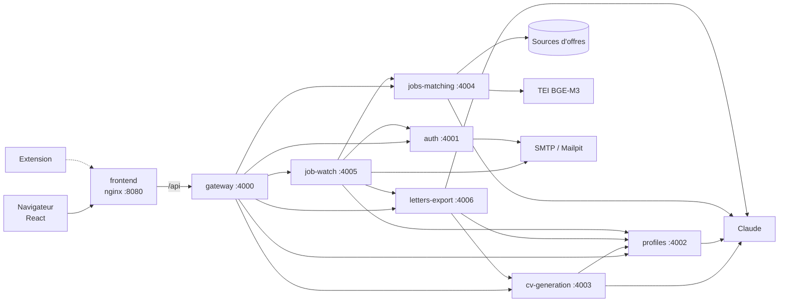

# Attesta : le CV qui dit vrai

Attesta génère un **CV ciblé pour chaque offre d'emploi**, sans jamais rien inventer : chaque ligne du CV
renvoie à un fait du profil du candidat, et une ligne sans source est retirée avant tout affichage ou export.
Autour de ce cœur, la plateforme accompagne toute la candidature : import du CV existant, lettres, six
assistants IA, veille emploi quotidienne dans quatre pays, suivi des candidatures et préparation des
entretiens.

> **Principe** : l'IA propose, le code contrôle, le candidat décide. Une compétence absente du profil est
> signalée, jamais ajoutée.

> **Statut** : application complète en local (6 microservices, gateway, frontend React). Déploiement
> Google Cloud écrit mais gelé. Voir [État et limites](#état-et-limites).

## Sommaire

- [Fonctionnalités](#fonctionnalités)
- [Assistants IA](#assistants-ia)
- [Pays et sources d'offres](#pays-et-sources-doffres)
- [Architecture](#architecture)
- [Pile technique](#pile-technique)
- [Démarrage rapide](#démarrage-rapide)
- [Configuration](#configuration)
- [Développement](#développement)
- [Tests et qualité](#tests-et-qualité)
- [CI/CD](#cicd)
- [Sécurité et RGPD](#sécurité-et-rgpd)
- [Structure du dépôt](#structure-du-dépôt)
- [Décisions d'architecture (ADR)](#décisions-darchitecture-adr)
- [État et limites](#état-et-limites)
- [Licence et données tierces](#licence-et-données-tierces)

## Fonctionnalités

### Compte et accès

| Fonctionnalité        | Détail                                                                                                                                             |
| --------------------- | -------------------------------------------------------------------------------------------------------------------------------------------------- |
| Compte sans e-mail    | Identifiant et mot de passe ; aucune adresse demandée à l'inscription ([ADR 0030](docs/adr/0030-comptes-identifiant-mot-de-passe.md))              |
| Codes de récupération | 8 codes à usage unique remis à la création, pour un mot de passe oublié ; régénérables ([ADR 0039](docs/adr/0039-codes-de-recuperation.md))        |
| Sécurité du compte    | Changement de mot de passe (autres sessions révoquées), consentements, export de toutes ses données, suppression définitive dans tous les services |
| Parcours invité       | Un CV ciblé sans compte, données effacées sous 24 h                                                                                                |
| Administration        | Compte `admin` : santé des services, usage et coût de l'IA, avis sur les assistants, lancement de la veille et du catalogue                        |

### Profil (seule source de vérité)

- Profil compatible [JSON Resume](https://jsonresume.org) : identité, expériences et réalisations, formations,
  compétences, langues, projets, certifications ; **une nouvelle version à chaque enregistrement**.
- **Import d'un CV PDF** : lecture dans un processus isolé et borné, puis extraction par Claude ou, sans clé
  IA, **par règles** (rubriques fr/en/de, dates, puces, coordonnées) ; tout élément proposé doit figurer
  dans le PDF ([ADR 0038](docs/adr/0038-import-par-regles.md)).
- **Informations selon le pays** : photo d'identité (chiffrée, stockée à part, jamais envoyée à l'IA), date de
  naissance, nationalité, autorisation de travail, permis ([ADR 0036](docs/adr/0036-usages-cv-par-pays.md)).
- **Pièces justificatives** (diplômes, attestations, certificats), chiffrées, rattachées à un élément du
  profil, ajoutables en annexe du PDF ([ADR 0027](docs/adr/0027-pieces-justificatives.md)).

### Offres

- Coller une annonce : analyse unique (exigences indispensables et souhaitées, mots-clés).
- **Catalogue d'offres synchronisé** toutes les 6 heures dans les quatre pays, filtrable par pays et par
  mots-clés, paginé ([ADR 0034](docs/adr/0034-catalogue-offres-synchronise.md)).
- **Extension de navigateur** « Cibler cette offre » : un clic sur une page d'annonce l'envoie à Attesta
  ([ADR 0044](docs/adr/0044-extension-navigateur.md), dossier [`extension/`](extension/README.md)).

### CV ciblé

- Génération en direct (progression affichée), chaque ligne reliée à ses sources ; rapport de fidélité.
- Relecture ligne par ligne obligatoire avant export ; corrections à la main, contrôlées.
- **5 modèles**, tous en une colonne lisible par les logiciels de recrutement (ATS) : Sobre, Soignée,
  Classique, Moderne, Compacte ([ADR 0041](docs/adr/0041-modeles-de-cv.md)).
- **Usages du pays visé** à l'export ([ADR 0036](docs/adr/0036-usages-cv-par-pays.md)) :

  | Pays                   | Photo             | Date de naissance | Nationalité | Autorisation de travail | Signature datée |
  | ---------------------- | ----------------- | ----------------- | ----------- | ----------------------- | --------------- |
  | Allemagne (Lebenslauf) | oui               | oui               | oui         | oui                     | oui             |
  | France                 | oui (facultative) | non               | non         | oui                     | non             |
  | Canada                 | **non**           | **non**           | **non**     | oui                     | non             |
  | Tunisie                | oui               | oui               | oui         | non                     | non             |

- **Exports** : PDF (identique à l'aperçu), **Word .docx** ([ADR 0037](docs/adr/0037-export-word.md)),
  CV traduit en anglais ou en allemand.
- **CV en ligne** : lien secret, non indexé, révocable, valable 90 jours, avec nombre de consultations
  ([ADR 0042](docs/adr/0042-cv-en-ligne.md)).

### Candidature

- **Lettre de motivation** selon un ton (sobre, chaleureux, dynamique), chaque paragraphe contrôlé.
- **Suivi des candidatures** en colonnes (à envoyer, envoyée, relancée, entretien, offre, refus), relance
  suggérée après 10 jours ([ADR 0040](docs/adr/0040-suivi-des-candidatures.md)).
- **Rappels** par e-mail (relance, étapes du plan de progression).
- **Veille emploi** : chaque jour, les nouvelles offres proches du profil, classées, avec deux PDF (offres,
  compétences à acquérir), envoyées à l'adresse choisie ; désabonnement en un clic.

### Pages publiques

Accueil, guide (vidéo explicative avec voix off, musique et bruitages générés dans le navigateur),
**exemples de CV par métier** ([ADR 0043](docs/adr/0043-exemples-de-cv.md)), **tarifs** (gratuité du
lancement tant qu'aucune formule n'est décidée), politique de confidentialité
([ADR 0045](docs/adr/0045-avis-et-tarifs.md)).

## Assistants IA

Six assistants, réunis dans le **Studio IA** d'un CV (chacun avec son écran) et sur un centre de contrôle
qui calcule un score de préparation ([ADR 0028](docs/adr/0028-roles-de-l-ia.md),
[ADR 0029](docs/adr/0029-assistants-evolutions.md)).

| Assistant               | Service                       | Ce qu'il fait                                                                            | Garde-fou (vérifié par le code)                                                                             |
| ----------------------- | ----------------------------- | ---------------------------------------------------------------------------------------- | ----------------------------------------------------------------------------------------------------------- |
| Intervieweuse de profil | profiles                      | Questions sur les réalisations floues, faits chiffrés proposés                           | Rien n'entre dans le profil sans la coche du candidat                                                       |
| Juge de fidélité        | cv-generation                 | Relit le sens de chaque ligne, signale les exagérations, propose une reformulation       | Reformulation gardée seulement si elle passe le contrôle de fidélité ; jeu d'évaluation `npm run eval:juge` |
| Conseillère ATS         | cv-generation                 | Mesure ce qu'un logiciel de tri trouve dans le CV ; place un mot-clé                     | Seul un fait du profil est recopié, avec sa source                                                          |
| Traduction              | cv-generation, letters-export | CV et lettre en anglais ou en allemand, export du CV traduit                             | Chiffres et noms propres vérifiés ; une traduction qui les modifie est refusée                              |
| Coach d'entretien       | cv-generation                 | Questions RH, manager ou technique ; retour selon la méthode STAR ; relance du recruteur | Les extraits cités doivent figurer mot pour mot dans la réponse                                             |
| Plan de progression     | cv-generation                 | Compétences manquantes → feuille de route datée, rappels                                 | Ressources issues d'un catalogue officiel tenu dans le code, jamais d'URL écrite par l'IA                   |

Tous les appels passent par [`packages/llm-client`](packages/llm-client) : Claude (API Anthropic ou Vertex AI
dans l'UE), budget mensuel par service, modèle choisi par étape (`LLM_STEP_MODELS`), prompts versionnés
(`services/*/prompts`), **mode démonstration** sans clé (réponses calculées par le code, signalées comme
telles). Aucun contenu personnel dans les journaux ; la photo et les informations personnelles ne sont
jamais envoyées à l'IA.

## Pays et sources d'offres

Quatre pays : **Allemagne, France, Canada, Tunisie** ([ADR 0033](docs/adr/0033-pays-veille.md)). Aucune page
n'est « scrapée » : seulement des API publiques ou sous contrat, et des flux RSS publics.

| Source                                                                                                                                                   | Pays           | Clé                                          | ADR                                                                                     |
| -------------------------------------------------------------------------------------------------------------------------------------------------------- | -------------- | -------------------------------------------- | --------------------------------------------------------------------------------------- |
| Bundesagentur für Arbeit                                                                                                                                 | DE             | non                                          | [0007](docs/adr/0007-veille-emploi.md)                                                  |
| Arbeitnow                                                                                                                                                | DE             | non                                          | [0031](docs/adr/0031-sources-offres-allemagne.md)                                       |
| Sites carrière des employeurs (Greenhouse, Lever, SmartRecruiters ; 52 employeurs dans [`employeurs.json`](services/jobs-matching/data/employeurs.json)) | DE, FR, CA, TN | non                                          | [0031](docs/adr/0031-sources-offres-allemagne.md), [0033](docs/adr/0033-pays-veille.md) |
| Flux RSS Tanitjobs et Tunisie Travail                                                                                                                    | TN             | non                                          | [0035](docs/adr/0035-flux-rss-tunisie.md)                                               |
| Jooble                                                                                                                                                   | DE, FR, CA, TN | gratuite (`JOOBLE_API_KEY`)                  | [0031](docs/adr/0031-sources-offres-allemagne.md)                                       |
| Adzuna                                                                                                                                                   | DE, FR, CA     | gratuite (`ADZUNA_APP_ID`, `ADZUNA_APP_KEY`) | [0007](docs/adr/0007-veille-emploi.md)                                                  |

Le classement combine recherche lexicale (français, allemand, anglais), vecteurs BGE-M3 et fusion RRF, puis
un reclassement par Claude quand une clé est configurée. Les intitulés de métiers sont traduits par le
référentiel européen **ESCO** ; les villes viennent de **GeoNames** (plus de 15 000 habitants, 2 475 villes).

## Architecture

Six microservices, chacun avec son code, **sa base**, son API et ses tests, derrière une gateway unique
([ADR 0011](docs/adr/0011-microservices-extraction.md), [ADR 0013](docs/adr/0013-une-base-par-service.md)).



| Service          | Port | Responsabilité                                                                            | Base               |
| ---------------- | ---- | ----------------------------------------------------------------------------------------- | ------------------ |
| `frontend`       | 8080 | Application React servie par nginx (en-têtes de sécurité, CSP)                            | —                  |
| `gateway`        | 4000 | Point d'entrée unique : JWT, routes publiques explicites, quotas, corrélation             | —                  |
| `auth`           | 4001 | Comptes, sessions (JWT RS256, JWKS), codes de récupération, consentements, RGPD distribué | `attesta_auth`     |
| `profiles`       | 4002 | Profil versionné, import PDF, justificatifs, photo, intervieweuse                         | `attesta_profiles` |
| `cv-generation`  | 4003 | CV ciblé, contrôle de fidélité, juge, ATS, coach, plan, traduction                        | `attesta_cvgen`    |
| `jobs-matching`  | 4004 | Offres, analyse, catalogue synchronisé, sources, matching, villes                         | `attesta_jobs`     |
| `job-watch`      | 4005 | Veille quotidienne, rapports par e-mail, rappels                                          | `attesta_watch`    |
| `letters-export` | 4006 | Lettres, rendu PDF et Word, CV en ligne, suivi des candidatures                           | `attesta_letters`  |

**Communication** ([ADR 0012](docs/adr/0012-communication-entre-services.md)) : HTTP JSON ; le jeton de
l'utilisateur est relayé, ou un jeton de service court à portée limitée (`users:contact`,
`matching:run`…). Routes `/internal/*` jamais exposées par la gateway.
**Contrats** : schémas Zod de [`packages/shared-schemas`](packages/shared-schemas), OpenAPI généré par service
(`services/*/openapi.yaml`) ([ADR 0017](docs/adr/0017-contrats-openapi-zod.md)).

Paquets partagés, **sans logique métier** : `shared-schemas`, `llm-client`, `http-kit`, `logger`, `config`.

## Pile technique

| Couche    | Outils                                                                        | Pourquoi                                                                                     |
| --------- | ----------------------------------------------------------------------------- | -------------------------------------------------------------------------------------------- |
| Langage   | TypeScript strict, Node.js 22                                                 | Un seul langage partout ; erreurs de contrat détectées à la compilation                      |
| API       | Express 5, Zod                                                                | Simple et connu ; une définition sert au type, à la validation et à l'OpenAPI                |
| Données   | PostgreSQL 16 + pgvector, node-pg-migrate                                     | Transactions, plein texte multilingue et vecteurs dans la même base ; migrations SQL testées |
| Sécurité  | jose (JWT RS256/JWKS), scrypt, AES-256-GCM, helmet, express-rate-limit        | Vérification locale des jetons ; mots de passe hachés ; fichiers chiffrés                    |
| IA        | Claude (SDK Anthropic, Vertex AI UE), BGE-M3 via TEI, ESCO                    | Rédaction fr/de de qualité ; vecteurs multilingues en local ; métiers multilingues           |
| Documents | Puppeteer (Chromium), EJS, pdf-lib, pdfjs-dist, zlib                          | PDF identique à l'aperçu ; annexes ; lecture PDF isolée ; Word sans dépendance               |
| E-mails   | nodemailer, Mailpit, SMTP (Gmail, Brevo)                                      | Standard SMTP, Mailpit en local, fournisseur réel par configuration                          |
| Frontend  | React 19, Vite, React Router 7, TanStack Query, Tailwind CSS v4               | Écosystème répandu, compilation rapide, cache d'API, thèmes clair et sombre                  |
| Tests     | Vitest, Supertest, Playwright, axe-core                                       | Rapides, TypeScript natif, vrai navigateur, accessibilité                                    |
| Qualité   | ESLint, Prettier, commitlint                                                  | Code homogène, historique lisible                                                            |
| DevOps    | Docker, Docker Compose, GitHub Actions, Trivy, gitleaks, Terraform, Cloud Run | Pile en une commande, CI par service, sécurité de la chaîne, infrastructure en code          |

## Démarrage rapide

Prérequis : **Docker** et **Node.js 22** (`nvm use 22.18.0`).

```bash
npm install

# Pile complète : bases, Mailpit, 6 services, gateway, frontend
FRONTEND_PORT=8081 docker compose --profile full up -d --build --wait \
  db db-init mailpit auth profiles cv-generation jobs-matching job-watch letters-export gateway frontend

# Données de démonstration (5 candidats et un administrateur)
DEMO_API=http://localhost:8081 npm run demo:seed
```

> On nomme les services : l'image de l'ancien monolithe (`web`, profil `core`/`full`) ne se construit plus.

| Adresse               | Contenu                                                              |
| --------------------- | -------------------------------------------------------------------- |
| http://localhost:8081 | Application                                                          |
| http://localhost:8025 | Mailpit : tous les e-mails envoyés en local (aucun ne sort du poste) |
| http://localhost:4000 | Gateway (API)                                                        |

**Comptes de démonstration** (mot de passe `demo-attesta-local`, local uniquement) :

| Identifiant                                       | Pour tester                                                                            |
| ------------------------------------------------- | -------------------------------------------------------------------------------------- |
| `amina.diallo`                                    | Le plus complet : 3 CV, informations personnelles, justificatifs, candidatures, veille |
| `lea.martin`                                      | CV Lyon et Berlin, traductions, candidatures                                           |
| `karim.benali`, `sophie.laurent`, `thomas.nguyen` | Juge et ATS ; coach et plan ; profil en reconversion                                   |
| `admin` (mot de passe `admin-dev-uniquement`)     | Administration                                                                         |

**Envoi réel des e-mails** : créer `.env.smtp` (jamais versionné) avec `SMTP_URL` et `MAIL_FROM`, puis
`docker compose --env-file .env.smtp …`. Vérifier avec `npm run smtp:test -- votre@adresse`. Gmail exige un
mot de passe d'application ([runbook](docs/runbook.md)).

**IA réelle** : par défaut, `LLM_PROVIDER=demo` (sans clé). Avec Claude : `LLM_PROVIDER=anthropic` et
`ANTHROPIC_API_KEY` (voir [État et limites](#état-et-limites)), ou `LLM_PROVIDER=vertex` et
`VERTEX_PROJECT_ID`.

**Extension** : `chrome://extensions` → mode développeur → « Charger l'extension non empaquetée » →
dossier [`extension/`](extension/README.md).

## Configuration

Chaque service valide ses variables au démarrage et les documente dans son `.env.example`. Les secrets ne
sont jamais versionnés : seul `.env.example` l'est.

| Variable                                                              | Service                                                | Rôle                                                                                      |
| --------------------------------------------------------------------- | ------------------------------------------------------ | ----------------------------------------------------------------------------------------- |
| `FRONTEND_PORT`                                                       | compose                                                | Port de l'application (8080 par défaut)                                                   |
| `LLM_PROVIDER`                                                        | profiles, cv-generation, jobs-matching, letters-export | `demo`, `anthropic`, `vertex` ou `none`                                                   |
| `LLM_STEP_MODELS`                                                     | idem                                                   | Modèle par étape, par exemple `juge-fidelite=claude-opus-5-5,traduction=claude-haiku-5-5` |
| `LLM_MONTHLY_BUDGET_EUR`                                              | idem                                                   | Plafond mensuel de dépense IA                                                             |
| `SMTP_URL`, `MAIL_FROM`                                               | auth, job-watch                                        | Envoi des e-mails                                                                         |
| `ADMIN_USERNAMES`, `ADMIN_PASSWORD`                                   | auth                                                   | Comptes administrateurs créés au démarrage                                                |
| `CATALOGUE_SYNC_HOURS`                                                | jobs-matching                                          | Fréquence de synchronisation du catalogue (6 ; 0 la désactive)                            |
| `BA_ENABLED`, `ARBEITNOW_ENABLED`, `EMPLOYERS_ENABLED`, `RSS_ENABLED` | jobs-matching                                          | Sources sans clé                                                                          |
| `JOOBLE_API_KEY`, `ADZUNA_APP_ID`, `ADZUNA_APP_KEY`                   | jobs-matching                                          | Sources sous clé (facultatives)                                                           |
| `EMBEDDINGS_PROVIDER`                                                 | jobs-matching                                          | `hash` (développement) ou `tei` (BGE-M3, profil `tei`)                                    |
| `DAILY_RUN_ENABLED`                                                   | job-watch                                              | Exécution quotidienne automatique de la veille                                            |
| `APP_BASE_URL`                                                        | auth, job-watch, letters-export                        | Adresse publique, pour les liens                                                          |

## Développement

Chaque service s'installe et se teste **dans son dossier** ([ADR 0023](docs/adr/0023-autonomie-des-services.md)).

```bash
cd services/cv-generation
npm ci
npm run typecheck
npm test
npm run openapi        # régénère openapi.yaml après un changement de contrat

# Paquets partagés (livrés compilés, ADR 0025)
npx tsc -b packages/shared-schemas     # puis `npm ci` dans chaque unité qui les consomme

# Reconstruire un seul service de la pile
FRONTEND_PORT=8081 docker compose --profile full up -d --build --no-deps --wait cv-generation
```

À la racine : `npm run lint` (ESLint et Prettier) et `npm run format`. Conventions : interface, erreurs,
documentation et commits **en français** ; commits conventionnels (`feat(profiles): …`) ; imports relatifs
avec l'extension `.js` ; règles détaillées dans [CLAUDE.md](CLAUDE.md).

## Tests et qualité

| Commande                            | Ce qu'elle vérifie                                                    |
| ----------------------------------- | --------------------------------------------------------------------- |
| `npm test` (par service)            | Unitaires et intégration (Vitest, Supertest, base PostgreSQL jetable) |
| `npm run eval:juge` (cv-generation) | Précision et rappel du juge de fidélité sur un jeu de référence       |
| `npx playwright test e2e/parite`    | Parcours complets dans le navigateur, accessibilité (axe-core)        |
| `npm run lint`, `npm run typecheck` | Style, formatage, typage strict                                       |

Plan détaillé : [docs/plan-de-tests.md](docs/plan-de-tests.md).

## CI/CD

GitHub Actions ([`.github/workflows`](.github/workflows)) :

- **CI** (`ci.yml`, chaque PR et push sur `main`) : lint, typage, migrations montée/descente/remontée,
  `npm audit` ; tests en matrice (seules les unités touchées sur une PR) ; gitleaks ; commits
  conventionnels ; E2E et accessibilité ; pile en conteneurs, cloisonnement des bases, scan Trivy, aucune
  donnée personnelle dans les journaux ; Terraform validé.
- **CD** (`cd.yml`, `rollback.yml`) : image construite une seule fois, préproduction sur Cloud Run, puis
  production par paliers (10, 50, 100 %) après approbation, retour arrière. **Gelé** tant que Google Cloud
  n'est pas configuré (`GCP_WIF_PROVIDER`).

## Sécurité et RGPD

- Mots de passe hachés (scrypt) ; jetons d'accès de 15 minutes, refresh tokens tournants en cookie HttpOnly,
  réutilisation détectée ; anti-CSRF ; quotas par IP et par identifiant.
- Justificatifs et photo chiffrés (AES-256-GCM) ; PDF importés lus dans un processus borné (mémoire, CPU,
  temps) ; rendu PDF dans un Chromium isolé (seccomp).
- CSP stricte, aucun script dans les documents générés ; routes publiques explicites à la gateway.
- Aucun contenu personnel dans les journaux ni dans les prompts au-delà du nécessaire ; photo et
  informations personnelles jamais envoyées à l'IA.
- RGPD : consentements journalisés, export de toutes les données (agrégé depuis chaque service), suppression
  propagée à tous les services par outbox ([ADR 0019](docs/adr/0019-rgpd-distribue.md)) ; invités effacés
  sous 24 h ; offres purgées après 60 jours. Voir [docs/conformite.md](docs/conformite.md).

## Structure du dépôt

```
services/            Les 6 microservices (src, migrations, prompts, tests, openapi.yaml, Dockerfile)
  auth/  profiles/  cv-generation/  jobs-matching/  job-watch/  letters-export/
gateway/             Point d'entrée de l'API
frontend/            Application React (pages, Studio IA, guide, nginx)
packages/            shared-schemas, llm-client, http-kit, logger, config (sans logique métier)
extension/           Extension de navigateur « Cibler cette offre »
e2e/                 Tests Playwright (parité, accessibilité)
scripts/             Données de démonstration, test SMTP, référentiel des villes, CI
infra/               Postgres (bases et rôles), seccomp Chromium, Terraform, scripts de déploiement
docs/                ADR, architecture, plan de tests, runbook, conformité, backlog
apps/, db/           Ancien monolithe v0.4 (gelé, en cours de retrait)
compose.yaml         Pile locale (profils core, full, veille, tei)
```

## Décisions d'architecture (ADR)

Index complet : [docs/adr/README.md](docs/adr/README.md). Les plus récentes (statut « proposé », à valider) :

| ADR                                                                                                                                                                                                                          | Sujet                                                                             |
| ---------------------------------------------------------------------------------------------------------------------------------------------------------------------------------------------------------------------------- | --------------------------------------------------------------------------------- |
| [0028](docs/adr/0028-roles-de-l-ia.md), [0029](docs/adr/0029-assistants-evolutions.md), [0032](docs/adr/0032-retrait-correspondance-redactrice.md)                                                                           | Assistants IA, leurs évolutions, retrait de la correspondance et de la rédactrice |
| [0030](docs/adr/0030-comptes-identifiant-mot-de-passe.md), [0039](docs/adr/0039-codes-de-recuperation.md)                                                                                                                    | Comptes par identifiant ; codes de récupération                                   |
| [0031](docs/adr/0031-sources-offres-allemagne.md), [0033](docs/adr/0033-pays-veille.md), [0034](docs/adr/0034-catalogue-offres-synchronise.md), [0035](docs/adr/0035-flux-rss-tunisie.md)                                    | Sources d'offres, 4 pays, catalogue synchronisé, flux tunisiens                   |
| [0036](docs/adr/0036-usages-cv-par-pays.md), [0037](docs/adr/0037-export-word.md), [0041](docs/adr/0041-modeles-de-cv.md), [0042](docs/adr/0042-cv-en-ligne.md)                                                              | Usages par pays, Word, modèles, CV en ligne                                       |
| [0038](docs/adr/0038-import-par-regles.md), [0040](docs/adr/0040-suivi-des-candidatures.md), [0043](docs/adr/0043-exemples-de-cv.md), [0044](docs/adr/0044-extension-navigateur.md), [0045](docs/adr/0045-avis-et-tarifs.md) | Import sans IA, suivi, exemples, extension, avis et tarifs                        |

## État et limites

- **Tests en retard** sur les dernières fonctionnalités : passe de tests prévue (tests E2E encore basés sur
  la connexion par lien, contrats modifiés, nouvelles fonctionnalités non couvertes).
- **CI en partie tournée vers l'ancien monolithe** (image `web`, parité sur le port 3080) : à passer aux
  microservices. **Déploiement Google Cloud gelé.**
- **Clé Claude** : `compose.yaml` transmet `LLM_PROVIDER` mais pas encore `ANTHROPIC_API_KEY` aux services ;
  à ajouter pour utiliser l'IA réelle en local.
- **Interface en français seulement** (anglais et allemand prévus).
- **Tunisie** : couverture limitée aux flux RSS et à quelques employeurs ; la clé Jooble l'élargit.
- **Extension** : icône et publication sur les boutiques à prévoir. **Tarifs** : formules à décider.
- Monolithe `apps/` et `db/` gelé (`v0.4-monolithe`), à retirer.

## Licence et données tierces

[MIT](LICENSE). Données tierces : villes GeoNames (CC BY 4.0), classification ESCO (Commission européenne),
offres de la Bundesagentur für Arbeit, d'Arbeitnow, des sites carrière des employeurs et des flux RSS de
Tanitjobs et Tunisie Travail (chaque offre renvoie à sa source) ; polices Source Sans 3 (SIL Open Font
License).
