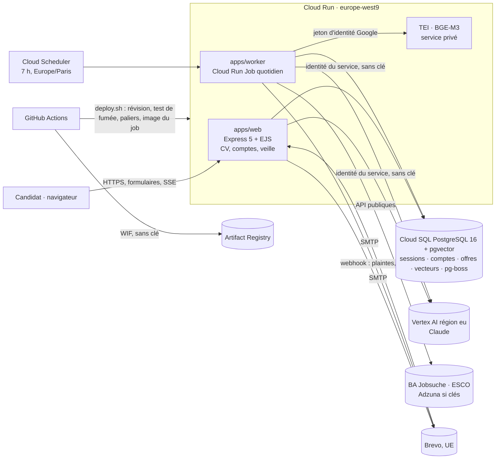
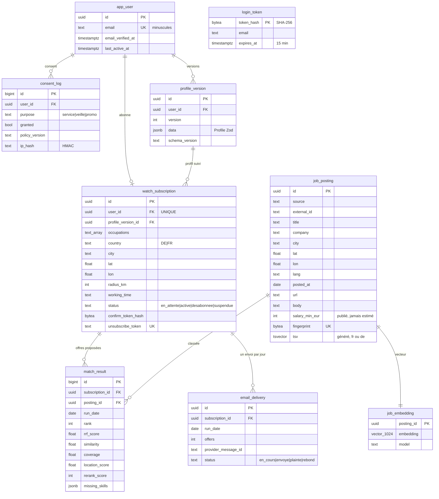

# Architecture d'Attesta

Statut : à jour à la fin de la Phase 4 (2026-10-16). Décisions détaillées : [adr/](adr/README.md).

## Vue d'ensemble



- **Un service web** (`apps/web`) sert le parcours CV, les comptes (connexion par lien), la gestion de la veille, le désabonnement et le webhook du fournisseur d'e-mail. Chromium est un processus à part et borné ; l'analyse des PDF importés tourne dans un processus enfant plafonné par le noyau, sans aucun secret ([ADR 0009](adr/0009-hebergement-et-execution.md)).
- **Un job quotidien** (`apps/worker`, même image) exécute la veille : purge, ingestion, vecteurs, matching, rapports, envoi. Les jobs passent par **pg-boss** (relances, une file par clé) ; l'idempotence repose sur les contraintes de la base ([ADR 0010](adr/0010-veille-comptes-envoi.md)).
- **Sans état local** : sessions, verrous, compteurs, coûts et données de veille sont dans PostgreSQL. Le service web peut tourner sur plusieurs instances ; le job tourne en une seule tâche, à cause des budgets de requêtes tenus en mémoire.

## Flux de la veille quotidienne

```mermaid
sequenceDiagram
  participant J as Job de veille
  participant S as Sources (BA, ESCO)
  participant DB as PostgreSQL
  participant T as TEI (BGE-M3)
  participant M as Claude (Vertex eu)
  participant B as Brevo
  J->>DB: purge (offres de plus de 60 j, comptes inactifs depuis 18 mois…)
  J->>S: métiers voisins (ESCO, en cache 30 j), puis offres par intitulé, ville, rayon
  J->>DB: offres normalisées, dédupliquées (source + identifiant, empreinte)
  J->>T: vecteurs des nouvelles offres
  loop un job pg-boss par abonné
    J->>T: vecteur du profil anonymisé
    J->>DB: filtres durs + recherche lexicale + recherche vectorielle (HNSW)
    J->>J: fusion RRF, 20 premières
    J->>M: rerank et compétences manquantes (vérifiées dans l'offre)
    J->>DB: résultats ; réservation de l'envoi du jour
    J->>B: e-mail + 2 PDF (rien s'il n'y a pas d'offre nouvelle)
  end
  J->>DB: taux de plaintes sur 30 jours (alerte au-delà de 0,1 %)
```

## Flux de génération d'un CV

```mermaid
sequenceDiagram
  participant N as Navigateur
  participant W as Web (Cloud Run)
  participant DB as PostgreSQL
  participant M as Claude (Vertex eu)
  N->>W: GET /cv/generer/flux?jeton=… (ou POST /cv/generer sans JS)
  W->>DB: jeton consommé, verrou + quota réservés (atomique)
  W->>M: analyse de l'offre (cache par empreinte)
  W-->>N: SSE « Offre analysée »
  W->>M: rédaction à partir des faits numérotés (≤ 2 relances)
  W->>W: contrôle de fidélité déterministe, retrait des lignes non prouvées
  W->>DB: session rechargée ; abandon si effacée ou profil modifié
  W-->>N: SSE « done »
  N->>W: relecture ligne par ligne, corrections, case « j'ai relu »
  N->>W: POST /cv/etape/5 → PDF (même HTML que l'aperçu)
```

## Modèle de données (ERD)

Modèle **en place** à la fin de la Phase 4. Écarts assumés par rapport au modèle cible de la Phase 0 ([ADR 0010](adr/0010-veille-comptes-envoi.md)) : pas de table `profile` (le profil est la dernière `profile_version`), pas de table `report` (rapports non conservés, `email_delivery` en tient lieu), coordonnées en `double precision` (pas de PostGIS). Le parcours anonyme ne stocke rien d'autre que sa session : offre, génération, traçabilité et score de fidélité restent en session ([ADR 0009](adr/0009-hebergement-et-execution.md)).



Tables techniques sans donnée personnelle : `session`, `ia_quota`, `rate_limit`, `llm_usage` (Phase 3), `job_source_run` (journal d'ingestion), `email_event` (compteur de plaintes et de rebonds, sans adresse), `esco_cache`, et le schéma `pgboss`.

### Index

| Table                                    | Index                                                   | Usage                                |
| ---------------------------------------- | ------------------------------------------------------- | ------------------------------------ |
| `job_posting`                            | GIN sur `tsv`                                           | recherche lexicale                   |
| `job_posting`                            | B-tree `(country, posted_at)`                           | filtres durs                         |
| `job_posting`                            | UNIQUE `fingerprint`, UNIQUE `(source, external_id)`    | déduplication                        |
| `job_embedding`                          | HNSW `vector_cosine_ops` (m = 16, ef_construction = 64) | rappel sémantique                    |
| `match_result`                           | UNIQUE `(subscription_id, posting_id)`                  | une offre n'est proposée qu'une fois |
| `email_delivery`                         | UNIQUE `(subscription_id, run_date)`                    | un e-mail par abonné et par jour     |
| `app_user`, `login_token`, `email_event` | B-tree sur `last_active_at`, `expires_at`, `at`         | purge                                |

### Rétention

| Donnée                                         | Durée                                                                                    |
| ---------------------------------------------- | ---------------------------------------------------------------------------------------- |
| Session anonyme                                | 2 h d'inactivité, 24 h au plus                                                           |
| PDF (CV et rapports)                           | jamais stockés                                                                           |
| Compte, profils, veille, envois, consentements | jusqu'à la suppression du compte, ou 18 mois sans connexion (**sans préavis** : backlog) |
| Lien de connexion ; confirmation de veille     | 15 min ; 48 h (veille non confirmée supprimée après 7 jours)                             |
| `job_posting` (et vecteurs, résultats liés)    | 60 jours après la publication                                                            |
| `email_event`, `job_source_run`, `llm_usage`   | 13 mois                                                                                  |
| `esco_cache`                                   | 30 jours                                                                                 |

## Observabilité

- **Journaux** pino en JSON, au format Cloud Logging (`severity`, `message`), sans aucune donnée personnelle. Événements métier : `generation` (statut, raison, score, coût, durée, tentatives), `llm_usage` (jetons, coût, latence), `pdf_export` (durée).
- **Métriques** : tirées des journaux par Terraform (générations par statut, score de fidélité, coût par CV, durée de génération), plus les métriques natives de Cloud Run (latence, 5xx, instances). Pas d'exposition Prometheus : Cloud Run n'en a pas besoin.
- **Alertes** : service injoignable, erreurs 5xx, IA en mode dégradé, veille en échec, plainte e-mail (voir [runbook](runbook.md#surveillance-et-alertes)).
- **Coûts** : table `llm_usage` (13 mois).
- **Veille** : événements `veille_terminee` (offres ingérées, envois, jobs en échec), `ingestion_erreur`, `rerank_degrade`, `taux_plaintes` (30 jours), `email_plainte`.
