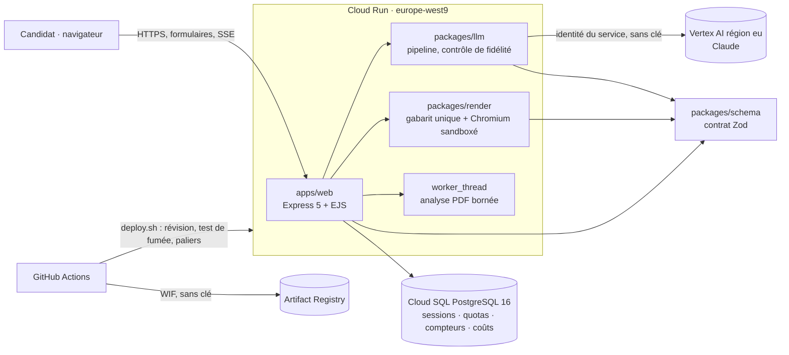
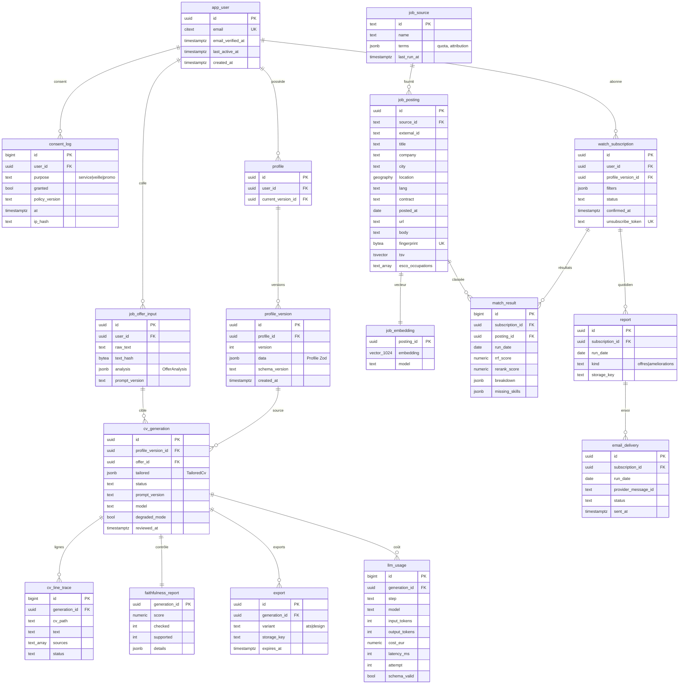

# Architecture d'Attesta

Statut : à jour à la fin de la Phase 3 (2026-10-16). Décisions détaillées : [adr/](adr/README.md).

## Vue d'ensemble



- **Un seul service** (`apps/web`) sert les pages, la génération (avec progression SSE), l'aperçu et l'export PDF. Il n'y a pas de worker séparé ([ADR 0009](adr/0009-hebergement-et-execution.md)) : Chromium est un processus à part et borné, et l'analyse des PDF importés tourne dans un `worker_thread` avec délai et plafond mémoire.
- **Sans état local** : sessions, verrou et quota d'IA, limiteur de requêtes et coûts sont dans PostgreSQL, avec des mises à jour atomiques. Le service peut donc tourner sur plusieurs instances.
- **pg-boss** arrivera en Phase 4 pour la veille planifiée (`packages/jobwatch`).

## Flux de génération d'un CV

```mermaid
sequenceDiagram
  participant N as Navigateur
  participant W as Web (Cloud Run)
  participant DB as PostgreSQL
  participant M as Claude (Vertex eu)
  N->>W: GET /cv/generer/flux?jeton=… (ou POST /cv/generer sans JS)
  W->>DB: jeton consommé, verrou + quota réservés (atomique)
  W->>M: analyse de l'offre (cache par empreinte)
  W-->>N: SSE « Offre analysée »
  W->>M: rédaction à partir des faits numérotés (≤ 2 relances)
  W->>W: contrôle de fidélité déterministe, retrait des lignes non prouvées
  W->>DB: session rechargée ; abandon si effacée ou profil modifié
  W-->>N: SSE « done »
  N->>W: relecture ligne par ligne, corrections, case « j'ai relu »
  N->>W: POST /cv/etape/5 → PDF (même HTML que l'aperçu)
```

## Modèle de données (ERD)

Modèle **cible**. Tables en place à la fin de la Phase 3 : `session`, `ia_quota`, `rate_limit`, `llm_usage`. Les autres (comptes, générations conservées, veille) arrivent en Phase 4 avec leur usage.



En mode anonyme, `profile_version`, `job_offer_input` et `cv_generation` sont stockés avec `user_id` nul et `expires_at` à 2 h. Une tâche de purge pg-boss tourne toutes les 15 minutes (ADR 0006).

### Index prévus

| Table           | Index                                                     | Usage              |
| --------------- | --------------------------------------------------------- | ------------------ |
| `job_posting`   | GIN sur `tsv`                                             | recherche lexicale |
| `job_posting`   | GiST sur `location`, B-tree `(lang, contract, posted_at)` | filtres durs       |
| `job_posting`   | UNIQUE `fingerprint`, UNIQUE `(source_id, external_id)`   | déduplication      |
| `job_embedding` | HNSW `vector_cosine_ops` (m = 16, ef_construction = 64)   | rappel sémantique  |
| `match_result`  | UNIQUE `(subscription_id, posting_id, run_date)`          | idempotence        |
| `report`        | UNIQUE `(subscription_id, run_date, kind)`                | idempotence        |
| `*`             | B-tree sur `expires_at`, `last_active_at`                 | purge              |

### Rétention

| Donnée                                  | Durée                                                           |
| --------------------------------------- | --------------------------------------------------------------- |
| Session anonyme et générations anonymes | 2 h d'inactivité                                                |
| PDF exporté                             | servi puis supprimé ; 24 h maximum                              |
| Compte inactif                          | 12 mois, prévenance à 11 mois                                   |
| `job_posting`                           | 60 jours après `posted_at`                                      |
| `consent_log`                           | durée du compte + 5 ans (preuve du consentement, **à valider**) |
| `llm_usage`                             | 13 mois, sans contenu                                           |

## Observabilité

- **Journaux** pino en JSON, au format Cloud Logging (`severity`, `message`), sans aucune donnée personnelle. Événements métier : `generation` (statut, raison, score, coût, durée, tentatives), `llm_usage` (jetons, coût, latence), `pdf_export` (durée).
- **Métriques** : tirées des journaux par Terraform (générations par statut, score de fidélité, coût par CV, durée de génération), plus les métriques natives de Cloud Run (latence, 5xx, instances). Pas d'exposition Prometheus : Cloud Run n'en a pas besoin.
- **Alertes** : service injoignable, erreurs 5xx, IA en mode dégradé (voir [runbook](runbook.md#surveillance-et-alertes)).
- **Coûts** : table `llm_usage` (13 mois).

Le taux de plaintes e-mail sera ajouté avec la veille (Phase 4).
