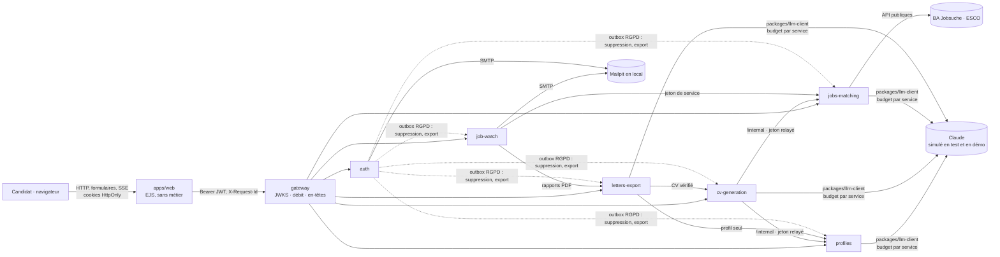
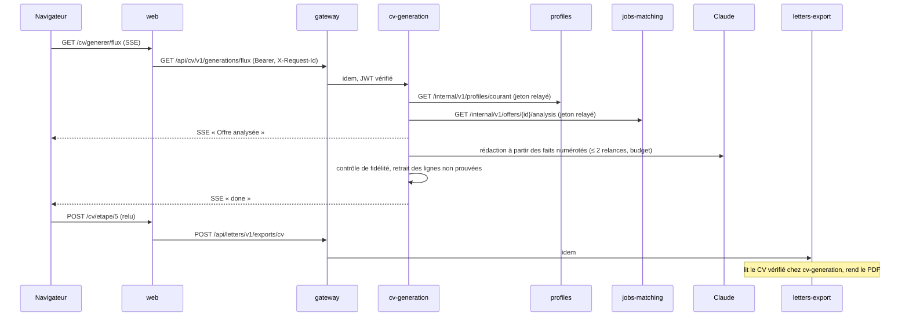
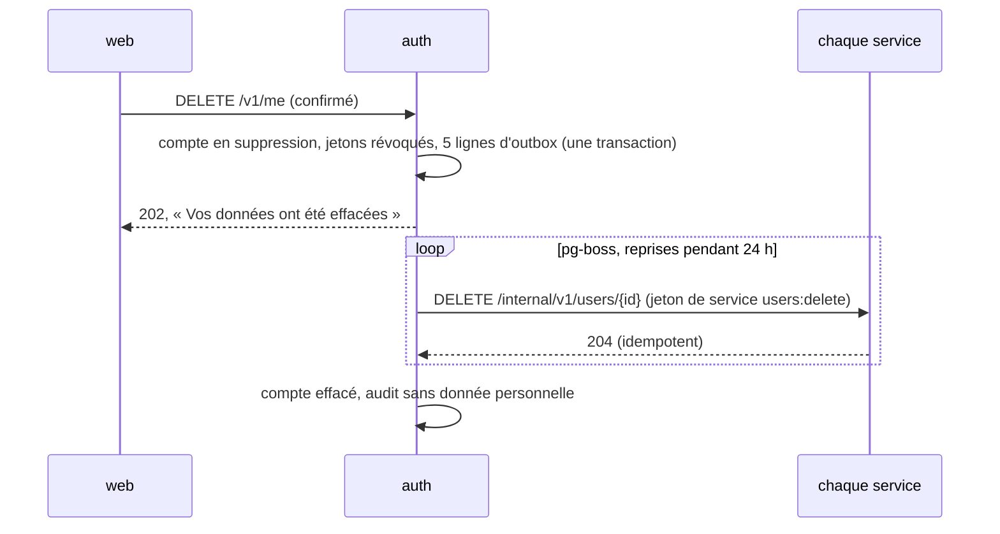
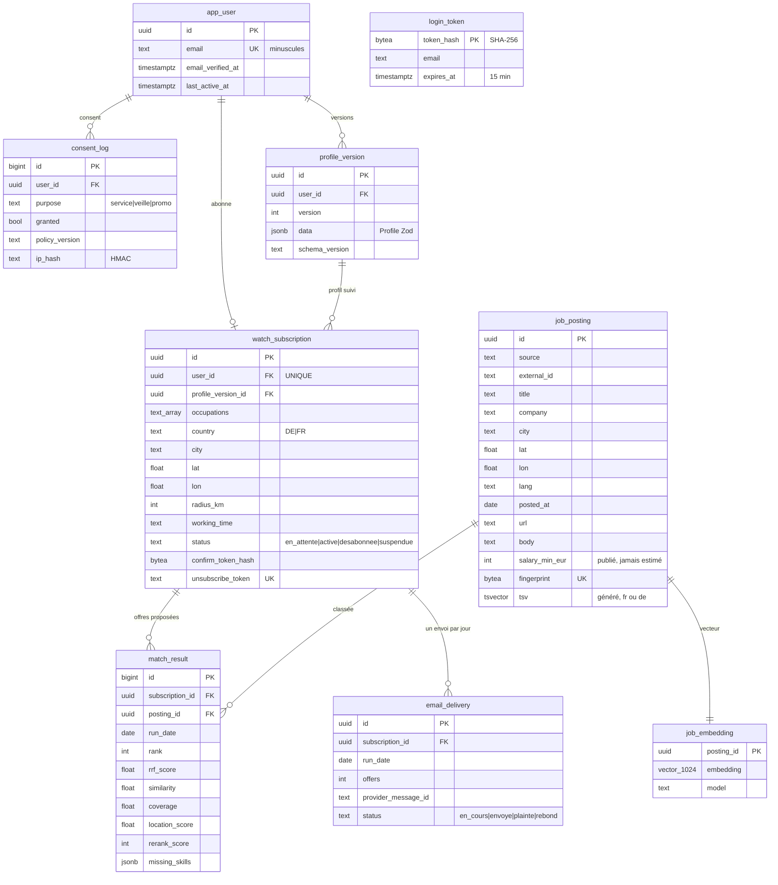

# Architecture d'Attesta

Statut : architecture **cible** en 6 microservices ([ADR 0011](adr/0011-microservices-extraction.md)),
mise à jour le 2026-10-18 au début de la migration. L'état de départ est le monolithe modulaire gelé par le
tag `v0.4-monolithe` (`git show v0.4-monolithe:docs/architecture.md`). Décisions : [adr/](adr/README.md).

## Vue d'ensemble (cible)

Chaque service a **sa base** dans une instance PostgreSQL 16 + pgvector partagée en local, avec un rôle
cloisonné ([ADR 0013](adr/0013-une-base-par-service.md)). Les flèches internes passent par le réseau
docker, jamais par la gateway ([ADR 0012](adr/0012-communication-entre-services.md)).

## Services

| Service          | Port | Base               | Responsabilité                                                       | Appelle                             |
| ---------------- | ---- | ------------------ | -------------------------------------------------------------------- | ----------------------------------- |
| `apps/web`       | 3080 | `attesta_web`      | Écrans EJS, session du brouillon, cookies, CSRF                      | gateway uniquement                  |
| `gateway`        | 4000 | aucune             | Routage `/api/<service>`, JWT, débit, en-têtes, corrélation          | tous les services                   |
| `auth`           | 4001 | `attesta_auth`     | Lien magique, JWT RS256, refresh, JWKS, invités, consentements, RGPD | tous (outbox RGPD), SMTP            |
| `profiles`       | 4002 | `attesta_profiles` | Profil versionné (CRUD), import de CV PDF avec extraction LLM        | LLM                                 |
| `cv-generation`  | 4003 | `attesta_cvgen`    | Analyse, rédaction, contrôle de fidélité, traces, corrections, SSE   | profiles, jobs-matching, LLM        |
| `jobs-matching`  | 4004 | `attesta_jobs`     | Offres saisies et collectées, analyse, ESCO, vecteurs, classement    | sources publiques, TEI, LLM         |
| `job-watch`      | 4005 | `attesta_watch`    | Abonnements, double opt-in, exécution quotidienne, rapports, e-mails | jobs-matching, letters-export, SMTP |
| `letters-export` | 4006 | `attesta_letters`  | Lettres de motivation, rendu PDF unique (CV, lettres, rapports)      | cv-generation, profiles, LLM        |

Code partagé, **sans logique métier** : `packages/shared-schemas` (contrats Zod), `packages/llm-client`,
`packages/logger`, `packages/config`, `packages/http-kit`. Une fiche par service (périmètre, endpoints,
dépendances) est écrite dans `docs/services/<nom>.md` au moment de son extraction.

## Flux de génération d'un CV (cible)

## Suppression d'un compte (cible)

## État de la migration

| Composant       | État au 2026-10-18                                     | Phase prévue |
| --------------- | ------------------------------------------------------ | ------------ |
| Monolithe       | en service (`apps/web`, `apps/worker`, `packages/*`)   | retiré en 4  |
| gateway, auth   | ADR acceptés, pas encore de code                       | 2            |
| profiles        | ADR acceptés, pas encore de code                       | 3 (gabarit)  |
| autres services | ADR acceptés, pas encore de code                       | 4            |
| Suite de parité | `e2e/` (Playwright), à tenir verte à chaque extraction | 1            |

## Modèle de données hérité (v0.4), réparti par service

Le modèle ci-dessous est celui du monolithe. Il ne change pas de forme pendant l'extraction : chaque table
part dans la base de son service propriétaire, **sans clé étrangère entre bases**
([ADR 0013](adr/0013-une-base-par-service.md)). Les identifiants `user_id` sont attribués par `auth` ; la
cohérence entre bases est assurée par la suppression distribuée ([ADR 0019](adr/0019-rgpd-distribue.md)).

| Tables héritées                                                       | Service propriétaire |
| --------------------------------------------------------------------- | -------------------- |
| `app_user`, `login_token`, `consent_log`                              | `auth`               |
| `profile_version`                                                     | `profiles`           |
| `ia_quota`, `llm_usage` (part génération)                             | `cv-generation`      |
| `job_posting`, `job_embedding`, `esco_cache`, `job_source_run`        | `jobs-matching`      |
| `watch_subscription`, `match_result`, `email_delivery`, `email_event` | `job-watch`          |
| `session`, `rate_limit`                                               | `apps/web`           |

Écarts du monolithe par rapport au modèle de la Phase 0, toujours valables : pas de table `profile` (le
profil est la dernière `profile_version`), pas de table `report` (rapports non conservés), coordonnées en
`double precision` (pas de PostGIS).

Tables techniques sans donnée personnelle : `session`, `ia_quota`, `rate_limit`, `llm_usage` (Phase 3), `job_source_run` (journal d'ingestion), `email_event` (compteur de plaintes et de rebonds, sans adresse), `esco_cache`, et le schéma `pgboss`.

### Index

| Table                                    | Index                                                   | Usage                                |
| ---------------------------------------- | ------------------------------------------------------- | ------------------------------------ |
| `job_posting`                            | GIN sur `tsv`                                           | recherche lexicale                   |
| `job_posting`                            | B-tree `(country, posted_at)`                           | filtres durs                         |
| `job_posting`                            | UNIQUE `fingerprint`, UNIQUE `(source, external_id)`    | déduplication                        |
| `job_embedding`                          | HNSW `vector_cosine_ops` (m = 16, ef_construction = 64) | rappel sémantique                    |
| `match_result`                           | UNIQUE `(subscription_id, posting_id)`                  | une offre n'est proposée qu'une fois |
| `email_delivery`                         | UNIQUE `(subscription_id, run_date)`                    | un e-mail par abonné et par jour     |
| `app_user`, `login_token`, `email_event` | B-tree sur `last_active_at`, `expires_at`, `at`         | purge                                |

### Rétention

| Donnée                                         | Durée                                                                                    |
| ---------------------------------------------- | ---------------------------------------------------------------------------------------- |
| Session anonyme                                | 2 h d'inactivité, 24 h au plus                                                           |
| PDF (CV et rapports)                           | jamais stockés                                                                           |
| Compte, profils, veille, envois, consentements | jusqu'à la suppression du compte, ou 18 mois sans connexion (**sans préavis** : backlog) |
| Lien de connexion ; confirmation de veille     | 15 min ; 48 h (veille non confirmée supprimée après 7 jours)                             |
| `job_posting` (et vecteurs, résultats liés)    | 60 jours après la publication                                                            |
| `email_event`, `job_source_run`, `llm_usage`   | 13 mois                                                                                  |
| `esco_cache`                                   | 30 jours                                                                                 |

## Observabilité

Cible locale ([ADR 0020](adr/0020-observabilite.md)) :

- **Journaux** pino en JSON, un format commun (`service`, `requestId`, `event`), sans aucune donnée
  personnelle. `X-Request-Id` est propagé de `apps/web` à la gateway puis aux services :
  `docker compose logs | grep <requestId>` suit une requête de bout en bout.
- **Santé** : `/health` (vivacité) et `/ready` (base, migrations, configuration) sur chaque processus ;
  les `healthcheck` de compose utilisent `/ready`.
- **Événements métier** conservés : `generation` (statut, score, coût, durée), `llm_usage` (jetons, coût,
  latence), `pdf_export`, `veille_terminee`, `taux_plaintes`.
- **Coûts LLM** : table `llm_usage` de chaque service, budget mensuel avec coupure
  ([ADR 0016](adr/0016-llm-client.md)) ; tableau de bord agrégé en Phase 5.
- La supervision Google Cloud (métriques tirées des journaux, alertes Terraform) est gelée avec
  l'hébergement ([ADR 0021](adr/0021-cible-execution-et-outillage.md)).
