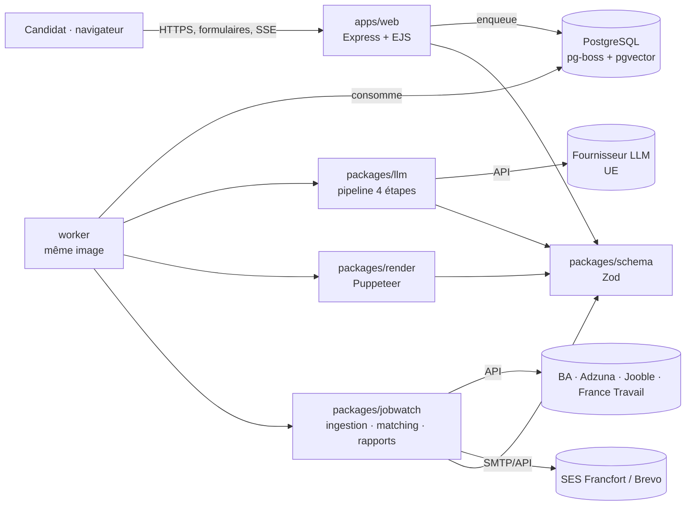
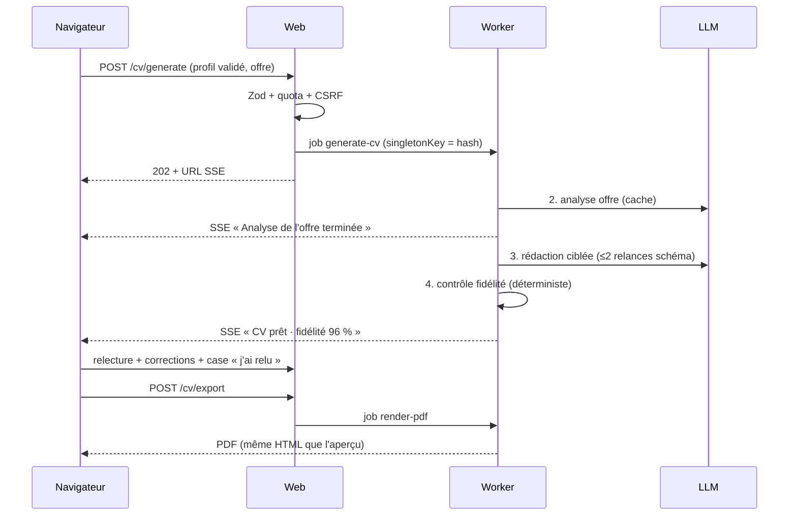
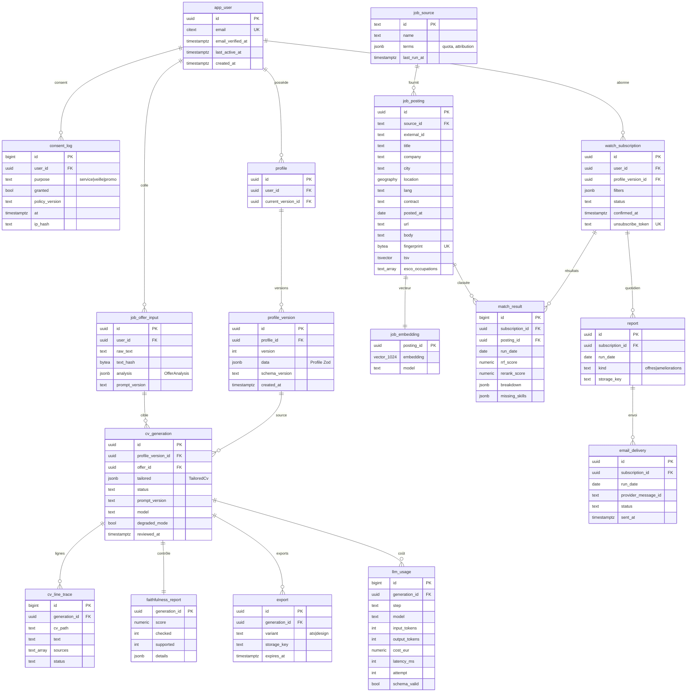

# Architecture d'Attesta

Statut : Phase 0, proposition à valider. Les décisions détaillées figurent dans [adr/](adr/README.md).

## Vue d'ensemble

- `apps/web` : routes, sessions, CSRF, vues EJS, endpoint SSE de progression, `/health`.
- `worker` : pipeline LLM, rendu PDF et veille. Il est séparé pour isoler Chromium et les appels longs du serveur HTTP.
- La génération est mise en file même en mode anonyme, ce qui donne idempotence, quotas et reprise. Le web s'abonne à la progression du job et la relaie en SSE (via `LISTEN/NOTIFY` de PostgreSQL).

## Flux de génération d'un CV

## Modèle de données (ERD)

En mode anonyme, `profile_version`, `job_offer_input` et `cv_generation` sont stockés avec `user_id` nul et `expires_at` à 2 h. Une tâche de purge pg-boss tourne toutes les 15 minutes (ADR 0006).

### Index prévus

| Table           | Index                                                     | Usage              |
| --------------- | --------------------------------------------------------- | ------------------ |
| `job_posting`   | GIN sur `tsv`                                             | recherche lexicale |
| `job_posting`   | GiST sur `location`, B-tree `(lang, contract, posted_at)` | filtres durs       |
| `job_posting`   | UNIQUE `fingerprint`, UNIQUE `(source_id, external_id)`   | déduplication      |
| `job_embedding` | HNSW `vector_cosine_ops` (m = 16, ef_construction = 64)   | rappel sémantique  |
| `match_result`  | UNIQUE `(subscription_id, posting_id, run_date)`          | idempotence        |
| `report`        | UNIQUE `(subscription_id, run_date, kind)`                | idempotence        |
| `*`             | B-tree sur `expires_at`, `last_active_at`                 | purge              |

### Rétention

| Donnée                                  | Durée                                                           |
| --------------------------------------- | --------------------------------------------------------------- |
| Session anonyme et générations anonymes | 2 h d'inactivité                                                |
| PDF exporté                             | servi puis supprimé ; 24 h maximum                              |
| Compte inactif                          | 12 mois, prévenance à 11 mois                                   |
| `job_posting`                           | 60 jours après `posted_at`                                      |
| `consent_log`                           | durée du compte + 5 ans (preuve du consentement, **à valider**) |
| `llm_usage`                             | 13 mois, sans contenu                                           |

## Observabilité

Logs pino JSON sans PII. Métriques Prometheus : latence par étape du pipeline, taux de rejet du schéma, score de fidélité moyen, coût LLM par CV, taux de mode dégradé, durée de rendu PDF, taux de plaintes e-mail.
