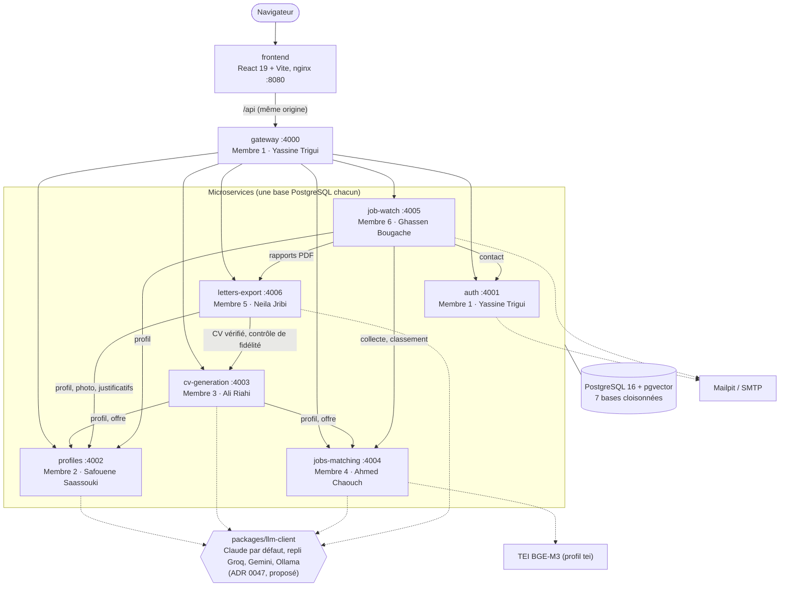
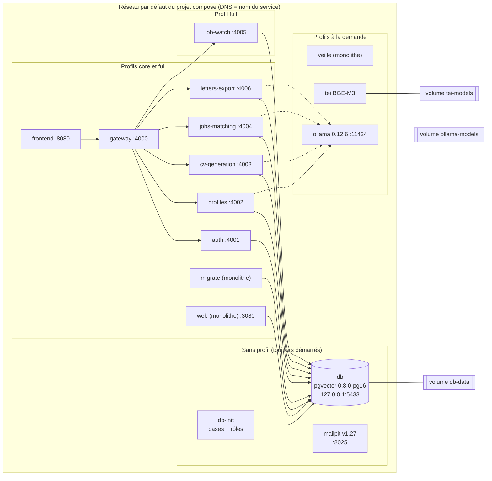
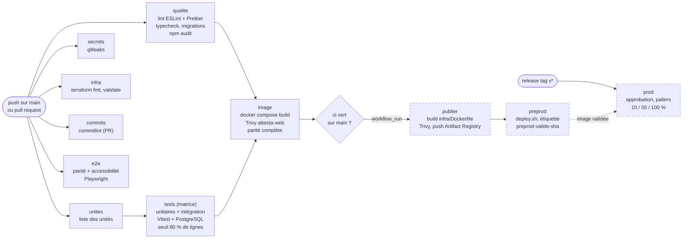

# Partie commune — architecture, Docker et CI/CD

> Partie présentée par toute l'équipe. Sources : `compose.yaml`, `.github/workflows/ci.yml`,
> `.github/workflows/cd.yml`, `docs/adr/`, branche `chore/phase-2-socle` (2026-10-26).

## 1. Architecture globale

Attesta génère des CV ciblés et **fidèles** : chaque ligne renvoie à un fait du profil. Le dépôt migre d'un
monolithe modulaire (`apps/web`, `apps/worker`) vers **6 microservices** (ADR 0011). Règles : un service
possède son code, sa base, son API et ses tests ; aucun accès à la base d'un autre service ; contrats Zod
partagés (`packages/shared-schemas`) ; tout appel LLM passe par `packages/llm-client`.



| Paquet partagé | Rôle (aucune logique métier) |
|---|---|
| `packages/shared-schemas` | schémas Zod des contrats (profil, CV, offres, API) |
| `packages/http-kit` | erreurs, santé, authentification JWT (`authenticate`, `requireRole`, `requireScope`) |
| `packages/llm-client` | fournisseurs Claude, démonstration, coût, budget, prompts versionnés |
| `packages/logger`, `packages/config` | journalisation sans donnée personnelle, lecture de configuration |

Chaque service vérifie lui-même les jetons avec les clés publiques publiées par `auth` (JWKS, non représenté sur le schéma pour la lisibilité ; voir la fiche du membre 1). Communication : HTTP synchrone ; le jeton de l'utilisateur est relayé tel quel (ADR 0012), les tâches de fond
(`job-watch`) utilisent des jetons de service à portée minimale délivrés par `auth`.

## 2. Docker Compose

### Diagramme des conteneurs et du réseau

Aucun réseau n'est déclaré : tous les conteneurs partagent le **réseau par défaut** du projet compose et se
joignent par leur nom de service. Trois volumes nommés existent : `db-data`, `tei-models` et `ollama-models`.



### `compose.yaml` complet

Fichier recopié intégralement ; **les commentaires sont ceux du dépôt** (déjà en français, ils expliquent
chaque bloc). Les valeurs sensibles (mots de passe, secrets, mots de passe dans les URL) sont remplacées par
`<masqué>` : ce sont des valeurs de développement, mais aucune valeur de secret ne figure dans ce dossier.

```yaml
# Environnement local, cible officielle de la soutenance (docs/adr/0021).
#   docker compose --profile core up --build   parcours principal, puis http://localhost:3080
#   docker compose --profile full up --build   tout, y compris la veille
# Sans profil, seule l'infrastructure démarre (PostgreSQL, initialisation des bases, Mailpit).
# Port hôte modifiable : ATTESTA_PORT=9000 docker compose --profile core up.
# E-mails envoyés (connexion, confirmation, rapports) : Mailpit, http://localhost:8025.
# Veille quotidienne, à la demande : `docker compose run --rm veille`.
# Avec les vrais vecteurs BGE-M3 (2 Go à télécharger au premier lancement) :
#   docker compose --profile tei up -d tei
#   EMBEDDINGS_PROVIDER=tei docker compose run --rm veille
#
# Migration en cours (docs/adr/0011) : le profil `core` sert encore le monolithe (web, migrate).
# Chaque service entre dans `core` ou `full` au moment de son extraction.

x-durci: &durci
  read_only: true
  tmpfs: ["/tmp"]
  cap_drop: [ALL]
  # Sandbox de Chromium active grâce à un profil seccomp dédié (docs/adr/0009).
  security_opt: ["no-new-privileges:true", "seccomp=./infra/seccomp/chromium.json"]

# Services extraits : même durcissement, sans Chromium (seul letters-export rendra des PDF).
x-service: &service
  init: true
  read_only: true
  tmpfs: ["/tmp"]
  cap_drop: [ALL]
  security_opt: ["no-new-privileges:true"]
  restart: unless-stopped
  environment: &service-env
    NODE_ENV: development
    LOG_LEVEL: info

# Fournisseur d'IA des services (docs/adr/0047) : AI_PROVIDER=claude|groq|gemini|ollama, demo par défaut.
# Clés (GROQ_API_KEY, GEMINI_API_KEY, ANTHROPIC_API_KEY) dans un --env-file jamais versionné.
# Ollama : profil `ollama` et OLLAMA_BASE_URL=http://ollama:11434 (voir le service ollama).
x-ai-env: &ai-env
  AI_PROVIDER: ${AI_PROVIDER:-}
  LLM_PROVIDER: ${LLM_PROVIDER:-demo}
  CLAUDE_TRANSPORT: ${CLAUDE_TRANSPORT:-}
  AI_FALLBACK_PROVIDERS: ${AI_FALLBACK_PROVIDERS:-}
  VERTEX_PROJECT_ID: ${VERTEX_PROJECT_ID:-}
  ANTHROPIC_API_KEY: <masqué>
  GROQ_API_KEY: <masqué>
  GROQ_MODEL: ${GROQ_MODEL:-}
  GEMINI_API_KEY: <masqué>
  GEMINI_MODEL: ${GEMINI_MODEL:-}
  OLLAMA_BASE_URL: ${OLLAMA_BASE_URL:-}
  OLLAMA_MODEL: ${OLLAMA_MODEL:-}

x-env: &env
  DATABASE_URL: postgres://attesta:<masqué>@db:5432/attesta
  # Poste local : mode développement (cookies sans Secure sur http://localhost,
  # fournisseur de démonstration autorisé). L'image est la même qu'en production.
  NODE_ENV: development
  LOG_LEVEL: info
  # demo : génération et rerank sans IA. Pour Claude sur Vertex AI (UE), voir docs/runbook.md.
  LLM_PROVIDER: demo
  # Mailpit par défaut. Pour un vrai envoi (Gmail, Mailjet…) : fichier .env.smtp (jamais commité),
  # puis `docker compose --env-file .env.smtp --profile core up -d` (docs/runbook.md).
  SMTP_URL: ${SMTP_URL:-smtp://mailpit:1025}
  MAIL_FROM: ${MAIL_FROM:-Attesta <ne-pas-repondre@attesta.localhost>}
  APP_BASE_URL: http://localhost:${ATTESTA_PORT:-3080}

services:
  # --- Infrastructure (toujours démarrée) ---------------------------------------------------

  db:
    image: pgvector/pgvector:0.8.0-pg16
    environment:
      POSTGRES_DB: attesta
      POSTGRES_USER: attesta
      POSTGRES_PASSWORD: <masqué>
    # Exposé sur la seule boucle locale, pour les services lancés hors Docker (npm run dev).
    ports: ["127.0.0.1:${DB_PORT:-5433}:5432"]
    volumes:
      - db-data:/var/lib/postgresql/data
    healthcheck:
      test: ["CMD-SHELL", "pg_isready -U attesta -d attesta"]
      interval: 5s
      timeout: 3s
      retries: 10

  # Une base et un rôle cloisonné par service (docs/adr/0013), idempotent à chaque démarrage.
  db-init:
    image: pgvector/pgvector:0.8.0-pg16
    command:
      [
        "psql",
        "-h",
        "db",
        "-U",
        "attesta",
        "-d",
        "postgres",
        "-q",
        "-v",
        "suffixe=<masqué>",
        "-f",
        "/init/init.sql",
      ]
    environment:
      PGPASSWORD: <masqué>
    volumes:
      - ./infra/postgres:/init:ro
    depends_on:
      db: { condition: service_healthy }

  # Boîte de réception de développement : aucun e-mail ne sort du poste.
  mailpit:
    image: axllent/mailpit:v1.27
    ports: ["${MAILPIT_PORT:-8025}:8025"]

  # --- Services (docs/adr/0011, 0023) ------------------------------------------------------
  # Chacun démarre seul : `docker compose up <service>` (la base est démarrée avec lui).
  # Rôle et mot de passe de développement créés par db-init (infra/postgres/init.sql).

  # Interface React servie par nginx non-root, qui relaie /api vers la gateway (docs/adr/0022).
  frontend:
    build: { context: ., dockerfile: frontend/Dockerfile }
    profiles: ["core", "full"]
    ports: ["${FRONTEND_PORT:-8080}:8080"]
    read_only: true
    tmpfs: ["/tmp"]
    cap_drop: [ALL]
    security_opt: ["no-new-privileges:true"]
    restart: unless-stopped
    depends_on:
      gateway: { condition: service_healthy }

  # Point d'entrée unique de l'API (docs/adr/0015). Le frontend la joint par nginx, même origine.
  gateway:
    <<: *service
    build: { context: ., dockerfile: gateway/Dockerfile }
    profiles: ["core", "full"]
    ports: ["${GATEWAY_PORT:-4000}:4000"]
    environment:
      <<: *service-env
      # nginx du frontend devant la gateway : l'IP réelle vient de X-Forwarded-For.
      TRUST_PROXY: "1"
      AUTH_URL: http://auth:4001
      PROFILES_URL: http://profiles:4002
      CV_GENERATION_URL: http://cv-generation:4003
      JOBS_MATCHING_URL: http://jobs-matching:4004
      JOB_WATCH_URL: http://job-watch:4005
      LETTERS_EXPORT_URL: http://letters-export:4006
      # Plafonds relevés en local pour les passages de parité (configurables, docs/adr/0015).
      RATE_LIMIT_GENERATION_PER_HOUR: ${RATE_LIMIT_GENERATION_PER_HOUR:-200}
      RATE_LIMIT_LOGIN_PER_HOUR: ${RATE_LIMIT_LOGIN_PER_HOUR:-200}
    depends_on:
      auth: { condition: service_healthy }

  auth:
    <<: *service
    build: { context: ., dockerfile: services/auth/Dockerfile }
    profiles: ["core", "full"]
    ports: ["${AUTH_PORT:-4001}:4001"]
    environment:
      <<: *service-env
      TRUST_PROXY: "1"
      DATABASE_URL: postgres://attesta_auth:<masqué>@db:5432/attesta_auth
      APP_BASE_URL: http://localhost:${FRONTEND_PORT:-8080}
      SMTP_URL: ${SMTP_URL:-smtp://mailpit:1025}
      MAIL_FROM: ${MAIL_FROM:-Attesta <ne-pas-repondre@attesta.localhost>}
      # Rôle administrateur à la connexion (docs/adr/0024).
      ADMIN_EMAILS: ${ADMIN_EMAILS:-admin@attesta.localhost}
      ADMIN_USERNAMES: ${ADMIN_USERNAMES:-admin}
      # Mot de passe initial du compte « admin », pile locale uniquement.
      ADMIN_PASSWORD: <masqué>
      IP_HASH_SECRET: <masqué>
      SERVICE_SECRET_JOB_WATCH: &secret-job-watch <masqué>
      PROFILES_URL: http://profiles:4002
      CV_GENERATION_URL: http://cv-generation:4003
      JOBS_MATCHING_URL: http://jobs-matching:4004
      JOB_WATCH_URL: http://job-watch:4005
      LETTERS_EXPORT_URL: http://letters-export:4006
    depends_on:
      db-init: { condition: service_completed_successfully }
      mailpit: { condition: service_started }

  profiles:
    <<: *service
    build: { context: ., dockerfile: services/profiles/Dockerfile }
    profiles: ["core", "full"]
    ports: ["${PROFILES_PORT:-4002}:4002"]
    environment:
      <<: [*service-env, *ai-env]
      DATABASE_URL: postgres://attesta_profiles:<masqué>@db:5432/attesta_profiles
      AUTH_JWKS_URL: http://auth:4001/.well-known/jwks.json
    depends_on:
      db-init: { condition: service_completed_successfully }
      auth: { condition: service_healthy }

  cv-generation:
    <<: *service
    build: { context: ., dockerfile: services/cv-generation/Dockerfile }
    profiles: ["core", "full"]
    ports: ["${CV_GENERATION_PORT:-4003}:4003"]
    environment:
      <<: [*service-env, *ai-env]
      DATABASE_URL: postgres://attesta_cvgen:<masqué>@db:5432/attesta_cvgen
      AUTH_JWKS_URL: http://auth:4001/.well-known/jwks.json
      PROFILES_URL: http://profiles:4002
      JOBS_MATCHING_URL: http://jobs-matching:4004
      QUOTA_SECRET: <masqué>
      # Générations par utilisateur et par jour, relevées en local pour les passages de parité.
      DAILY_QUOTA: ${DAILY_QUOTA:-200}
    depends_on:
      db-init: { condition: service_completed_successfully }
      auth: { condition: service_healthy }

  # Analyse des offres collées : parcours principal, donc dans core (docs/adr/0026).
  jobs-matching:
    <<: *service
    build: { context: ., dockerfile: services/jobs-matching/Dockerfile }
    profiles: ["core", "full"]
    ports: ["${JOBS_MATCHING_PORT:-4004}:4004"]
    environment:
      <<: [*service-env, *ai-env]
      DATABASE_URL: postgres://attesta_jobs:<masqué>@db:5432/attesta_jobs
      AUTH_JWKS_URL: http://auth:4001/.well-known/jwks.json
      EMBEDDINGS_PROVIDER: ${EMBEDDINGS_PROVIDER:-hash}
      TEI_URL: http://tei:80
      # Sources d'offres sous clé (docs/adr/0031) : clés dans .env.smtp ou un autre --env-file, jamais versionnées.
      ADZUNA_APP_ID: ${ADZUNA_APP_ID:-}
      ADZUNA_APP_KEY: <masqué>
      JOOBLE_API_KEY: <masqué>
    depends_on:
      db-init: { condition: service_completed_successfully }
      auth: { condition: service_healthy }

  job-watch:
    <<: *service
    build: { context: ., dockerfile: services/job-watch/Dockerfile }
    profiles: ["full"]
    ports: ["${JOB_WATCH_PORT:-4005}:4005"]
    environment:
      <<: *service-env
      DATABASE_URL: postgres://attesta_watch:<masqué>@db:5432/attesta_watch
      AUTH_JWKS_URL: http://auth:4001/.well-known/jwks.json
      AUTH_URL: http://auth:4001
      PROFILES_URL: http://profiles:4002
      JOBS_MATCHING_URL: http://jobs-matching:4004
      LETTERS_EXPORT_URL: http://letters-export:4006
      SERVICE_SECRET: *secret-job-watch
      APP_BASE_URL: http://localhost:${FRONTEND_PORT:-8080}
      SMTP_URL: ${SMTP_URL:-smtp://mailpit:1025}
      MAIL_FROM: ${MAIL_FROM:-Attesta <ne-pas-repondre@attesta.localhost>}
      IP_HASH_SECRET: <masqué>
      # En local, la veille part à la demande (administration) ; true pour l'exécution quotidienne.
      DAILY_RUN_ENABLED: ${DAILY_RUN_ENABLED:-false}
    depends_on:
      db-init: { condition: service_completed_successfully }
      auth: { condition: service_healthy }
      mailpit: { condition: service_started }

  # Seul service avec Chromium (docs/adr/0018) : sandbox active grâce au profil seccomp dédié.
  letters-export:
    <<: *service
    build: { context: ., dockerfile: services/letters-export/Dockerfile }
    profiles: ["core", "full"]
    ports: ["${LETTERS_EXPORT_PORT:-4006}:4006"]
    security_opt: ["no-new-privileges:true", "seccomp=./infra/seccomp/chromium.json"]
    environment:
      <<: [*service-env, *ai-env]
      DATABASE_URL: postgres://attesta_letters:<masqué>@db:5432/attesta_letters
      APP_BASE_URL: http://localhost:${FRONTEND_PORT:-8080}
      AUTH_JWKS_URL: http://auth:4001/.well-known/jwks.json
      CV_GENERATION_URL: http://cv-generation:4003
      PROFILES_URL: http://profiles:4002
    depends_on:
      db-init: { condition: service_completed_successfully }
      auth: { condition: service_healthy }

  # --- Monolithe, en cours d'extraction (profil core) ---------------------------------------

  migrate:
    build: { context: ., dockerfile: infra/Dockerfile }
    profiles: ["core", "full"]
    command:
      [
        "node",
        "node_modules/node-pg-migrate/bin/node-pg-migrate.js",
        "up",
        "--migrations-dir",
        "db/migrations",
        "--migration-file-language",
        "sql",
      ]
    environment:
      DATABASE_URL: postgres://attesta:<masqué>@db:5432/attesta
    depends_on:
      db: { condition: service_healthy }

  web:
    build: { context: ., dockerfile: infra/Dockerfile }
    profiles: ["core", "full"]
    init: true
    ports: ["${ATTESTA_PORT:-3080}:3000"]
    environment:
      <<: *env
      SESSION_STORE: postgres
      # Secret de développement : en préprod et en prod, il est injecté par l'hébergeur.
      SESSION_SECRET: <masqué>
    <<: *durci
    depends_on:
      migrate: { condition: service_completed_successfully }
      db-init: { condition: service_completed_successfully }
      mailpit: { condition: service_started }
    restart: unless-stopped

  # Exécution quotidienne de la veille (en production : Cloud Run Job planifié).
  veille:
    build: { context: ., dockerfile: infra/Dockerfile }
    # À la demande seulement : un `up` ne doit ni interroger les sources ni envoyer d'e-mails.
    profiles: ["veille"]
    init: true
    command: ["node", "apps/worker/dist/main.js"]
    environment:
      <<: *env
      EMBEDDINGS_PROVIDER: ${EMBEDDINGS_PROVIDER:-hash}
      TEI_URL: http://tei:80
    <<: *durci
    depends_on:
      migrate: { condition: service_completed_successfully }
      mailpit: { condition: service_started }

  # BGE-M3 servi par Text Embeddings Inference (CPU), décision Q15.
  tei:
    image: ghcr.io/huggingface/text-embeddings-inference:cpu-1.8
    profiles: ["tei"]
    command: ["--model-id", "BAAI/bge-m3", "--max-client-batch-size", "32"]
    volumes:
      - tei-models:/data

  # Modèle local optionnel (docs/adr/0047), traitement sur le poste : admis en production.
  #   docker compose --profile core --profile ollama up -d
  #   docker compose exec ollama ollama pull qwen3:8b
  #   puis OLLAMA_BASE_URL=http://ollama:11434 (et AI_PROVIDER=ollama, ou en repli).
  ollama:
    image: ollama/ollama:0.12.6
    profiles: ["ollama"]
    ports: ["${OLLAMA_PORT:-11434}:11434"]
    volumes:
      - ollama-models:/root/.ollama
    healthcheck:
      test: ["CMD", "ollama", "list"]
      interval: 10s
      timeout: 5s
      retries: 5

volumes:
  db-data:
  tei-models:
  ollama-models:
```

Points clés :

| Élément | Rôle |
|---|---|
| Profils | sans profil : infrastructure ; `core` : parcours principal (frontend, gateway, 5 services, monolithe) ; `full` : + `job-watch` ; `veille`, `tei`, `ollama` : à la demande |
| `x-ai-env` | variables du fournisseur d’IA (`AI_PROVIDER`, clés vides par défaut), fusionnées dans les 4 services à IA (ADR 0047, proposé) |
| `x-service` | durcissement commun : `init`, `read_only`, `tmpfs: /tmp`, `cap_drop: [ALL]`, `no-new-privileges`, `restart: unless-stopped` |
| `db-init` | crée une base et un rôle cloisonné par service (`infra/postgres/init.sql`, ADR 0013) |
| `depends_on` + `condition` | démarrage ordonné : `service_healthy` (sondes `HEALTHCHECK`), `service_completed_successfully` (`db-init`, `migrate`) |
| Ports | exposés pour le développement ; en production seule l'entrée publique compte (frontend → gateway) |

Commandes :

```bash
docker compose --profile core up -d --build --wait   # parcours principal
docker compose --profile full up -d --build --wait   # tout, y compris la veille
docker compose ps                                     # état et santé
docker compose --profile core down -v                 # arrêt et suppression des volumes
```

### Dockerfile du frontend (commenté)

```dockerfile
# syntax=docker/dockerfile:1.7
# Image du frontend : build Vite, puis nginx non-root (port 8080). Contexte : la racine du dépôt, réduite par
# Dockerfile.dockerignore au dossier du frontend et aux contrats partagés compilés.
#   docker build -f frontend/Dockerfile -t attesta/frontend .

# » Étape 1 « build » : image officielle Node 22 sur Debian 12 (bookworm), variante slim.
FROM node:22-bookworm-slim AS build
# » Répertoire qui reproduit l'arborescence du dépôt : les dépendances « file:../../packages/* » restent résolues.
WORKDIR /repo
# » Manifeste du paquet partagé @attesta/shared-schemas.
COPY packages/shared-schemas/package.json packages/shared-schemas/
# » @attesta/shared-schemas déjà compilé (dist/ versionné, ADR 0025) : rien à recompiler dans l'image.
COPY packages/shared-schemas/dist packages/shared-schemas/dist
# » Construction dans le seul dossier de l'unité frontend (autonomie des services, ADR 0023).
WORKDIR /repo/frontend
# » Manifestes et lockfile seuls d'abord : la couche « npm ci » reste en cache tant qu'ils ne changent pas.
COPY frontend/package.json frontend/package-lock.json frontend/.npmrc ./
# Cache npm partagé entre les builds, reprises réseau : une relance réutilise les paquets déjà téléchargés.
# » Installation reproductible (lockfile), cache npm BuildKit partagé entre builds, reprises réseau.
RUN --mount=type=cache,target=/root/.npm npm ci --no-audit --no-fund --fetch-retries=5 --fetch-retry-maxtimeout=120000
# » Configuration de compilation (TypeScript, et Vite pour le frontend).
COPY frontend/tsconfig.json frontend/vite.config.ts frontend/index.html ./
# » Fichiers statiques publics (favicon, script de thème).
COPY frontend/public public
# » Code source copié en dernier : modifier le code n'invalide pas le cache des dépendances.
COPY frontend/src src
# » Build de production Vite : fichiers statiques dans dist/.
RUN npm run build

# » Étape 2 « runtime » : nginx non-root (port 8080) sur Alpine, image minimale pour servir des fichiers statiques.
FROM nginxinc/nginx-unprivileged:1.27-alpine AS runtime
# » Configuration nginx : fichiers statiques et relais de /api vers la gateway (même origine).
COPY --chown=root:root frontend/nginx.conf /etc/nginx/conf.d/default.conf
# » En-têtes de sécurité HTTP (CSP, etc.) inclus par nginx.
COPY --chown=root:root frontend/security-headers.conf /etc/nginx/security-headers.conf
# » Fichiers statiques produits par Vite, servis par nginx.
COPY --from=build --chown=root:root /repo/frontend/dist /usr/share/nginx/html
# » Port documenté du conteneur.
EXPOSE 8080
# » Sonde de santé : interroge /ready (ou /health) sans installer curl ; Docker marque le conteneur healthy ou unhealthy.
HEALTHCHECK --interval=10s --timeout=3s --start-period=5s --retries=5 CMD ["wget", "-q", "-O", "/dev/null", "http://127.0.0.1:8080/health"]
```

## 3. Pipeline CI/CD

### Constat

Le dépôt **contient** un pipeline GitHub Actions : `.github/workflows/ci.yml` (intégration continue) et
`.github/workflows/cd.yml` (déploiement continu sur Google Cloud), plus `mutation.yml`, `rollback.yml` et
`labels.yml`. Deux écarts avec la chaîne attendue sont à signaler :

1. **Le déploiement est gelé** (ADR 0021) : tous les jobs de `cd.yml` exigent la variable `GCP_WIF_PROVIDER` ;
   tant qu'elle n'est pas définie, **aucun job de CD ne s'exécute**.
2. **Seule l'image du monolithe est publiée** : `cd.yml` construit `infra/Dockerfile` et pousse l'image `web`
   vers Artifact Registry. Les images des 6 microservices, de la gateway et du frontend sont construites en CI
   (job `image`, `docker compose --profile core up --build`), mais **ni scannées individuellement ni
   poussées** vers un registre. Une extension est proposée dans
   `presentation/propositions/cd-microservices.yml` (non ajoutée au projet).

### Diagramme des étapes



Les étapes en pointillés (`cd.yml`) ne s'exécutent pas tant que Google Cloud n'est pas configuré.

### Étapes : outil, déclencheur, conditions d'échec

| Étape (job) | Outil | Déclencheur | Échoue si… |
|---|---|---|---|
| `qualite` | ESLint, Prettier (`npm run lint`), `tsc` (`npm run typecheck`), node-pg-migrate, `npm audit` | push sur `main`, toute PR | erreur de lint ou de format, erreur de type, `dist/` des paquets partagés obsolète, migration qui ne monte/descend/remonte pas, vulnérabilité ≥ haute en production, test des scripts de déploiement en échec |
| `unites` | `scripts/ci/unites.mjs` | idem | — (sur PR, ne retient que les unités touchées) |
| `tests` (matrice) | Vitest + couverture V8, service PostgreSQL `pgvector:0.8.0-pg16`, `scripts/ci/tester-unite.mjs` | idem, si la matrice n'est pas vide | un test échoue, couverture des lignes < 80 % (`vitest.config.ts`), base absente (les tests d'intégration ne sont pas ignorés en CI) |
| `secrets` | gitleaks v8.21.2 (tout l'historique) | idem | un secret détecté |
| `infra` | Terraform 1.9.8 (`fmt -check`, `validate`) | idem | format ou configuration invalide |
| `commits` | commitlint (Conventional Commits) | PR seulement | message de commit non conforme |
| `e2e` | Playwright (`npm run test:parite`), axe-core | push sur `main`, toute PR | parité fonctionnelle ou accessibilité en échec |
| `image` | Docker Compose, `verifier-cloisonnement.sh`, Trivy 0.57.0, Playwright | après `qualite` et `tests` | pile non saine, bases non cloisonnées, vulnérabilité critique/haute corrigeable dans `attesta-web`, parité complète en échec, donnée saisie retrouvée dans les journaux |
| `publier` (CD) | gcloud, Docker, Trivy | `workflow_run` de `ci` réussi sur un push `main` du dépôt (pas d'un fork), `GCP_WIF_PROVIDER` défini | build, scan Trivy ou push en échec |
| `preprod` (CD) | `infra/deploy/deploy.sh` | après `publier` | déploiement en échec (l'image n'est alors pas étiquetée « validée ») |
| `prod` (CD) | `infra/deploy/deploy.sh` | `release` publiée avec un tag `v*` ; approbation de l'environnement `prod` | aucune image validée en préprod pour ce commit, déploiement en échec |

### `ci.yml` intégral

Commentaires d'origine ; mots de passe de la base de test éphémère masqués.

```yaml
# Intégration continue : chaque PR et chaque push sur main.
# Tests en matrice, une entrée par unité (paquet, application, service, gateway : scripts/ci/unites.mjs). Sur une
# PR, seules les unités touchées sont testées (matrice par chemins) ; sur main, toutes. Chaque service est installé
# et testé dans son seul dossier (docs/adr/0023). Suite de parité de la migration (docs/adr/0011, 0021).
# Le déploiement Google Cloud (cd.yml) est gelé (docs/adr/0021) : il ne part pas sans projet configuré.
name: ci

on:
  push:
    branches: [main]
  pull_request:

permissions:
  contents: read

concurrency:
  group: ci-${{ github.ref }}
  cancel-in-progress: true

jobs:
  qualite:
    name: Lint, types, migrations, dépendances
    runs-on: ubuntu-24.04
    services:
      postgres:
        image: pgvector/pgvector:0.8.0-pg16
        env:
          POSTGRES_PASSWORD: <masqué>
          POSTGRES_DB: attesta_test
        ports: ["5432:5432"]
        options: >-
          --health-cmd "pg_isready -U postgres -d attesta_test"
          --health-interval 5s --health-timeout 3s --health-retries 10
    env:
      TEST_DATABASE_URL: postgres://postgres:<masqué>@localhost:5432/attesta_test
    steps:
      - uses: actions/checkout@11d5960a326750d5838078e36cf38b85af677262 # v4
      - uses: actions/setup-node@49933ea5288caeca8642d1e84afbd3f7d6820020 # v4
        with:
          node-version-file: .nvmrc
          cache: npm
      - run: npm ci
      - run: npm run lint
      - run: npm run typecheck
      - name: Paquets partagés livrés compilés (dist/ versionné à jour, docs/adr/0025)
        run: |
          npx tsc -b packages/logger packages/config packages/http-kit
          test -z "$(git status --porcelain -- packages/logger/dist packages/config/dist packages/http-kit/dist)"             || { git status --short -- packages/*/dist; echo "dist/ obsolète : node scripts/sync-packages.mjs, puis committer"; exit 1; }
      - name: Migrations (montée, descente, remontée)
        run: |
          DATABASE_URL=$TEST_DATABASE_URL npm run db:migrate
          DATABASE_URL=$TEST_DATABASE_URL npx node-pg-migrate down --count 999 --migrations-dir db/migrations --migration-file-language sql
          DATABASE_URL=$TEST_DATABASE_URL npm run db:migrate
      - run: npm audit --omit=dev --audit-level=high
      - name: Scripts de déploiement et de retour arrière
        run: bash infra/deploy/test/deploy.test.sh

  unites:
    name: Liste des unités testées
    runs-on: ubuntu-24.04
    outputs:
      matrice: ${{ steps.liste.outputs.matrice }}
    steps:
      - uses: actions/checkout@11d5960a326750d5838078e36cf38b85af677262 # v4
        with:
          fetch-depth: 0
      - id: liste
        env:
          BASE_REF: ${{ github.base_ref }}
        run: |
          if [ -n "$BASE_REF" ]; then
            echo "matrice=$(node scripts/ci/unites.mjs --depuis "origin/$BASE_REF")" >> "$GITHUB_OUTPUT"
          else
            echo "matrice=$(node scripts/ci/unites.mjs)" >> "$GITHUB_OUTPUT"
          fi

  tests:
    name: Tests · ${{ matrix.name }}
    needs: [unites]
    # PR sans unité touchée (documentation seule) : aucun test à lancer.
    if: needs.unites.outputs.matrice != '[]'
    runs-on: ubuntu-24.04
    strategy:
      fail-fast: false
      matrix:
        include: ${{ fromJSON(needs.unites.outputs.matrice) }}
    services:
      postgres:
        image: pgvector/pgvector:0.8.0-pg16
        env:
          POSTGRES_PASSWORD: <masqué>
          POSTGRES_DB: attesta_test
        ports: ["5432:5432"]
        options: >-
          --health-cmd "pg_isready -U postgres -d attesta_test"
          --health-interval 5s --health-timeout 3s --health-retries 10
    env:
      # Les tests d'intégration échouent (et ne sont pas ignorés) si la base manque en CI.
      TEST_DATABASE_URL: postgres://postgres:<masqué>@localhost:5432/attesta_test
      # Services : chaque suite d'intégration crée puis supprime sa propre base jetable.
      TEST_ADMIN_DATABASE_URL: postgres://postgres:<masqué>@localhost:5432/postgres
    steps:
      - uses: actions/checkout@11d5960a326750d5838078e36cf38b85af677262 # v4
      - uses: actions/setup-node@49933ea5288caeca8642d1e84afbd3f7d6820020 # v4
        with:
          node-version-file: .nvmrc
          cache: npm
          cache-dependency-path: |
            package-lock.json
            services/*/package-lock.json
            gateway/package-lock.json
            frontend/package-lock.json
      # Ubuntu 24.04 restreint les espaces de noms utilisateur : sans ce réglage,
      # la sandbox de Chromium (rendu PDF du monolithe et de letters-export) ne démarre pas.
      - run: sudo sysctl -w kernel.apparmor_restrict_unprivileged_userns=0
      # Monolithe seulement : un service, la gateway ou le frontend s'installe dans son dossier.
      - if: ${{ !startsWith(matrix.dir, 'services/') && matrix.dir != 'gateway' && matrix.dir != 'frontend' }}
        run: |
          npm ci
          npm run build
          DATABASE_URL=$TEST_DATABASE_URL npm run db:migrate
      # Couverture limitée au src/ de l'unité ; l'entrée `evals` est la porte de fidélité (bloquante).
      - run: node scripts/ci/tester-unite.mjs ${{ matrix.dir }}

  secrets:
    name: Recherche de secrets
    runs-on: ubuntu-24.04
    steps:
      - uses: actions/checkout@11d5960a326750d5838078e36cf38b85af677262 # v4
        with:
          fetch-depth: 0
      - name: gitleaks (tout l'historique)
        run: docker run --rm -v "$PWD:/repo" zricethezav/gitleaks:v8.21.2 detect --source /repo --no-banner --redact

  infra:
    name: Terraform (gelé, validé seulement)
    runs-on: ubuntu-24.04
    steps:
      - uses: actions/checkout@11d5960a326750d5838078e36cf38b85af677262 # v4
      - uses: hashicorp/setup-terraform@b9cd54a3c349d3f38e8881555d616ced269862dd # v3
        with:
          terraform_version: 1.9.8
      - run: terraform fmt -check -recursive infra/terraform
      - name: terraform validate
        run: |
          for root in infra/terraform/shared infra/terraform/environment; do
            terraform -chdir="$root" init -backend=false -input=false
            terraform -chdir="$root" validate
          done

  commits:
    name: Conventional Commits
    if: github.event_name == 'pull_request'
    runs-on: ubuntu-24.04
    steps:
      - uses: actions/checkout@11d5960a326750d5838078e36cf38b85af677262 # v4
        with:
          fetch-depth: 0
      - uses: wagoid/commitlint-github-action@b948419dd99f3fd78a6548d48f94e3df7f6bf3ed # v6

  e2e:
    name: Parité (serveur local) et accessibilité
    runs-on: ubuntu-24.04
    steps:
      - uses: actions/checkout@11d5960a326750d5838078e36cf38b85af677262 # v4
      - uses: actions/setup-node@49933ea5288caeca8642d1e84afbd3f7d6820020 # v4
        with:
          node-version-file: .nvmrc
          cache: npm
      - run: sudo sysctl -w kernel.apparmor_restrict_unprivileged_userns=0
      - run: npm ci
      - run: npx playwright install --with-deps chromium
      - run: npm run test:parite
      - uses: actions/upload-artifact@ea165f8d65b6e75b540449e92b4886f43607fa02 # v4
        if: failure()
        with:
          name: playwright-report
          path: playwright-report/
          retention-days: 7

  image:
    name: Pile compose, parité complète, vulnérabilités
    runs-on: ubuntu-24.04
    needs: [qualite, tests]
    steps:
      - uses: actions/checkout@11d5960a326750d5838078e36cf38b85af677262 # v4
      - uses: actions/setup-node@49933ea5288caeca8642d1e84afbd3f7d6820020 # v4
        with:
          node-version-file: .nvmrc
          cache: npm
      - run: docker compose --profile core up -d --build --wait
      - name: Bases et rôles cloisonnés (docs/adr/0013)
        run: bash infra/postgres/verifier-cloisonnement.sh
      - name: Vulnérabilités de l'image (critiques et hautes, corrigeables)
        # Image Docker de Trivy, version figée (comme dans cd.yml) : l'action trivy-action
        # dépendait d'une version de setup-trivy retirée par son éditeur.
        run: >-
          docker run --rm -v /var/run/docker.sock:/var/run/docker.sock aquasec/trivy:0.57.0
          image --severity CRITICAL,HIGH --ignore-unfixed --exit-code 1 --quiet attesta-web
      - run: node scripts/smoke.mjs http://localhost:3080
      - run: npm ci && npx playwright install --with-deps chromium
      - name: Suite de parité complète (comptes et veille par Mailpit)
        run: npx playwright test e2e/parite
        env:
          E2E_BASE_URL: http://localhost:3080
          MAILPIT_URL: http://localhost:8025
      # Le worker démarre dans l'image, migre la file pg-boss, purge et s'arrête :
      # aucun abonné, donc aucune requête vers les sources (pas de réseau externe).
      - name: Worker de veille dans l'image
        run: docker compose run --rm -e ESCO_ENABLED=false veille
      - name: Aucune donnée saisie dans les journaux
        # Noms et adresses saisis par les tests E2E, jetons des liens envoyés par e-mail.
        run: |
          ! docker compose logs web | grep -e 'Léa' -e 'lea.martin' -e 'Camille' -e '@attesta.localhost' \
            -e '/connexion/[A-Za-z0-9_-]\{20,\}' -e '/confirmer/[A-Za-z0-9_-]\{20,\}' -e '/desabonner/[A-Za-z0-9_-]\{20,\}'
      - if: always()
        run: docker compose --profile core --profile veille down -v
```

### `cd.yml` intégral

```yaml
# Déploiement continu sur Google Cloud (docs/adr/0009, docs/runbook.md).
# - push sur main du dépôt lui-même, CI verte : image construite une seule fois,
#   scannée, publiée (étiquette immuable), déployée en préprod ; si le déploiement
#   réussit, l'image reçoit l'étiquette « preprod-valide-sha-<commit> » ;
# - release (tag v*) : seule une image portant cette étiquette pour ce commit peut
#   être promue en prod, par paliers (10, 50, 100 %), après approbation.
# Identités : Workload Identity Federation, un compte de déploiement par
# environnement GitHub (variable GCP_DEPLOYER_SA définie dans chaque environnement).
# Variables du dépôt : GCP_WIF_PROVIDER, REGISTRY (sorties de infra/terraform/shared).
# Tant que GCP_WIF_PROVIDER n'est pas défini (Google Cloud pas encore configuré),
# aucun job ne part : la CI reste seule active.
name: cd

on:
  workflow_run:
    workflows: [ci]
    types: [completed]
    branches: [main]
  release:
    types: [published]

permissions:
  contents: read

env:
  REGION: europe-west9

jobs:
  publier:
    name: Image (construite une seule fois)
    # Uniquement un push sur main de CE dépôt : une PR venue d'un fork, même depuis
    # une branche nommée « main », ne déclenche jamais de publication.
    if: >-
      github.event_name == 'workflow_run' &&
      github.event.workflow_run.conclusion == 'success' &&
      github.event.workflow_run.event == 'push' &&
      github.event.workflow_run.head_branch == 'main' &&
      github.event.workflow_run.head_repository.full_name == github.repository &&
      vars.GCP_WIF_PROVIDER != ''
    runs-on: ubuntu-24.04
    environment:
      name: preprod
    permissions:
      contents: read
      id-token: write
    outputs:
      image: ${{ steps.image.outputs.image }}
    steps:
      - uses: actions/checkout@11d5960a326750d5838078e36cf38b85af677262 # v4
        with:
          ref: ${{ github.event.workflow_run.head_sha }}
      - uses: google-github-actions/auth@c200f3691d83b41bf9bbd8638997a462592937ed # v2
        with:
          workload_identity_provider: ${{ vars.GCP_WIF_PROVIDER }}
          service_account: ${{ vars.GCP_DEPLOYER_SA }}
      - uses: google-github-actions/setup-gcloud@e427ad8a34f8676edf47cf7d7925499adf3eb74f # v2
      - run: gcloud auth configure-docker "${REGION}-docker.pkg.dev" --quiet
      - id: image
        env:
          SHA: ${{ github.event.workflow_run.head_sha }}
          REGISTRY: ${{ vars.REGISTRY }}
        run: |
          ref="$REGISTRY/web:sha-$SHA"
          # Étiquettes immuables : une relance réutilise l'image déjà publiée.
          digest=$(gcloud artifacts docker images describe "$ref" --format='value(image_summary.digest)' 2>/dev/null || true)
          if [ -z "$digest" ]; then
            docker build -f infra/Dockerfile -t "$ref" .
            docker run --rm -v /var/run/docker.sock:/var/run/docker.sock aquasec/trivy:0.57.0 \
              image --severity CRITICAL,HIGH --ignore-unfixed --exit-code 1 --quiet "$ref"
            docker push "$ref"
            digest=$(docker inspect --format='{{index .RepoDigests 0}}' "$ref" | cut -d@ -f2)
          fi
          echo "image=$REGISTRY/web@$digest" >> "$GITHUB_OUTPUT"

  preprod:
    name: Préprod
    needs: [publier]
    runs-on: ubuntu-24.04
    environment:
      name: preprod
    concurrency:
      group: deploiement-preprod
      cancel-in-progress: false
    permissions:
      contents: read
      id-token: write
    steps:
      - uses: actions/checkout@11d5960a326750d5838078e36cf38b85af677262 # v4
        with:
          ref: ${{ github.event.workflow_run.head_sha }}
      - uses: actions/setup-node@49933ea5288caeca8642d1e84afbd3f7d6820020 # v4
        with:
          node-version-file: .nvmrc
      - uses: google-github-actions/auth@c200f3691d83b41bf9bbd8638997a462592937ed # v2
        with:
          workload_identity_provider: ${{ vars.GCP_WIF_PROVIDER }}
          service_account: ${{ vars.GCP_DEPLOYER_SA }}
      - uses: google-github-actions/setup-gcloud@e427ad8a34f8676edf47cf7d7925499adf3eb74f # v2
      - env:
          IMAGE: ${{ needs.publier.outputs.image }}
        run: bash infra/deploy/deploy.sh attesta-preprod "$IMAGE" "100"
      - name: Image validée en préprod (seule promouvable en prod)
        env:
          IMAGE: ${{ needs.publier.outputs.image }}
          SHA: ${{ github.event.workflow_run.head_sha }}
          REGISTRY: ${{ vars.REGISTRY }}
        run: gcloud artifacts docker tags add "$IMAGE" "$REGISTRY/web:preprod-valide-sha-$SHA" --quiet

  prod:
    name: Prod (promotion de l'image validée en préprod)
    if: github.event_name == 'release' && startsWith(github.event.release.tag_name, 'v') && vars.GCP_WIF_PROVIDER != ''
    runs-on: ubuntu-24.04
    environment:
      name: prod # approbation obligatoire, déploiement limité aux tags v* (règles de l'environnement)
    concurrency:
      group: deploiement-prod
      cancel-in-progress: false
    permissions:
      contents: read
      id-token: write
    steps:
      - uses: actions/checkout@11d5960a326750d5838078e36cf38b85af677262 # v4
      - uses: actions/setup-node@49933ea5288caeca8642d1e84afbd3f7d6820020 # v4
        with:
          node-version-file: .nvmrc
      - uses: google-github-actions/auth@c200f3691d83b41bf9bbd8638997a462592937ed # v2
        with:
          workload_identity_provider: ${{ vars.GCP_WIF_PROVIDER }}
          service_account: ${{ vars.GCP_DEPLOYER_SA }}
      - uses: google-github-actions/setup-gcloud@e427ad8a34f8676edf47cf7d7925499adf3eb74f # v2
      - name: Image validée en préprod pour ce commit
        id: image
        env:
          REGISTRY: ${{ vars.REGISTRY }}
        run: |
          digest=$(gcloud artifacts docker images describe "$REGISTRY/web:preprod-valide-sha-$GITHUB_SHA" --format='value(image_summary.digest)')
          [ -n "$digest" ] || { echo "Ce commit n'a pas été validé en préprod : rien à promouvoir."; exit 1; }
          echo "image=$REGISTRY/web@$digest" >> "$GITHUB_OUTPUT"
      - env:
          IMAGE: ${{ steps.image.outputs.image }}
        run: bash infra/deploy/deploy.sh attesta-prod "$IMAGE" "10 50 100"
```

### Résultats des tests lancés pour ce dossier (2026-10-26)

Deux passes : **11 h 30**, puis **14 h 07**, après l’apparition dans le répertoire de travail des changements de l’ADR 0047 (fournisseurs LLM multiples, statut proposé, non committés).

Environnement : Windows 11, Node 22.18.0, PostgreSQL local (`docker compose up -d db db-init`),
`npx vitest run --coverage` dans chaque unité. Les suites `e2e/parite` (Playwright) n'ont **pas** été lancées
pour ce dossier.

| Unité | Membre | Tests | Couverture lignes | Seuil 80 % |
|---|---|---|---|---|
| `services/auth` | 1 | 86/86 | 92,3 % | atteint |
| `gateway` | 1 | 17/17 | 95,55 % | atteint |
| `services/profiles` | 2 | 11 h 30 : 136/136 ; **14 h 07 : 2 fichiers sur 6 non chargés** (module `openai` absent de `services/profiles/node_modules`), 116 tests passés | 67 % (11 h 30) | **non atteint** |
| `services/cv-generation` | 3 | 199/199 (1 dépassement de délai sous charge au 1er passage, vert seul ; 199/199 à 14 h 07) | 56,19 % puis 56,32 % | **non atteint** |
| `services/jobs-matching` | 4 | 93/93 | 73,34 % puis 73,39 % | **non atteint** |
| `services/letters-export` | 5 | 50/50 | 53,86 % puis 54 % | **non atteint** |
| `services/job-watch` | 6 | 50/50 | 87,26 % | atteint |
| `frontend` | commun | 25/25 | 61,74 % | **non atteint** |
| **Total** | | **656/656** à 11 h 30 ; à 14 h 07, 636 tests passés et 2 fichiers de `profiles` non chargés | | 3 unités sur 8 au-dessus du seuil |

En CI, les cinq unités sous le seuil feraient échouer le job `tests` correspondant.

## 4. Stack globale

| Couche | Technologie | Version (lue dans le dépôt) | Où |
|---|---|---|---|
| Langage | TypeScript (strict) | ^5.9.3 | tous les `package.json` |
| Exécution | Node.js | 22 (`.nvmrc`), images `node:22-bookworm-slim` | Dockerfiles |
| API | Express | ^5.3.0 | services, gateway |
| Contrats | Zod | ^4.6.7 | `packages/shared-schemas`, services, frontend |
| Base de données | PostgreSQL 16 + pgvector | image `pgvector/pgvector:0.8.0-pg16`, `pg` ^8.23.1 | `compose.yaml` |
| Migrations | node-pg-migrate | ^9.0.0 | services |
| Authentification | jose (JWT RS256, JWKS) | ^6.2.12 | `auth`, `http-kit` |
| Gateway | http-proxy-middleware, helmet, express-rate-limit | ^3.0.7, ^8.3.0, ^8.7.1 | `gateway/package.json` |
| IA | @anthropic-ai/sdk, @anthropic-ai/vertex-sdk ; modèle par défaut `claude-opus-5-5` | ^0.135.0, ^0.21.0 | `packages/llm-client` |
| IA (repli, ADR 0047 proposé) | openai (Groq, Ollama), @google/genai (Gemini) ; Ollama `ollama/ollama:0.12.6` | ^6.49.0, ^2.31.0 | `packages/llm-client`, `compose.yaml` |
| Embeddings | Text Embeddings Inference + BAAI/bge-m3 | `cpu-1.8` | `compose.yaml` |
| PDF | Puppeteer + Chromium Debian, EJS, pdf-lib | ^25.14.0, ^3.1.10, ^1.17.1 | `letters-export` |
| E-mail | nodemailer ; Mailpit en local | ^8.0.2 ; v1.27 | `auth`, `job-watch` |
| Frontend | React, React Router, TanStack Query, Vite, Tailwind CSS | ^19.3.1, ^7.18.4, ^5.104.5, ^8.3.4, ^4.3.3 | `frontend/package.json` |
| Serveur web | nginx non-root | `nginxinc/nginx-unprivileged:1.27-alpine` | `frontend/Dockerfile` |
| Tests | Vitest, supertest, fast-check, Stryker, Playwright, Testing Library | ^5.0.5, ^7.3.1, ^4.10.2, ^10.1.1, ^1.64.1, ^16.3.3 | `package.json` |
| Qualité | ESLint, Prettier, typescript-eslint | ^10.12.0, ^3.9.10, ^8.71.2 | `package.json` racine |
| CI/CD | GitHub Actions, Trivy, gitleaks, Terraform | Trivy 0.57.0, gitleaks v8.21.2, Terraform 1.9.8 | `.github/workflows/` |
| Hébergement cible | Google Cloud (Cloud Run, Artifact Registry, région `europe-west9`) | — | `cd.yml`, ADR 0009, 0021 |
