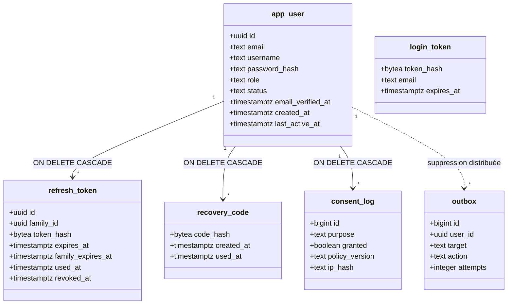
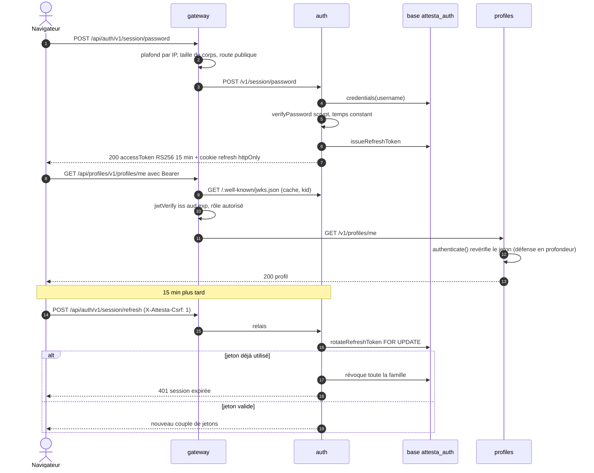
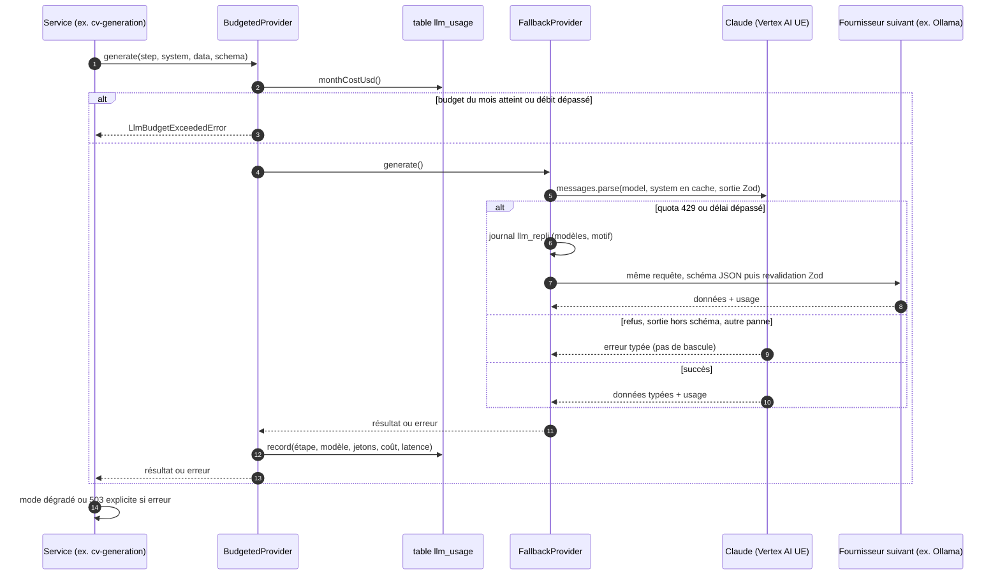

# Membre 1 — Yassine Trigui · Utilisateurs, sécurité et gateway

> **Périmètre** : service `services/auth` (comptes, sessions, jetons JWT, RGPD), `gateway/` (point d'entrée
> unique de l'API) et paquet commun `packages/llm-client` (assistant IA retenu, voir § 3).
> Toutes les affirmations renvoient à un fichier du dépôt (branche `chore/phase-2-socle`, 2026-10-26).

## 1. Partie CRUD

### Entité gérée : `app_user` (compte utilisateur)

Table créée par `services/auth/migrations/1761000000000_auth.sql`, complétée par
`1761900000000_password-accounts.sql` (identifiant + mot de passe, ADR 0030) et
`1762200000000_recovery-codes.sql` (codes de récupération, ADR 0039).

| Attribut | Type SQL | Contraintes |
|---|---|---|
| `id` | `uuid` | clé primaire, `gen_random_uuid()` |
| `email` | `text` | facultatif depuis ADR 0030 ; `email = lower(email)`, ≤ 254 caractères, index unique |
| `username` | `text` | minuscules, regex `^[a-z0-9][a-z0-9._-]{2,29}$`, index unique |
| `password_hash` | `text` | obligatoire si `username` renseigné (contrainte `app_user_mot_de_passe`) |
| `role` | `text` | `candidate` (défaut) ou `admin` |
| `status` | `text` | `active` (défaut) ou `deleting` |
| `email_verified_at` | `timestamptz` | facultatif depuis ADR 0030 |
| `created_at`, `last_active_at` | `timestamptz` | `now()` par défaut |

Contrainte `app_user_identifiant` : `email IS NOT NULL OR username IS NOT NULL`.
Validation applicative (Zod, `packages/shared-schemas/src/api/auth.ts`) : identifiant 3 à 30 caractères
`^[a-z0-9][a-z0-9._-]*$`, mot de passe 10 à 128 caractères, acceptation de la politique de confidentialité
obligatoire (`policyAccepted: z.literal(true)`).



Les tables `audit_event` (journal d'audit) et `outbox` (suppressions RGPD à propager aux autres services) ne
portent pas de clé étrangère : elles doivent survivre à l'effacement du compte.

### Opérations CRUD

Routes déclarées dans `services/auth/src/routes.ts` ; publiques via la gateway sous le préfixe `/api/auth`.

| Opération | Méthode et route | Rôle requis | Validation |
|---|---|---|---|
| **Create** — créer un compte | `POST /v1/accounts` | public (liste blanche gateway), plafond par IP | `AccountCreate` (Zod) ; identifiant réservé aux admins refusé ; 409 si identifiant pris |
| **Read** — mon compte | `GET /v1/me` | `candidate` ou `admin` (`requireAccount()`) | jeton JWT valide |
| **Read** — export RGPD | `GET /v1/me/export` | `candidate` ou `admin` | jeton JWT valide |
| **Read** — statistiques | `GET /v1/admin/stats` | `admin` (`requireRole("admin")`) | jeton JWT valide |
| **Update** — mot de passe | `PUT /v1/me/password` | `candidate` ou `admin` | `PasswordChange` ; mot de passe actuel vérifié |
| **Update** — consentements | `PUT /v1/me/consents` | `candidate` ou `admin` | `ConsentUpdate` |
| **Update** — codes de récupération | `POST /v1/me/recovery-codes` | `candidate` ou `admin` | compte à identifiant uniquement |
| **Delete** — supprimer le compte | `DELETE /v1/me` | `candidate` ou `admin` | `AccountDeletion` (`confirm: true`) ; réponse 202 |

Les sessions forment un second jeu d'opérations : `POST /v1/session/password` (connexion),
`POST /v1/session/refresh` (rotation), `POST /v1/session/guest` (invité), `DELETE /v1/session` (déconnexion).

### Extrait de code commenté — création de compte

`services/auth/src/routes.ts` (extrait de `registerRoutes`) :

```ts
app.post("/v1/accounts", async (req, res) => {
  // Validation Zod : identifiant, mot de passe, acceptation de la politique (sinon 400 détaillé).
  const { username, password } = parseInput(AccountCreate, req.body);
  // Les identifiants administrateurs (ADMIN_USERNAMES) sont réservés : créés au démarrage seulement.
  const reserved = roleOf(username) === "admin";
  const user = reserved
    ? undefined
    : await store.createAccount(username, await hashPassword(password), "candidate", ipHash(req));
  if (!user) {
    throw new AppError("identifiant_pris", 409, "Cet identifiant est déjà pris. Choisissez-en un autre.", [
      { champ: "username", message: "Identifiant déjà pris." },
    ]);
  }
  // Journal sans donnée personnelle : ni identifiant ni IP en clair.
  logger.info({ event: "compte_cree", methode: "mot_de_passe" }, "connexion");
  res.status(201);
  // Codes de récupération (ADR 0039) : seul moyen de retrouver un compte sans e-mail.
  const recoveryCodes = await store.newRecoveryCodes(user.id);
  // Réponse : jeton d'accès JWT + cookie httpOnly de rafraîchissement.
  await userSession(res, user, await store.issueRefreshToken(user.id), { recoveryCodes });
});
```

`hashPassword` (`services/auth/src/passwords.ts`) utilise `scrypt` de `node:crypto`, sans dépendance, au
format auto-décrit `scrypt$N$r$p$sel$empreinte` pour pouvoir durcir les paramètres sans migration.

### Côté front

| Écran | Fichier | Rôle |
|---|---|---|
| Connexion / création de compte | `frontend/src/pages/Login.tsx` | formulaire, affichage des codes de récupération (`components/RecoveryCodes.tsx`) |
| Mon compte (détail + modification + suppression) | `frontend/src/pages/Account.tsx` | sections « Sécurité », « Consentements », « Mes données » (export), « Supprimer mon compte » |
| Administration (liste des statistiques) | `frontend/src/pages/Admin.tsx` | statistiques des 6 services, santé agrégée (`/api/admin/v1/health`) |
| Session et gardes de routes | `frontend/src/auth/session.tsx`, `frontend/src/auth/guards.tsx` | jeton en mémoire, rafraîchissement, redirections selon le rôle |

## 2. Fonctionnalité avancée — authentification JWT par JWKS, rôles et gateway

### Besoin et fonctionnement

Six services indépendants doivent vérifier l'identité d'un utilisateur **sans partager de base ni de
secret** (ADR 0014). Le service `auth` signe des JWT **RS256** avec sa clé privée et publie la clé publique
sur `GET /.well-known/jwks.json`. Chaque service vérifie localement les jetons (`createJwksVerifier`,
`packages/http-kit/src/auth.ts`), avec un cache rechargé quand un `kid` inconnu apparaît (rotation de clé).

- **Jeton d'accès** : 15 min (`ACCESS_TTL_S`), revendications `sub`, `role`, `scope`, `iss=attesta-auth`,
  `aud=attesta` ; aucune donnée personnelle (pas d'e-mail).
- **Refresh token** : opaque, stocké haché, cookie httpOnly ; rotation à chaque usage, 7 jours d'inactivité,
  30 jours au plus (`REFRESH_IDLE_MS`, `REFRESH_MAX_MS`). **Réutilisation détectée** : toute la famille est
  révoquée (`rotateRefreshToken`, `services/auth/src/store.ts`).
- **Rôles** (ADR 0024) : `candidate`, `admin`, `guest` (parcours sans compte, 24 h max), `service`.
- **Jetons de service** : `POST /internal/v1/token` délivre un jeton de 5 min, audience = service cible, portée
  minimale (`SERVICE_GRANTS` : par exemple `job-watch` → `auth users:contact`).
- **Gateway** (`gateway/src/app.ts`, ADR 0015) : sans état ; en-têtes `helmet`, identifiant de corrélation,
  refus des pré-requêtes `OPTIONS` (pas de CORS), plafonds de débit, taille des corps, vérification du jeton
  sauf liste blanche (`gateway/src/routing.ts`), refus de `/internal/*`, `/v1/admin/*` réservé aux admins,
  puis mandataire vers le service.



### Extraits de code clés

Signature (`services/auth/src/keys.ts`) :

```ts
const sign = (claims: Record<string, unknown>, sub: string, audience: string, ttlSeconds: number) =>
  new SignJWT(claims)
    .setProtectedHeader({ alg: "RS256", kid }) // kid = empreinte RFC 7638 de la clé
    .setIssuer(TOKEN_ISSUER)                    // "attesta-auth"
    .setAudience(audience)                      // "attesta" ou nom du service cible
    .setSubject(sub)
    .setJti(randomUUID())
    .setIssuedAt()
    .setExpirationTime(`${ttlSeconds}s`)
    .sign(privateKey);
```

Vérification et contrôle de rôle partagés (`packages/http-kit/src/auth.ts`) :

```ts
export function authenticate(verifier: TokenVerifier) {
  return async (req: Request, res: Response, next: NextFunction) => {
    const token = bearerToken(req);
    if (!token) return next(unauthorized());
    try {
      res.locals.principal = await verifier.verify(token); // signature, exp, iss, aud, RS256 seul
      next();
    } catch {
      next(unauthorized("Votre session a expiré. Reconnectez-vous.")); // motif jamais détaillé
    }
  };
}

export function requireRole(...roles: Role[]) {
  return (_req: Request, res: Response, next: NextFunction) => {
    const { role } = principalOf(res);
    next(roles.includes(role) ? undefined : forbidden());
  };
}
```

Garde de la gateway (`gateway/src/app.ts`) :

```ts
const guard = (service: string): RequestHandler => async (req, res, next) => {
  if (isInternalPath(req.path)) return next(new AppError("introuvable", 404, "Ressource introuvable."));
  if (isPublic(service, req.method, req.path)) return next(); // liste blanche explicite et testée
  const token = bearerToken(req);
  if (!token) return next(unauthorized());
  let role: string;
  try {
    ({ role } = await verifier.verify(token));
  } catch {
    return next(unauthorized("Votre session a expiré. Reconnectez-vous."));
  }
  if (role === "service") return next(forbidden());                     // un jeton de service ne passe pas par l'extérieur
  if (isAdminPath(req.path) && role !== "admin") return next(forbidden()); // /v1/admin/* réservé
  next();
};
```

### Difficultés rencontrées et solutions (d'après les commentaires et ADR du dépôt)

| Difficulté | Solution dans le code |
|---|---|
| Après un redémarrage local, une nouvelle clé éphémère gardait le même `kid` : les services gardaient l'ancienne clé en cache | `kid` dérivé de l'empreinte de la clé (`calculateJwkThumbprint`), rechargement JWKS au plus toutes les 30 s (`keys.ts`, `http-kit/src/auth.ts`) |
| Vol d'un refresh token | rotation à chaque usage et révocation de toute la famille en cas de réutilisation (`store.ts`) |
| Énumération des comptes par le temps de réponse | hachage leurre (`decoyHash()`) pour un identifiant inconnu (`routes.ts`) |
| Essais de mot de passe en masse | plafond par IP dans la gateway + plafond par identifiant haché dans `auth` (10 échecs / 15 min par défaut) |
| CSRF sur les routes à cookie | en-tête `X-Attesta-Csrf: 1` exigé ; pré-requêtes `OPTIONS` refusées par la gateway (ADR 0022) |
| Suppression RGPD dans 6 bases distinctes | table `outbox` + appels `DELETE /internal/v1/users/:id` à jeton de service portée `users:delete` (ADR 0019) |

## 3. Assistant IA — client LLM commun `packages/llm-client`

> Le service `auth` n'appelle aucun modèle. L'assistant IA présenté ici est la **brique commune** par
> laquelle passent tous les appels LLM des services (règle d'architecture n° 4 de `CLAUDE.md`, ADR 0016).

### Fonctionnalité et cas d'usage

Fournir aux services `profiles`, `cv-generation`, `jobs-matching` et `letters-export` un appel structuré
unique : choix du fournisseur, sortie validée par schéma Zod, gestion des erreurs, comptage des coûts,
**budget mensuel** et débit maximal, prompts versionnés, et un fournisseur de démonstration sans IA.

### Modèles, API et bibliothèques (versions lues dans le code)

> **Évolution en cours.** Le 2026-10-26, pendant la rédaction de ce dossier, le client a été étendu à quatre
> fournisseurs avec repli automatique (**ADR 0047, statut « proposé », à valider par le chef de projet** ;
> modifications non encore committées sur la branche). Ce qui suit décrit l'état du répertoire de travail à
> cette date.

| Fournisseur (`AI_PROVIDER`) | Modèle par défaut | Bibliothèque | Admis en production |
|---|---|---|---|
| `claude` (défaut si configuré) | `claude-opus-5-5` (`LLM_MODEL`), surcharge par étape `LLM_STEP_MODELS` | `@anthropic-ai/sdk` ^0.135.0 (API directe) ou `@anthropic-ai/vertex-sdk` ^0.21.0 (Vertex AI, région `eu`), selon `CLAUDE_TRANSPORT` | oui, **via Vertex AI UE seulement** |
| `groq` | `openai/gpt-oss-120b` (`GROQ_MODEL`) | `openai` ^6.49.0, API compatible OpenAI | non (hors UE) |
| `gemini` | `gemini-2.5-flash` (`GEMINI_MODEL`) | `@google/genai` ^2.31.0 | non (API directe hors UE) |
| `ollama` | `qwen3:8b` (`OLLAMA_MODEL`) | `openai` ^6.49.0, `baseURL` locale ; image `ollama/ollama:0.12.6` (profil `ollama`) | oui (local) |
| `demo` (défaut en local) | aucun modèle : contenu recopié des données réelles | `src/demo-provider.ts` | **interdit** en production |

Sources : `packages/llm-client/package.json`, `src/ai-config.ts`, `src/anthropic-provider.ts`,
`src/openai-compatible-provider.ts`, `src/gemini-provider.ts`, `src/fallback-provider.ts`, `compose.yaml`.
Validation des sorties : `zod` ^4.6.7 ; pour Groq, Gemini et Ollama, schéma JSON (`z.toJSONSchema`) demandé
au modèle puis **sortie toujours revalidée par Zod**.

### Fonctionnement

1. Au démarrage, `createAiProvider` (`ai-config.ts`) construit la **chaîne** de fournisseurs : le fournisseur
   choisi, puis les autres fournisseurs configurés dans l'ordre circulaire claude → groq → gemini → ollama
   (ou la liste `AI_FALLBACK_PROVIDERS`). En production, seuls Claude sur Vertex AI et Ollama sont gardés ;
   une configuration contraire bloque le démarrage (`aiConfigProblems`).
2. Le service appelle `provider.generate({ step, system, messages, schema, effort, maxTokens })`.
3. `BudgetedProvider` refuse l'appel si le coût du mois (table `llm_usage` du service) dépasse
   `LLM_MONTHLY_BUDGET_EUR`, ou si le seau à jetons (30 ou 60 appels/min selon le service) est vide.
4. `FallbackProvider` essaie le premier fournisseur ; **seulement** sur quota atteint (429) ou délai dépassé,
   la même requête passe au suivant, et la bascule est journalisée (`llm_repli`, modèles et motif).
5. Pour Claude : `messages.parse` avec le prompt système mis en cache (`cache_control: ephemeral`) et le
   format de sortie Zod.
6. Le coût est estimé (`pricing.ts`) et enregistré (étape, modèle qui a réellement répondu, jetons, coût,
   latence — **jamais le contenu**).
7. Les données de l'utilisateur sont transmises dans des blocs balisés (`dataBlock`) dont les `<` sont
   échappés, pour qu'un texte de CV ou d'offre ne puisse pas se faire passer pour une consigne.



### Erreurs, coûts, limites et sécurité des clés

- **Erreurs typées** (`src/provider.ts`) : `LlmUnavailableError` avec un motif (`quota`, `timeout`, `reseau`,
  `autre`), `LlmRefusalError`, `LlmSchemaError`, `LlmBudgetExceededError`. Le SDK fait jusqu'à 2 relances
  (`maxRetries`), **0** quand un fournisseur suivant peut prendre le relais. `assist()` (`src/assist.ts`)
  relance 2 fois une sortie non conforme, puis lève `AssistUnavailableError` ; **aucune sortie non validée
  n'est renvoyée**.
- **Coûts** : tarifs en USD par million de jetons dans `pricing.ts` (Claude Opus 4/20, Sonnet 2/10, Haiku
  0,1/0,5 ; Groq et Gemini « relevés auprès d'agrégateurs, pages officielles à vérifier » ; Ollama compté à
  0) ; modèle inconnu = tarif Opus par prudence ; conversion en euros à 0,92. Budgets par défaut : profiles
  2 €, jobs-matching 4 €, letters-export 5 €, cv-generation 9 € par mois.
- **Limites** : délai `LLM_TIMEOUT_MS` (90 s par défaut) ; `LLM_STEP_MODELS` et l'effort ne s'appliquent qu'à
  Claude ; sorties de Groq, Gemini et Ollama « moins stables » (davantage de relances, ADR 0047) ; estimation
  de coût indicative (« la facture fait foi »).
- **Clés** : aucune valeur dans le code ni dans `compose.yaml` (variables `${NOM:-}` vides par défaut). Sur
  Vertex AI, l'identité du compte de service Google est utilisée. Variables (noms seulement) : `AI_PROVIDER`,
  `LLM_PROVIDER` (ancien nom), `CLAUDE_TRANSPORT`, `AI_FALLBACK_PROVIDERS`, `LLM_MODEL`, `LLM_STEP_MODELS`,
  `LLM_TIMEOUT_MS`, `VERTEX_PROJECT_ID`, `VERTEX_REGION`, `ANTHROPIC_API_KEY`, `GROQ_API_KEY`, `GROQ_MODEL`,
  `GEMINI_API_KEY`, `GEMINI_MODEL`, `OLLAMA_BASE_URL`, `OLLAMA_MODEL`, `LLM_MONTHLY_BUDGET_EUR`. La clé privée
  JWT du service `auth` suit la même règle (`AUTH_PRIVATE_KEY`, obligatoire en production, clé éphémère en
  local).

## 4. Partie Docker

### Dockerfile du service `auth` (intégral, commenté)

Les lignes `# »` sont les commentaires ajoutés pour cette présentation ; les autres sont d'origine.

```dockerfile
# syntax=docker/dockerfile:1.7
# Image du service auth. Contexte de construction : la racine du dépôt, réduite par
# Dockerfile.dockerignore au dossier du service et aux paquets partagés (docs/adr/0023).
#   docker build -f services/auth/Dockerfile -t attesta/auth .

# » Étape 1 « build » : image officielle Node 22 sur Debian 12 (bookworm), variante slim.
FROM node:22-bookworm-slim AS build
# » Répertoire qui reproduit l'arborescence du dépôt : les dépendances « file:../../packages/* » restent résolues.
WORKDIR /repo
# » Manifeste du paquet partagé @attesta/logger.
COPY packages/logger/package.json packages/logger/
# » @attesta/logger déjà compilé (dist/ versionné, ADR 0025) : rien à recompiler dans l'image.
COPY packages/logger/dist packages/logger/dist
# » Manifeste du paquet partagé @attesta/config.
COPY packages/config/package.json packages/config/
# » @attesta/config déjà compilé (dist/ versionné, ADR 0025) : rien à recompiler dans l'image.
COPY packages/config/dist packages/config/dist
# » Manifeste du paquet partagé @attesta/http-kit.
COPY packages/http-kit/package.json packages/http-kit/
# » @attesta/http-kit déjà compilé (dist/ versionné, ADR 0025) : rien à recompiler dans l'image.
COPY packages/http-kit/dist packages/http-kit/dist
# » Manifeste du paquet partagé @attesta/shared-schemas.
COPY packages/shared-schemas/package.json packages/shared-schemas/
# » @attesta/shared-schemas déjà compilé (dist/ versionné, ADR 0025) : rien à recompiler dans l'image.
COPY packages/shared-schemas/dist packages/shared-schemas/dist
# » Construction dans le seul dossier de l'unité services/auth (autonomie des services, ADR 0023).
WORKDIR /repo/services/auth
# » Manifestes et lockfile seuls d'abord : la couche « npm ci » reste en cache tant qu'ils ne changent pas.
COPY services/auth/package.json services/auth/package-lock.json services/auth/.npmrc ./
# Cache npm partagé entre les builds, reprises réseau : une relance réutilise les paquets déjà téléchargés.
# » Installation reproductible (lockfile), cache npm BuildKit partagé entre builds, reprises réseau.
RUN --mount=type=cache,target=/root/.npm npm ci --no-audit --no-fund --fetch-retries=5 --fetch-retry-maxtimeout=120000
# » Configuration de compilation (TypeScript, et Vite pour le frontend).
COPY services/auth/tsconfig.json services/auth/tsconfig.build.json ./
# » Code source copié en dernier : modifier le code n'invalide pas le cache des dépendances.
COPY services/auth/src src
# » Compilation TypeScript vers dist/, puis retrait des dépendances de développement.
RUN npm run build && npm prune --omit=dev

# » Étape 2 « runtime » : image neuve, sans sources TypeScript, sans compilateur ni dépendances de développement.
FROM node:22-bookworm-slim AS runtime
# npm et npx sont inutiles à l'exécution (et signalés par Trivy).
# » Mises à jour de sécurité Debian, puis suppression du cache apt et de npm/npx (inutiles à l'exécution, signalés par Trivy).
RUN apt-get update \
  && apt-get upgrade -y --no-install-recommends \
  && rm -rf /var/lib/apt/lists/* /usr/local/lib/node_modules/npm /usr/local/bin/npm /usr/local/bin/npx
# » Mode production et port d'écoute (pour letters-export : HOME et caches dans /tmp, chemin du Chromium système).
ENV NODE_ENV=production \
  PORT=4001
# » Dossier de l'application dans l'image finale.
WORKDIR /app
# » Seuls les artefacts utiles sont repris de l'étape build, propriété root : l'utilisateur d'exécution ne peut pas les modifier.
COPY --from=build --chown=root:root /repo/services/auth/package.json ./
# » Dépendances de production uniquement (après npm prune).
COPY --from=build --chown=root:root /repo/services/auth/node_modules node_modules
# » JavaScript compilé.
COPY --from=build --chown=root:root /repo/services/auth/dist dist
# » Migrations SQL du service, appliquées au démarrage (MIGRATE_ON_START, vrai par défaut).
COPY --chown=root:root services/auth/migrations migrations
# » Exécution sous l'utilisateur non-root « node » fourni par l'image officielle.
USER node
# » Port documenté du conteneur.
EXPOSE 4001
# » Sonde de santé : interroge /ready (ou /health) sans installer curl ; Docker marque le conteneur healthy ou unhealthy.
HEALTHCHECK --interval=10s --timeout=3s --start-period=20s --retries=5 \
  CMD ["node", "-e", "fetch('http://127.0.0.1:'+(process.env.PORT||4001)+'/ready').then(r=>process.exit(r.ok?0:1),()=>process.exit(1))"]
# » Démarrage direct de Node, sans npm : les signaux d'arrêt arrivent au processus (init: true dans compose).
CMD ["node", "dist/server.js"]
```

### Dockerfile de la `gateway` (intégral, commenté)

```dockerfile
# syntax=docker/dockerfile:1.7
# Image de la gateway. Contexte : la racine du dépôt, réduite par Dockerfile.dockerignore.
#   docker build -f gateway/Dockerfile -t attesta/gateway .

# » Étape 1 « build » : image officielle Node 22 sur Debian 12 (bookworm), variante slim.
FROM node:22-bookworm-slim AS build
# » Répertoire qui reproduit l'arborescence du dépôt : les dépendances « file:../../packages/* » restent résolues.
WORKDIR /repo
# » Manifeste du paquet partagé @attesta/logger.
COPY packages/logger/package.json packages/logger/
# » @attesta/logger déjà compilé (dist/ versionné, ADR 0025) : rien à recompiler dans l'image.
COPY packages/logger/dist packages/logger/dist
# » Manifeste du paquet partagé @attesta/config.
COPY packages/config/package.json packages/config/
# » @attesta/config déjà compilé (dist/ versionné, ADR 0025) : rien à recompiler dans l'image.
COPY packages/config/dist packages/config/dist
# » Manifeste du paquet partagé @attesta/http-kit.
COPY packages/http-kit/package.json packages/http-kit/
# » @attesta/http-kit déjà compilé (dist/ versionné, ADR 0025) : rien à recompiler dans l'image.
COPY packages/http-kit/dist packages/http-kit/dist
# » Construction dans le seul dossier de l'unité gateway (autonomie des services, ADR 0023).
WORKDIR /repo/gateway
# » Manifestes et lockfile seuls d'abord : la couche « npm ci » reste en cache tant qu'ils ne changent pas.
COPY gateway/package.json gateway/package-lock.json gateway/.npmrc ./
# Cache npm partagé entre les builds, reprises réseau : une relance réutilise les paquets déjà téléchargés.
# » Installation reproductible (lockfile), cache npm BuildKit partagé entre builds, reprises réseau.
RUN --mount=type=cache,target=/root/.npm npm ci --no-audit --no-fund --fetch-retries=5 --fetch-retry-maxtimeout=120000
# » Configuration de compilation (TypeScript, et Vite pour le frontend).
COPY gateway/tsconfig.json gateway/tsconfig.build.json ./
# » Code source copié en dernier : modifier le code n'invalide pas le cache des dépendances.
COPY gateway/src src
# » Compilation TypeScript vers dist/, puis retrait des dépendances de développement.
RUN npm run build && npm prune --omit=dev

# » Étape 2 « runtime » : image neuve, sans sources TypeScript, sans compilateur ni dépendances de développement.
FROM node:22-bookworm-slim AS runtime
# » Mises à jour de sécurité Debian, puis suppression du cache apt et de npm/npx (inutiles à l'exécution, signalés par Trivy).
RUN apt-get update \
  && apt-get upgrade -y --no-install-recommends \
  && rm -rf /var/lib/apt/lists/* /usr/local/lib/node_modules/npm /usr/local/bin/npm /usr/local/bin/npx
# » Mode production et port d'écoute (pour letters-export : HOME et caches dans /tmp, chemin du Chromium système).
ENV NODE_ENV=production \
  PORT=4000
# » Dossier de l'application dans l'image finale.
WORKDIR /app
# » Seuls les artefacts utiles sont repris de l'étape build, propriété root : l'utilisateur d'exécution ne peut pas les modifier.
COPY --from=build --chown=root:root /repo/gateway/package.json ./
# » Dépendances de production uniquement (après npm prune).
COPY --from=build --chown=root:root /repo/gateway/node_modules node_modules
# » JavaScript compilé.
COPY --from=build --chown=root:root /repo/gateway/dist dist
# » Exécution sous l'utilisateur non-root « node » fourni par l'image officielle.
USER node
# » Port documenté du conteneur.
EXPOSE 4000
# » Sonde de santé : interroge /ready (ou /health) sans installer curl ; Docker marque le conteneur healthy ou unhealthy.
HEALTHCHECK --interval=10s --timeout=3s --start-period=10s --retries=5 \
  CMD ["node", "-e", "fetch('http://127.0.0.1:'+(process.env.PORT||4000)+'/ready').then(r=>process.exit(r.ok?0:1),()=>process.exit(1))"]
# » Démarrage direct de Node, sans npm : les signaux d'arrêt arrivent au processus (init: true dans compose).
CMD ["node", "dist/server.js"]
```

### Extraits de `compose.yaml` (variables : noms seulement)

```yaml
  auth:
    <<: *service
    build: { context: ., dockerfile: services/auth/Dockerfile }
    profiles: ["core", "full"]
    ports: ["${AUTH_PORT:-4001}:4001"]
    environment:
      <<: *service-env
      TRUST_PROXY: …
      DATABASE_URL: …
      APP_BASE_URL: …
      SMTP_URL: …
      MAIL_FROM: …
      ADMIN_EMAILS: …
      ADMIN_USERNAMES: …
      ADMIN_PASSWORD: …
      IP_HASH_SECRET: …
      SERVICE_SECRET_JOB_WATCH: …
      PROFILES_URL: …
      CV_GENERATION_URL: …
      JOBS_MATCHING_URL: …
      JOB_WATCH_URL: …
      LETTERS_EXPORT_URL: …
    depends_on:
      db-init: { condition: service_completed_successfully }
      mailpit: { condition: service_started }

# Ancre fusionnée par « <<: *service » (début de compose.yaml) :
x-service: &service
  init: true
  read_only: true
  tmpfs: ["/tmp"]
  cap_drop: [ALL]
  security_opt: ["no-new-privileges:true"]
  restart: unless-stopped
  environment: &service-env
    NODE_ENV: …
    LOG_LEVEL: …
```

```yaml
  gateway:
    <<: *service
    build: { context: ., dockerfile: gateway/Dockerfile }
    profiles: ["core", "full"]
    ports: ["${GATEWAY_PORT:-4000}:4000"]
    environment:
      <<: *service-env
      TRUST_PROXY: …
      AUTH_URL: …
      PROFILES_URL: …
      CV_GENERATION_URL: …
      JOBS_MATCHING_URL: …
      JOB_WATCH_URL: …
      LETTERS_EXPORT_URL: …
      RATE_LIMIT_GENERATION_PER_HOUR: …
      RATE_LIMIT_LOGIN_PER_HOUR: …
    depends_on:
      auth: { condition: service_healthy }

# Ancre fusionnée par « <<: *service » (début de compose.yaml) :
x-service: &service
  init: true
  read_only: true
  tmpfs: ["/tmp"]
  cap_drop: [ALL]
  security_opt: ["no-new-privileges:true"]
  restart: unless-stopped
  environment: &service-env
    NODE_ENV: …
    LOG_LEVEL: …
```

- **Ports** : `auth` 4001, `gateway` 4000 (modifiables par `AUTH_PORT`, `GATEWAY_PORT`).
- **Volumes** : aucun (système de fichiers en lecture seule, `/tmp` en tmpfs).
- **Réseaux** : aucun réseau déclaré : réseau par défaut du projet compose ; les services se joignent par
  leur nom (`http://auth:4001`).
- **depends_on** : `auth` attend `db-init` (bases créées) et `mailpit` ; la gateway attend `auth` *healthy*.

### Commandes

```bash
docker build -f services/auth/Dockerfile -t attesta/auth .      # contexte = racine du dépôt
docker build -f gateway/Dockerfile -t attesta/gateway .
docker compose --profile core up -d --build --wait auth gateway  # avec leurs dépendances
docker compose ps auth gateway                                   # état « healthy »
```

### Justification des choix

| Choix | Raison |
|---|---|
| `node:22-bookworm-slim` | Node 22 imposé par le projet (`.nvmrc` = 22) ; Debian slim : glibc (compatibilité des modules natifs), image réduite |
| Multi-stage `build` / `runtime` | ni TypeScript, ni sources, ni dépendances de développement dans l'image finale |
| Ordre des `COPY` | manifestes puis `npm ci` avant le code : cache de couche conservé quand seul le code change |
| `--mount=type=cache` | cache npm BuildKit réutilisé d'un build à l'autre |
| `npm prune --omit=dev`, retrait de npm/npx | image plus petite, moins de surface signalée par Trivy |
| `USER node`, fichiers `root:root` | exécution non-root, code non modifiable par le processus |
| `HEALTHCHECK` via `fetch` natif | pas de `curl` à installer ; `depends_on: service_healthy` exploitable |
| compose : `read_only`, `cap_drop: [ALL]`, `no-new-privileges` | durcissement commun à tous les services (ancre `x-service`) |

## 5. Stack et justifications

| Partie | Technologie | Version | Rôle | Justification | Alternative écartée et pourquoi |
|---|---|---|---|---|---|
| CRUD | Express | ^5.3.0 | serveur HTTP de `auth` et de la gateway | gestion native des erreurs asynchrones (v5), écosystème | à confirmer : aucun autre framework documenté ; ADR 0001 écarte JavaScript + JSDoc au profit de TypeScript strict |
| CRUD | PostgreSQL (`pg`) | ^8.23.1 (image `pgvector/pgvector:0.8.0-pg16`) | base `attesta_auth` | contraintes SQL fortes, une base par service (ADR 0013) | base partagée : interdite par la règle n° 1 de `CLAUDE.md` |
| CRUD | node-pg-migrate | ^9.0.0 | migrations SQL versionnées | migrations SQL lisibles, montée/descente testées en CI | ORM : non utilisé, le SQL reste explicite |
| CRUD | Zod | ^4.6.7 | validation des entrées, contrats partagés | un schéma unique pour validation, types et OpenAPI (ADR 0017) | à confirmer : aucune alternative documentée |
| Avancée | jose | ^6.2.12 | signature et vérification JWT, JWKS | RS256 + JWKS + refresh rotatif : vérification locale (ADR 0014, option A) | HS256 à secret partagé : chaque service pourrait forger des jetons ; sessions opaques : `auth` deviendrait un passage obligé (ADR 0014, B et C) |
| Avancée | scrypt (`node:crypto`) | Node 22 | empreintes de mots de passe | sans dépendance (commentaire de `passwords.ts`) | à confirmer : bcrypt/argon2 non documentés |
| Avancée | helmet | ^8.3.0 | en-têtes de sécurité de la gateway | standard Express | — |
| Avancée | express-rate-limit | ^8.7.1 | plafonds de débit | plafonds par route (connexion, génération, export) | — |
| Avancée | http-proxy-middleware | ^3.0.7 | mandataire vers les services | gateway en TypeScript, testable avec supertest (ADR 0015, option A) | Traefik/nginx : logique en configuration non testable ; Kong/Tyk : apprentissage élevé, base en plus (ADR 0015) |
| IA | @anthropic-ai/sdk | ^0.135.0 | appels Claude, sorties structurées | sortie validée par schéma (`messages.parse`) | Mistral : « alternative souveraine crédible », second adaptateur possible ; Bedrock : modèles récents en UE non garantis (ADR 0008) |
| IA | @anthropic-ai/vertex-sdk | ^0.21.0 | Claude via Vertex AI, région UE | traitement dans l'UE (commentaire « décision Q5 ») | API directe : réservée au développement avec données fictives |
| IA | openai (Groq, Ollama) | ^6.49.0 | fournisseurs de repli (ADR 0047, proposé) | Groq et Ollama exposent l'API Chat Completions : un seul client | Vercel AI SDK, LangChain : « dépendance large pour quatre appels », contrôle plus faible des erreurs et des journaux (ADR 0047) |
| IA | @google/genai | ^2.31.0 | fournisseur Gemini (ADR 0047, proposé) | SDK officiel de Google | idem |
| Docker | node:22-bookworm-slim | Node 22 | image de base | voir § 4 | Alpine : à confirmer, non documenté |
| Tests | Vitest | ^5.0.5 | tests unitaires et d'intégration | même outil que tout le dépôt | — |
| Tests | supertest | ^7.3.1 | requêtes HTTP sur l'application Express | tests sans port réseau | — |
| Tests | fast-check | ^4.10.2 | tests de propriétés (fuzzing) | `passwords.test.ts` | — |
| Tests | Stryker | ^10.1.1 | tests de mutation | `stryker.config.json`, ADR 0046 | — |

## 6. Tests

| Fichier | Tests | Ce qu'il couvre |
|---|---|---|
| `services/auth/tests/accounts.test.ts` | 21 | création (partitions et valeurs limites), connexion, mot de passe oublié, codes de récupération |
| `services/auth/tests/app.test.ts` | 30 | lien de connexion, refresh rotatif, invité, compte et RGPD (intégration avec PostgreSQL) |
| `services/auth/tests/passwords.test.ts` | 22 | empreintes scrypt, propriétés fast-check, bornes des paramètres |
| `services/auth/tests/config.test.ts` | 8 | configuration et clés de signature |
| `services/auth/tests/db.test.ts` | 3 | migrations de la base du service |
| `services/auth/tests/openapi.test.ts` | 2 | `openapi.yaml` conforme aux routes |
| `gateway/tests/gateway.test.ts` | 17 | routage, protections (jeton, admin, internes, débit, taille), santé agrégée |
| `frontend/tests/login.test.tsx` | 3 | écran de connexion |

Commandes (Node 22.18.0, base locale `docker compose up -d db db-init` pour l'intégration) :

```bash
cd services/auth && npx vitest run --coverage
cd gateway && npx vitest run --coverage
```

Résultat obtenu le 2026-10-26 (passe de 11 h 30 ; seconde passe à 14 h 07 après les changements de l’ADR 0047 : résultats identiques) :

| Unité | Tests | Couverture (lignes) | Seuil (80 %) |
|---|---|---|---|
| `services/auth` | **86/86 réussis** (6 fichiers) | 92,3 % | atteint |
| `gateway` | **17/17 réussis** | 95,55 % | atteint |
