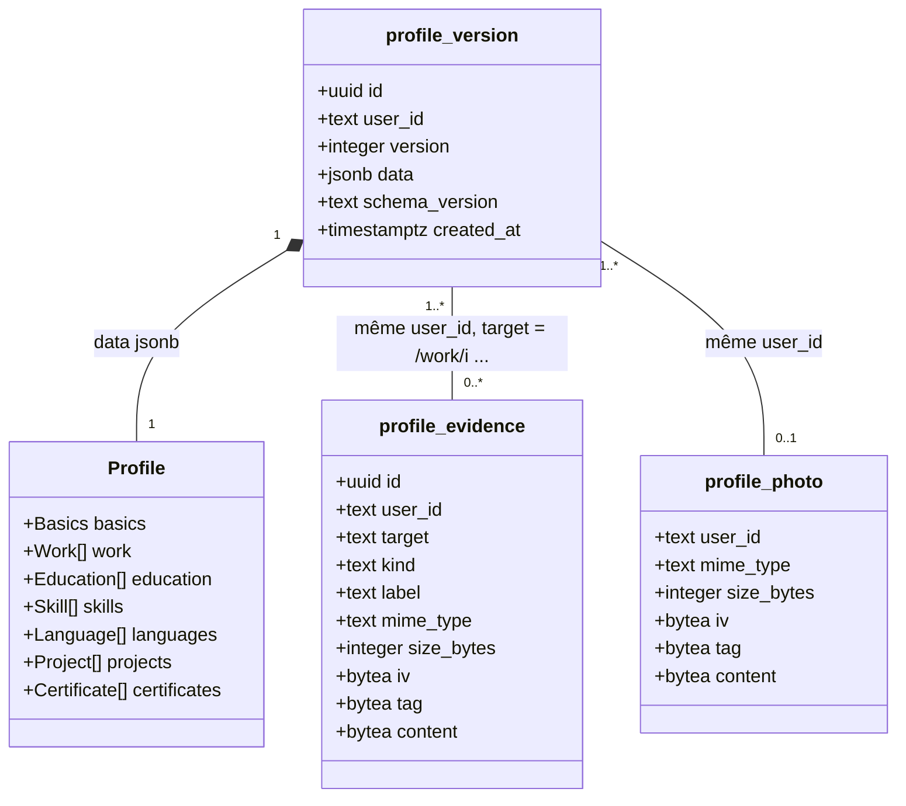
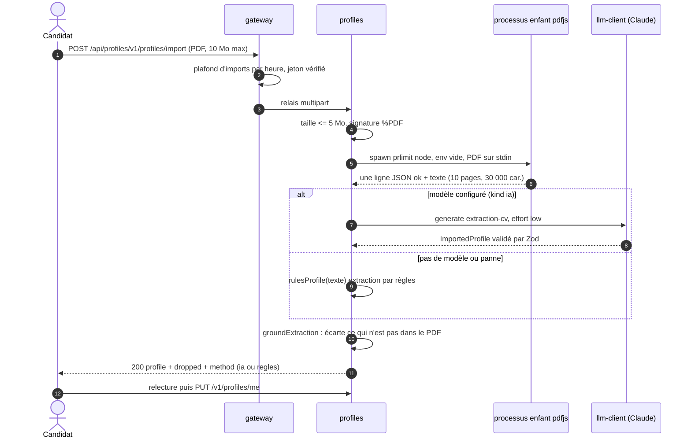
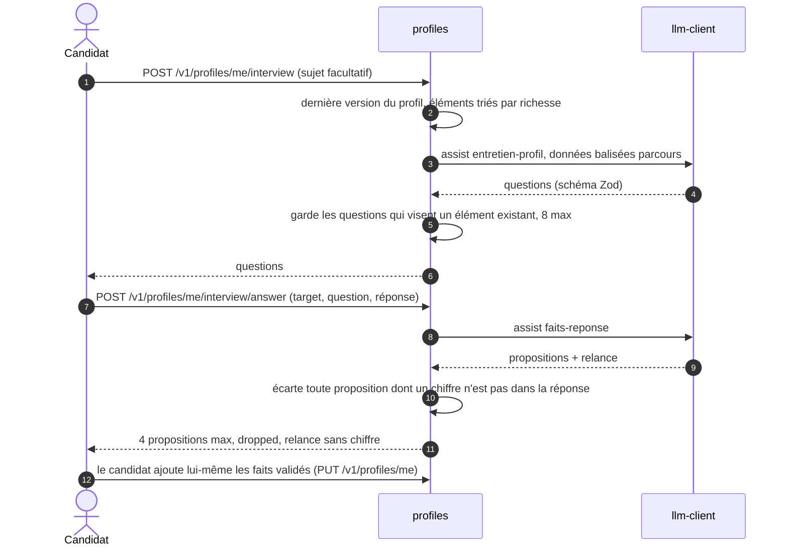

# Membre 2 — Safouene Saassouki · Profils candidats

> **Périmètre** : service `services/profiles` — profil candidat versionné (source unique de vérité du CV),
> import de CV PDF, pièces justificatives chiffrées, photo, intervieweuse de profil.
> Toutes les affirmations renvoient à un fichier du dépôt (branche `chore/phase-2-socle`, 2026-10-26).

## 1. Partie CRUD

### Entité gérée : `profile_version` (profil versionné)

Table créée par `services/profiles/migrations/1761000000000_profiles.sql`. Chaque enregistrement qui modifie
le profil crée une **nouvelle version** ; les anciennes restent consultables.

| Attribut | Type SQL | Contraintes |
|---|---|---|
| `id` | `uuid` | clé primaire, `gen_random_uuid()` |
| `user_id` | `text` | 1 à 80 caractères (UUID d'un compte, ou `guest_<uuid>` pour un invité) |
| `version` | `integer` | `> 0`, unique avec `user_id` |
| `data` | `jsonb` | profil complet, validé par le schéma Zod `Profile` |
| `schema_version` | `text` | version du schéma du profil |
| `created_at` | `timestamptz` | `now()` par défaut |

Le contenu de `data` suit le schéma `Profile` (`packages/shared-schemas/src/profile.ts`), compatible
JSON Resume : `basics` (nom obligatoire, e-mail, téléphone, URL, résumé, localisation, réseaux), `work`
(≤ 30, poste et employeur obligatoires, date de début obligatoire, ≤ 20 réalisations), `education` (≤ 15),
`skills` (≤ 50), `languages` (≤ 15), `projects` (≤ 30), `certificates` (≤ 30). Une date de fin antérieure
à la date de début est refusée (`withDateOrder`).



Les relations passent par `user_id` (pas de clé étrangère : un utilisateur a plusieurs versions). Une pièce
justificative vise un élément du profil par son pointeur `target`
(`^/(work|education|certificates|languages)/[0-9]{1,2}$`), taille ≤ 5 Mo, PDF/PNG/JPEG.

### Opérations CRUD

Routes de `services/profiles/src/routes.ts`, publiques sous `/api/profiles`.

| Opération | Méthode et route | Rôle requis | Validation |
|---|---|---|---|
| **Create / Update** — enregistrer le profil | `PUT /v1/profiles/me` | `candidate`, `admin`, `guest` | `ProfileSave` = `{ profile: Profile }` ; 201 si nouvelle version, 200 si identique à la dernière |
| **Read** — profil courant | `GET /v1/profiles/me` | `candidate`, `admin`, `guest` | 404 si aucun profil |
| **Read** — liste des versions | `GET /v1/profiles/me/versions` | idem | — |
| **Read** — une version | `GET /v1/profiles/me/versions/:version` | idem | `VersionParam` |
| **Delete** — supprimer le profil | `DELETE /v1/profiles/me` | idem | supprime versions, pièces et photo ; 204 |
| Create — pièce justificative | `POST /v1/profiles/me/evidence` | `candidate`, `admin` (pas d'invité) | fichier multipart, type et taille contrôlés |
| Delete — pièce justificative | `DELETE /v1/profiles/me/evidence/:evidenceId` | `candidate`, `admin` | — |
| Create/Update/Delete — photo | `PUT`, `GET`, `DELETE /v1/profiles/me/photo` | `candidate`, `admin` | PNG/JPEG ≤ 2 Mo |

### Extrait de code commenté — enregistrement d'une version

`services/profiles/src/store.ts`, méthode `save` :

```ts
async save(userId: string, profile: Profile): Promise<{ row: StoredRow; created: boolean }> {
  // Égalité jsonb : indépendante de l'ordre des clés, contrairement à une comparaison de textes.
  const same = await this.pool.query<StoredRow>(
    `SELECT ${COLUMNS} FROM (
       SELECT * FROM profile_version WHERE user_id = $1 ORDER BY version DESC LIMIT 1
     ) last WHERE data = $2::jsonb`,
    [userId, JSON.stringify(profile)],
  );
  if (same.rows[0]) return { row: same.rows[0], created: false }; // rien de nouveau : pas de version
  // Numéro suivant calculé dans la même requête ; UNIQUE (user_id, version) protège des doublons.
  const { rows } = await this.pool.query<StoredRow>(
    `INSERT INTO profile_version (user_id, version, data, schema_version)
     SELECT $1, coalesce(max(version), 0) + 1, $2, $3 FROM profile_version WHERE user_id = $1
     RETURNING ${COLUMNS}`,
    [userId, JSON.stringify(profile), SCHEMA_VERSION],
  );
  return { row: rows[0]!, created: true };
}
```

La route `PUT /v1/profiles/me` répond 201 si `created`, 200 sinon, et ne journalise que le numéro de version.

### Côté front

| Écran | Fichier | Rôle |
|---|---|---|
| Formulaire de profil (création, modification, import) | `frontend/src/pages/Builder.tsx` | parcours « Créer un CV ciblé » : « Importer un CV existant », « Vous », « Selon le pays visé », « Compétences et langues » |
| Logique du formulaire | `frontend/src/lib/profileForm.ts`, `frontend/src/lib/draftStore.tsx` | conversion formulaire ⇄ `Profile`, brouillon local |
| Pièces justificatives (liste, ajout, suppression) | `frontend/src/pages/Evidence.tsx` | « Mes justificatifs » |
| Intervieweuse de profil | `frontend/src/pages/assistants/ProfileCoach.tsx` | questions et propositions de faits |
| Compte | `frontend/src/pages/Account.tsx` | section « Profil enregistré » |

## 2. Fonctionnalité avancée — import d'un CV PDF ancré dans le texte source

### Besoin et fonctionnement

Le candidat importe un CV PDF existant pour pré-remplir son profil (`POST /v1/profiles/import`). Deux risques :
un **PDF piégé** (mémoire, CPU) et une **extraction inventée** par l'IA (règle de fidélité n° 5 de `CLAUDE.md`).

1. **Analyse isolée** (`src/extraction.ts`, `src/pdf-text-child.ts`) : le PDF (≤ 5 Mo, en-tête `%PDF`
   vérifié) est lu par `pdfjs-dist` dans un **processus enfant** lancé avec un environnement vide (aucun
   secret transmis), borné par `prlimit` (mémoire, CPU) et un délai ; 10 pages et 30 000 caractères au plus ;
   nombre d'analyses simultanées limité (`acquireSlot`).
2. **Extraction** : par Claude (étape `extraction-cv`) si un modèle est configuré, sinon ou en cas de panne
   **par règles** (`src/import-rules.ts`, ADR 0038).
3. **Ancrage** (`groundExtraction`) : chaque réalisation doit avoir 80 % de ses mots et **tous ses nombres**
   présents dans le texte du PDF ; chaque compétence et mot-clé doit y figurer. Le reste est écarté et compté
   (`dropped`).
4. Le résultat est un **brouillon** que le candidat relit avant d'enregistrer.



### Extraits de code clés

Route d'import (`services/profiles/src/routes.ts`) :

```ts
app.post("/v1/profiles/import", auth, user, receiveFile, async (req, res) => {
  if (!req.file) throw new AppError("fichier_absent", 400, "Choisissez un fichier PDF à importer.");
  let text: string;
  try {
    text = await extractPdfText(new Uint8Array(req.file.buffer)); // processus enfant borné
  } catch (error) {
    if (error instanceof PdfImportError) throw new AppError("pdf_illisible", 400, error.publicMessage);
    throw error;
  }
  // Claude si un modèle est configuré ; sinon, ou s'il est en panne, extraction par règles (ADR 0038).
  let extracted;
  let method: "ia" | "regles" = "regles";
  if (llm && llm.kind === "ia") {
    try {
      extracted = (await extractProfile(llm, text)).profile;
      method = "ia";
    } catch (error) {
      logger.warn({ event: "import_echec", errorType: (error as Error)?.name }, "import"); // type d'erreur seul
    }
  }
  extracted ??= rulesProfile(text);
  // Tout élément extrait doit se retrouver dans le texte du PDF.
  const { profile, dropped } = groundExtraction(extracted, text);
  res.json({ profile, dropped, method });
});
```

Processus enfant borné (`services/profiles/src/extraction.ts`, extrait) :

```ts
const [command, args] = PRLIMIT
  ? [PRLIMIT, [`--data=${PDF_ANALYSIS_LIMITS.maxDataBytes}`, `--cpu=${PDF_ANALYSIS_LIMITS.cpuSeconds}`,
      process.execPath, ...nodeArgs]]
  : [process.execPath, nodeArgs];
// Environnement vide : aucun secret (DATABASE_URL, clés…) n'est transmis.
const child = spawn(command, args, { env: {}, stdio: ["pipe", "pipe", "ignore"] });
```

### Difficultés rencontrées et solutions

| Difficulté | Solution dans le code |
|---|---|
| PDF malveillant (bombe mémoire, boucle) | processus enfant, `prlimit`, délai, `SIGKILL`, sortie limitée (`extraction.ts`, ADR 0009) |
| Le modèle « complète » le CV avec des éléments absents | ancrage par vocabulaire et nombres (`groundExtraction`) ; prompt « Recopie, ne reformule pas » |
| Injection de consignes dans le texte du CV | texte placé dans un bloc `<cv>` échappé (`dataBlock`) ; le prompt précise que ce bloc est une donnée |
| Service sans IA (local, panne, budget) | extraction par règles (`import-rules.ts`, 109 tests dont fast-check) |
| PDF scanné sans texte | message explicite si moins de 50 caractères extraits |
| Limite connue | un texte caché (blanc sur blanc) est bien « dans » le PDF : seule la relecture du candidat l'écarte (commentaire de `groundExtraction`) |
| Pièces justificatives sensibles | chiffrement AES-256-GCM (`evidence.ts`, clé `EVIDENCE_KEY`), jamais journalisées ni envoyées à l'IA (ADR 0027) |

## 3. Assistant IA — extraction de CV et intervieweuse de profil

### Fonctionnalités et cas d'usage

| Étape (prompt) | Version en vigueur | Cas d'usage | Code |
|---|---|---|---|
| `extraction-cv` | v1 | pré-remplir le profil depuis un PDF | `src/extraction.ts` |
| `entretien-profil` | v2 | poser jusqu'à 8 questions sur les expériences les moins riches en réalisations chiffrées | `src/assistant.ts`, `interviewQuestions` |
| `faits-reponse` | v2 | transformer la réponse du candidat en 4 propositions de faits au plus, à valider | `src/assistant.ts`, `factProposals` |

Versions déclarées par `createPromptLoader` (`extraction.ts`, `assistant.ts`) ; textes dans
`services/profiles/prompts/<étape>/vN.md`, historique dans `prompts/CHANGELOG.md`.

### Modèle et API

> Fournisseur choisi par `AI_PROVIDER` (`createAiProvider`, `src/server.ts`) : Claude par défaut s’il est configuré, Groq, Gemini ou Ollama en option, avec repli automatique sur quota ou délai (ADR 0047, **statut proposé**, ajouté le 2026-10-26 ; détail dans la fiche du membre 1). En local, `demo` par défaut.

Via `@attesta/llm-client` (voir fiche du membre 1) : Claude, modèle `LLM_MODEL` par défaut `claude-opus-5-5`
(`services/profiles/src/config.ts`), SDK `@anthropic-ai/sdk` ^0.135.0 ; effort `low` pour l'extraction
(16 000 jetons max), `medium` pour l'entretien.

### Fonctionnement



Garde-fou clé (`services/profiles/src/assistant.ts`) :

```ts
// Garde-fou : chaque chiffre proposé doit figurer dans la réponse du candidat.
const allowed = new Set(numbers(input.answer));
const grounded = data.proposals.filter((p) => numbers(p.text).every((n) => allowed.has(n)));
// Une relance ne doit pas souffler de chiffre au candidat.
const followUp = data.followUp?.trim().slice(0, 300);
```

### Erreurs, coûts, limites, sécurité

- Panne, refus, budget atteint ou sortie non conforme après 2 relances : `AssistUnavailableError`, traduite en
  **503 « L'assistant est indisponible »** ; l'import bascule sur les règles.
- Budget mensuel par défaut : 2 € (`LLM_MONTHLY_BUDGET_EUR`), 30 appels/min (`server.ts`) ; consommation
  enregistrée dans la table `llm_usage` du service.
- En mode `demo`, les assistants ont des réponses construites à partir des données réelles
  (`assistantDemoHandlers`) ; l'import exige un vrai modèle et retombe sinon sur les règles.
- Données jamais envoyées au modèle : pièces justificatives, photo ; le prompt d'extraction interdit d'extraire
  âge, date de naissance, situation familiale, nationalité.
- Clés : variables d'environnement uniquement (`LLM_PROVIDER`, `LLM_MODEL`, `VERTEX_PROJECT_ID`,
  `VERTEX_REGION`, `EVIDENCE_KEY`…). Aucune valeur dans ce document.

## 4. Partie Docker

### Dockerfile du service `profiles` (intégral, commenté)

Les lignes `# »` sont les commentaires ajoutés pour cette présentation ; les autres sont d'origine.

```dockerfile
# syntax=docker/dockerfile:1.7
# Image du service profiles. Contexte de construction : la racine du dépôt, réduite par
# Dockerfile.dockerignore au dossier du service et aux paquets partagés (docs/adr/0023).
#   docker build -f services/profiles/Dockerfile -t attesta/profiles .

# » Étape 1 « build » : image officielle Node 22 sur Debian 12 (bookworm), variante slim.
FROM node:22-bookworm-slim AS build
# » Répertoire qui reproduit l'arborescence du dépôt : les dépendances « file:../../packages/* » restent résolues.
WORKDIR /repo
# » Manifeste du paquet partagé @attesta/logger.
COPY packages/logger/package.json packages/logger/
# » @attesta/logger déjà compilé (dist/ versionné, ADR 0025) : rien à recompiler dans l'image.
COPY packages/logger/dist packages/logger/dist
# » Manifeste du paquet partagé @attesta/config.
COPY packages/config/package.json packages/config/
# » @attesta/config déjà compilé (dist/ versionné, ADR 0025) : rien à recompiler dans l'image.
COPY packages/config/dist packages/config/dist
# » Manifeste du paquet partagé @attesta/http-kit.
COPY packages/http-kit/package.json packages/http-kit/
# » @attesta/http-kit déjà compilé (dist/ versionné, ADR 0025) : rien à recompiler dans l'image.
COPY packages/http-kit/dist packages/http-kit/dist
# » Manifeste du paquet partagé @attesta/shared-schemas.
COPY packages/shared-schemas/package.json packages/shared-schemas/
# » @attesta/shared-schemas déjà compilé (dist/ versionné, ADR 0025) : rien à recompiler dans l'image.
COPY packages/shared-schemas/dist packages/shared-schemas/dist
# » Manifeste du paquet partagé @attesta/llm-client.
COPY packages/llm-client/package.json packages/llm-client/
# » @attesta/llm-client déjà compilé (dist/ versionné, ADR 0025) : rien à recompiler dans l'image.
COPY packages/llm-client/dist packages/llm-client/dist
# » Construction dans le seul dossier de l'unité services/profiles (autonomie des services, ADR 0023).
WORKDIR /repo/services/profiles
# » Manifestes et lockfile seuls d'abord : la couche « npm ci » reste en cache tant qu'ils ne changent pas.
COPY services/profiles/package.json services/profiles/package-lock.json services/profiles/.npmrc ./
# Cache npm partagé entre les builds, reprises réseau : une relance réutilise les paquets déjà téléchargés.
# » Installation reproductible (lockfile), cache npm BuildKit partagé entre builds, reprises réseau.
RUN --mount=type=cache,target=/root/.npm npm ci --no-audit --no-fund --fetch-retries=5 --fetch-retry-maxtimeout=120000
# » Configuration de compilation (TypeScript, et Vite pour le frontend).
COPY services/profiles/tsconfig.json services/profiles/tsconfig.build.json ./
# » Code source copié en dernier : modifier le code n'invalide pas le cache des dépendances.
COPY services/profiles/src src
# » Compilation TypeScript vers dist/, puis retrait des dépendances de développement.
RUN npm run build && npm prune --omit=dev

# » Étape 2 « runtime » : image neuve, sans sources TypeScript, sans compilateur ni dépendances de développement.
FROM node:22-bookworm-slim AS runtime
# prlimit (util-linux, déjà présent dans l'image de base) : plafonds du noyau pour l'analyse des PDF (docs/adr/0009).
# » Mises à jour de sécurité Debian, puis suppression du cache apt et de npm/npx (inutiles à l'exécution, signalés par Trivy).
RUN apt-get update \
  && apt-get upgrade -y --no-install-recommends \
  && rm -rf /var/lib/apt/lists/* /usr/local/lib/node_modules/npm /usr/local/bin/npm /usr/local/bin/npx
# » Mode production et port d'écoute (pour letters-export : HOME et caches dans /tmp, chemin du Chromium système).
ENV NODE_ENV=production \
  PORT=4002
# » Dossier de l'application dans l'image finale.
WORKDIR /app
# » Seuls les artefacts utiles sont repris de l'étape build, propriété root : l'utilisateur d'exécution ne peut pas les modifier.
COPY --from=build --chown=root:root /repo/services/profiles/package.json ./
# » Dépendances de production uniquement (après npm prune).
COPY --from=build --chown=root:root /repo/services/profiles/node_modules node_modules
# » JavaScript compilé.
COPY --from=build --chown=root:root /repo/services/profiles/dist dist
# » Migrations SQL du service, appliquées au démarrage (MIGRATE_ON_START, vrai par défaut).
COPY --chown=root:root services/profiles/migrations migrations
# » Prompts versionnés (prompts/<étape>/vN.md), lus à l'exécution.
COPY --chown=root:root services/profiles/prompts prompts
# » Exécution sous l'utilisateur non-root « node » fourni par l'image officielle.
USER node
# » Port documenté du conteneur.
EXPOSE 4002
# » Sonde de santé : interroge /ready (ou /health) sans installer curl ; Docker marque le conteneur healthy ou unhealthy.
HEALTHCHECK --interval=10s --timeout=3s --start-period=20s --retries=5 \
  CMD ["node", "-e", "fetch('http://127.0.0.1:'+(process.env.PORT||4002)+'/ready').then(r=>process.exit(r.ok?0:1),()=>process.exit(1))"]
# » Démarrage direct de Node, sans npm : les signaux d'arrêt arrivent au processus (init: true dans compose).
CMD ["node", "dist/server.js"]
```

### Extrait de `compose.yaml` (variables : noms seulement)

```yaml
  profiles:
    <<: *service
    build: { context: ., dockerfile: services/profiles/Dockerfile }
    profiles: ["core", "full"]
    ports: ["${PROFILES_PORT:-4002}:4002"]
    environment:
      <<: [*service-env, *ai-env]
      DATABASE_URL: …
      AUTH_JWKS_URL: …
    depends_on:
      db-init: { condition: service_completed_successfully }
      auth: { condition: service_healthy }

# Ancre fusionnée par « <<: *service » (début de compose.yaml) :
x-service: &service
  init: true
  read_only: true
  tmpfs: ["/tmp"]
  cap_drop: [ALL]
  security_opt: ["no-new-privileges:true"]
  restart: unless-stopped
  environment: &service-env
    NODE_ENV: …
    LOG_LEVEL: …

# Ancre fusionnée par « *ai-env » (début de compose.yaml, ADR 0047) :
x-ai-env: &ai-env
  AI_PROVIDER: …
  LLM_PROVIDER: …
  CLAUDE_TRANSPORT: …
  AI_FALLBACK_PROVIDERS: …
  VERTEX_PROJECT_ID: …
  ANTHROPIC_API_KEY: …
  GROQ_API_KEY: …
  GROQ_MODEL: …
  GEMINI_API_KEY: …
  GEMINI_MODEL: …
  OLLAMA_BASE_URL: …
  OLLAMA_MODEL: …
```

- **Port** : 4002 (`PROFILES_PORT`). **Volumes** : aucun (lecture seule, `/tmp` en tmpfs).
- **Réseau** : réseau par défaut du projet compose (nom DNS `profiles`).
- **depends_on** : `db-init` terminé avec succès, `auth` *healthy* (JWKS disponible).

### Commandes

```bash
docker build -f services/profiles/Dockerfile -t attesta/profiles .
docker compose --profile core up -d --build --wait profiles
docker compose logs -f profiles
```

### Justification

Même modèle que les autres services (voir fiche 1) : `node:22-bookworm-slim`, multi-stage, cache npm, non-root,
`HEALTHCHECK`. Spécificités : l'image embarque `prompts/` (lus à l'exécution) et compte sur `prlimit`
(util-linux, déjà présent dans l'image Debian de base) pour borner l'analyse des PDF ; `pdfjs-dist` est une
dépendance JavaScript pure, aucun binaire système à installer.

## 5. Stack et justifications

| Partie | Technologie | Version | Rôle | Justification | Alternative écartée et pourquoi |
|---|---|---|---|---|---|
| CRUD | Express | ^5.3.0 | API du service | socle commun des services | à confirmer : aucune alternative documentée |
| CRUD | PostgreSQL `jsonb` (`pg`) | ^8.23.1 | versions du profil | profil JSON Resume stocké tel quel, égalité `jsonb` | une base, un schéma par service : « jointures tentantes » (ADR 0013, option C) |
| CRUD | Zod (`@attesta/shared-schemas`) | ^4.6.7 | schéma `Profile` partagé avec le front | un seul contrat vérifié des deux côtés (ADR 0002, 0017) | JavaScript + JSDoc : perte de la vérification à la compilation (ADR 0001) |
| CRUD | multer | ^2.0.2 | réception des fichiers multipart | import PDF, pièces, photo | — |
| Avancée | pdfjs-dist | ^6.4.299 | extraction du texte PDF | JavaScript pur, exécutable dans un processus enfant | à confirmer |
| Avancée | prlimit (util-linux) | image Debian | plafonds noyau du processus enfant | déjà présent dans l'image de base | — |
| Avancée | AES-256-GCM (`node:crypto`) | Node 22 | chiffrement des pièces | sans dépendance | stockage objet S3/GCS : volume faible, pile locale inchangée (ADR 0027) |
| IA | @attesta/llm-client (SDK Anthropic) | ^0.135.0 | extraction, entretien | voir fiche 1 | Mistral, Bedrock (ADR 0008) |
| Docker | node:22-bookworm-slim | Node 22 | image de base | voir fiche 1 | — |
| Tests | Vitest, supertest, fast-check, Stryker | ^5.0.5, ^7.3.1, ^4.10.2, ^10.1.1 | tests unitaires, intégration, propriétés, mutation | outillage commun | — |

## 6. Tests

| Fichier | Tests | Ce qu'il couvre |
|---|---|---|
| `services/profiles/tests/app.test.ts` | 14 | profil versionné, import de CV PDF, routes internes et RGPD (intégration PostgreSQL) |
| `services/profiles/tests/extraction.test.ts` | 6 | analyse d'un PDF dans un processus enfant |
| `services/profiles/tests/import-rules.test.ts` | 109 | extraction par règles (boîte blanche), propriétés fast-check, tables de mois et rubriques |
| `services/profiles/tests/config.test.ts` | 2 | configuration |
| `services/profiles/tests/db.test.ts` | 3 | migrations |
| `services/profiles/tests/openapi.test.ts` | 2 | `openapi.yaml` conforme |
| `frontend/tests/profileForm.test.ts` | 8 | conversion du formulaire de profil |

```bash
cd services/profiles && npx vitest run --coverage
```

Résultat obtenu le 2026-10-26 (Node 22.18.0, PostgreSQL local) : **136/136 tests réussis** (6 fichiers).
Couverture des lignes : **67 %**, **sous le seuil de 80 %** fixé dans `services/profiles/vitest.config.ts` :
la commande `--coverage` se termine donc en échec (code 1) malgré des tests tous verts.

**Seconde passe** (14 h 07–14 h 14, après l’ajout des fournisseurs de l’ADR 0047 dans le répertoire de travail) : **2 fichiers sur 6 en échec au chargement** (`tests/app.test.ts`, `tests/extraction.test.ts`) : `Cannot find module …/services/profiles/node_modules/openai/index.mjs`, importé par `@attesta/llm-client` (`openai-compatible-provider.js`). La nouvelle dépendance `openai` n’est pas installée dans le dossier du service. Les 116 tests des 4 autres fichiers passent. **À corriger par l’équipe** (installation des dépendances du service et mise à jour de son lockfile) avant la soutenance.
