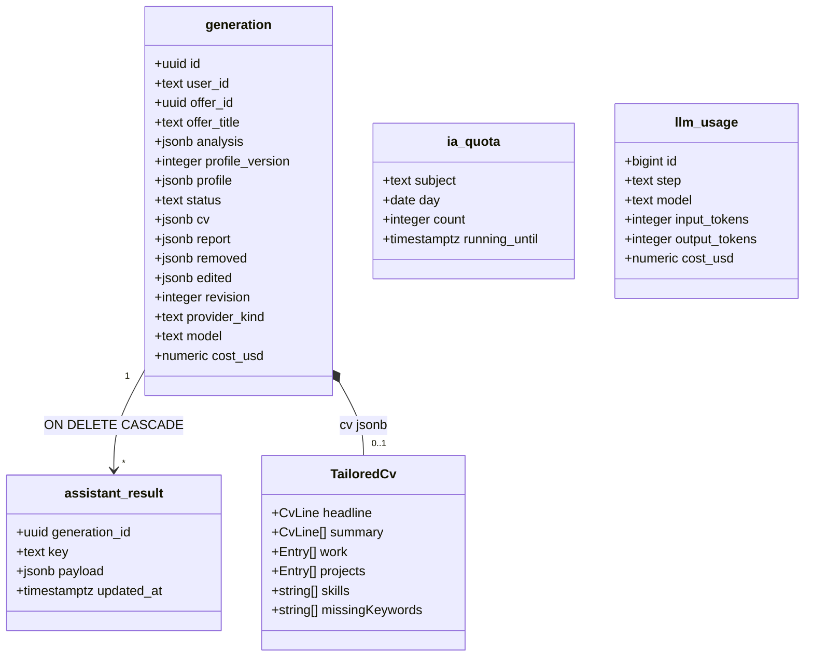
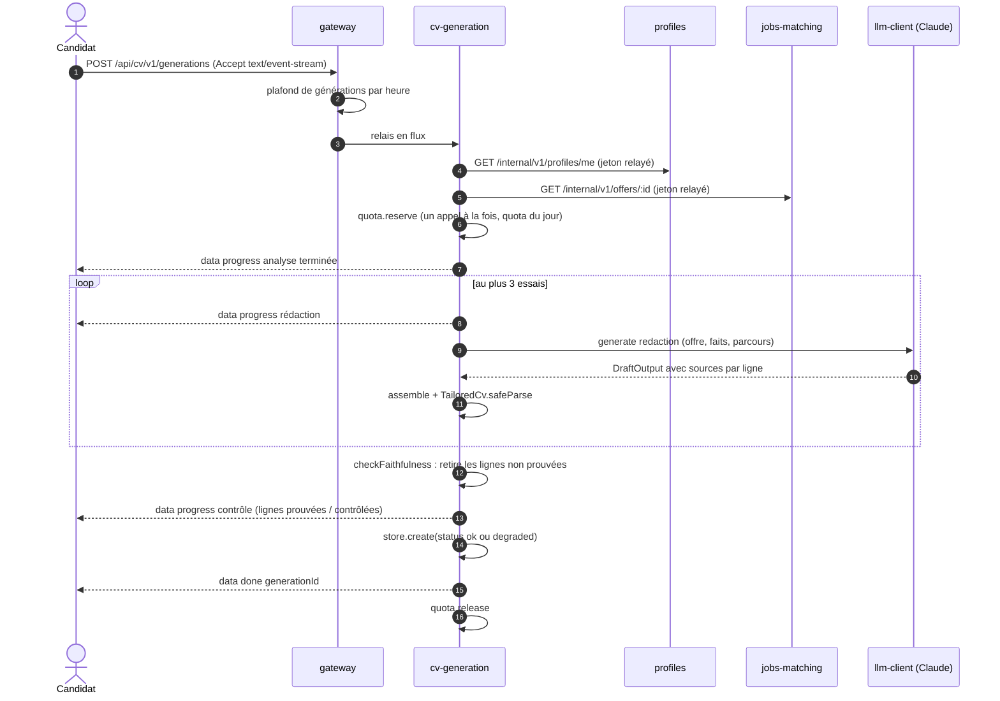
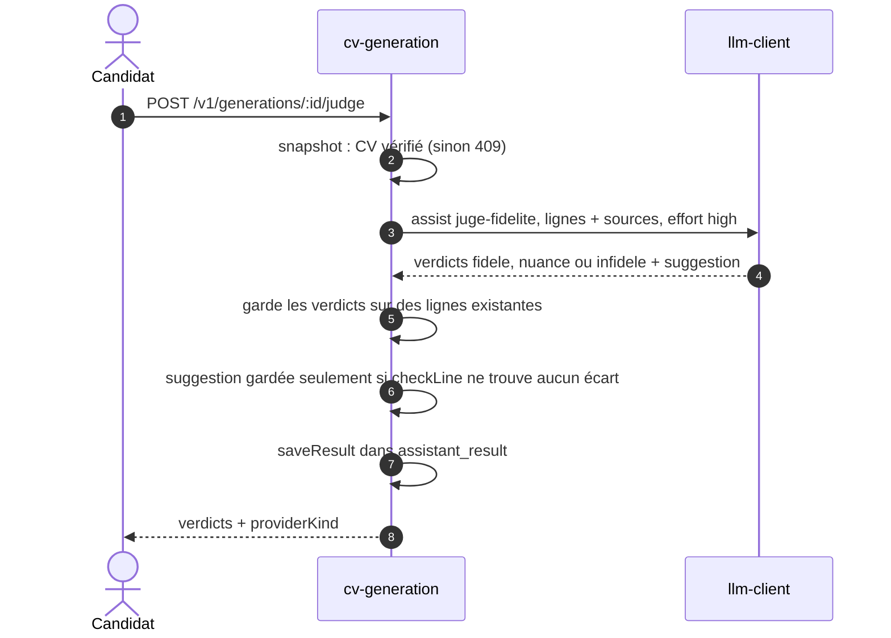

# Membre 3 — Ali Riahi · Génération de CV ciblés et contrôle de fidélité

> **Périmètre** : service `services/cv-generation` — génération d'un CV ciblé pour une offre, contrôle de
> fidélité ligne par ligne, corrections, assistants du CV (juge, coach, ATS, traduction, plan de progression).
> Toutes les affirmations renvoient à un fichier du dépôt (branche `chore/phase-2-socle`, 2026-10-26).

## 1. Partie CRUD

### Entité gérée : `generation` (CV ciblé généré)

Table créée par `services/cv-generation/migrations/1761000000000_cvgen.sql`.

| Attribut | Type SQL | Contraintes / rôle |
|---|---|---|
| `id` | `uuid` | clé primaire |
| `user_id` | `text` | 1 à 80 caractères ; index `(user_id, created_at DESC)` |
| `offer_id`, `offer_title`, `offer_text` | `uuid`, `text`, `text` | instantané de l'offre (service `jobs-matching`) |
| `analysis` | `jsonb` | analyse de l'offre |
| `profile_version`, `profile` | `integer`, `jsonb` | instantané du profil source (service `profiles`) |
| `status` | `text` | `ok` ou `degraded` |
| `degraded_reason` | `text` | motif du mode dégradé |
| `cv` | `jsonb` | CV ciblé (`TailoredCv`), lignes avec leurs sources |
| `report` | `jsonb` | rapport de fidélité (score, lignes contrôlées) |
| `removed`, `edited` | `jsonb` | lignes écartées par le contrôle, lignes corrigées par le candidat |
| `revision` | `integer` | verrou optimiste des corrections |
| `provider_kind`, `model`, `pipeline_version` | `text` | `ia` ou `demo`, modèle, signature des prompts |
| `cost_usd` | `numeric(10,6)` | coût de la génération |
| `created_at`, `updated_at` | `timestamptz` | — |



Chaque ligne du CV (`CvLine`) porte `text` et `sources` : des pointeurs vers les faits du profil
(`packages/shared-schemas/src/pointer.ts`), par exemple `/work/0/highlights/1`.

### Opérations CRUD

Routes de `services/cv-generation/src/routes.ts`, publiques sous `/api/cv`.

| Opération | Méthode et route | Rôle requis | Validation |
|---|---|---|---|
| **Create** — générer un CV | `POST /v1/generations` | `candidate`, `admin`, `guest` | `GenerationCreate` = `{ offerId: uuid }` ; quota quotidien ; JSON ou flux SSE selon `Accept` |
| **Read** — liste | `GET /v1/generations` | idem | — |
| **Read** — détail | `GET /v1/generations/:id` | idem, propriétaire uniquement | `IdParam` ; 404 sinon |
| **Update** — corriger des lignes | `PATCH /v1/generations/:id/lines` | idem | `Corrections` (`revision`, chemins de lignes validés par regex, 500 caractères max) ; 409 si `revision` périmée |
| **Delete** — supprimer | `DELETE /v1/generations/:id` | idem | 204 / 404 |
| Read — statistiques | `GET /v1/admin/stats` | `admin` | — |

### Extrait de code commenté — corrections avec verrou optimiste

`services/cv-generation/src/routes.ts` (extrait de `PATCH /v1/generations/:id/lines`) :

```ts
const row = await own(res, id); // 404 si la génération n'appartient pas à l'utilisateur
if (row.status !== "ok" || !row.cv) {
  throw new AppError("generation_degradee", 409, "Cette génération n'a pas de CV reformulé à corriger.");
}
if (row.revision !== body.revision) throw conflict(); // le CV a changé depuis l'affichage
let corrected;
try {
  // Chaque ligne modifiée ou ajoutée repasse le contrôle de fidélité contre le profil et l'offre.
  corrected = applyCorrections({ cv: row.cv, edited: row.edited }, row.profile, row.offerText,
    body.lines, body.additions);
} catch (error) {
  if (error instanceof AdditionError) throw new AppError("ajout_refuse", 400, error.message);
  throw error;
}
// Écriture conditionnée par la révision (deuxième contrôle, en base).
const saved = await store.saveCorrections(me(res), id, body.revision, corrected);
if (!saved) throw conflict();
res.json(toDto(saved));
```

### Côté front

| Écran | Fichier | Rôle |
|---|---|---|
| Lancement de la génération | `frontend/src/pages/Builder.tsx` (« Générer le CV ciblé ») | progression lue en flux (`frontend/src/api/sse.ts`) |
| Liste et détail des CV | `frontend/src/pages/Generations.tsx` | « Mes CV ciblés », aperçu identique au PDF, lignes retirées, mots-clés absents |
| Studio des assistants | `frontend/src/pages/studio/Studio.tsx` et scènes `JudgeScene`, `CoachScene`, `AtsScene`, `TranslateScene`, `PlanScene` | juge, coach d'entretien, ATS, traduction, plan |
| Hub des assistants | `frontend/src/pages/assistants/GenerationAssistants.tsx`, `Hub.tsx` | accès aux assistants d'un CV |

## 2. Fonctionnalité avancée — pipeline de génération en flux avec contrôle de fidélité

### Besoin et fonctionnement

Produire un CV adapté à une offre **sans jamais ajouter de compétence ni de fait** (règle n° 5 de
`CLAUDE.md`). Pipeline (`src/pipeline.ts`, ADR 0003 amendé par ADR 0016) :

1. `prepare` récupère le profil (`profiles`) et l'offre analysée (`jobs-matching`) en relayant le jeton de
   l'utilisateur ; `reserved` réserve **atomiquement** le quota (un appel IA à la fois par utilisateur,
   `DAILY_QUOTA` générations par jour, 20 par défaut).
2. **Rédaction** : le modèle reçoit l'offre analysée, les faits du profil et le plan du parcours, chacun dans
   un bloc balisé ; il doit citer ses sources pour chaque ligne.
3. **Contrat** : la sortie assemblée est validée par le schéma strict `TailoredCv` ; en cas d'écart, 2
   relances bornées avec la liste exacte des erreurs (`z.prettifyError`) ; plafond de coût par CV
   (`MAX_COST_PER_CV_USD`, 0,5 $).
4. **Contrôle de fidélité** (`checkFaithfulness`, `src/faithfulness.ts`) : chaque ligne est vérifiée
   (nombres, dates, entités, compétences, sources introuvables ou étrangères) ; les lignes non prouvées sont
   **retirées** et listées.
5. Toute panne aboutit au **mode dégradé** (`status = degraded`), jamais à une sortie non validée.
6. La progression est envoyée en **Server-Sent Events** (`text/event-stream`), relayée sans tampon par la
   gateway ; si le navigateur se déconnecte, la génération est annulée (`AbortController`).



### Extraits de code clés

Contrôle de fidélité (`services/cv-generation/src/faithfulness.ts`) :

```ts
export function checkFaithfulness(cv: TailoredCv, profile: Profile, offerText = ""): FaithfulnessOutcome {
  const ctx = lineContext(profile, cv.missingKeywords, offerText);
  const unresolvedRefs = new Set(findUnresolvedRefs(cv, profile)); // sources qui ne pointent sur rien
  const checked = cvLines(cv).map(({ path, line }) => {
    const issues = checkLine(line, ctx, entryOf(path));          // nombres, dates, entités, compétences
    return { path, line, issues, status: issues.length ? ("unsupported" as const) : ("supported" as const) };
  });
  const supported = checked.filter((c) => c.status === "supported").length;
  const report = { score: checked.length ? supported / checked.length : 1, /* … */ };
  // CV dont les lignes non prouvées ont été retirées (décision Q9).
  const rejected = new Set(checked.filter((c) => c.status === "unsupported").map((c) => c.line));
  // … reconstruction de headline, summary, work, projects, skills sans les lignes rejetées
  return { report, cv: cleaned, removed };
}
```

Relance bornée sur écart au contrat (`services/cv-generation/src/pipeline.ts`) :

```ts
const parsed = TailoredCv.safeParse(assemble(output, profile, missing));
if (parsed.success) return parsed.data;
if (attempt > MAX_SCHEMA_RETRIES) break;
// Relance bornée : le modèle reçoit sa réponse et la liste exacte des écarts au contrat.
messages.push(
  { role: "assistant", content: JSON.stringify(output) },
  { role: "user", content: `Ta réponse ne respecte pas le contrat. Corrige uniquement ces points et renvoie l'objet complet :\n${z.prettifyError(parsed.error)}` },
);
```

### Difficultés rencontrées et solutions

| Difficulté | Solution dans le code |
|---|---|
| Le modèle oublie des expériences | `assemble` réinjecte à l'identique les entrées non reprises (« aucune expérience … n'est perdue ») |
| Contournements du contrôle (alias, nombres en lettres, unités) | campagne de tests dédiée `faithfulness-campagne.test.ts` (144 tests : alias, « nombres écrits en lettres », « 40 % ne prouve pas 40 mois ») |
| Coût incontrôlé en cas de relances | budget par CV `maxCostUsd` vérifié avant chaque relance (`guardBudget`) |
| Double clic / générations concurrentes | réservation atomique (`ia_quota`, `running_until`) : 409 « Une génération est déjà en cours » |
| Corrections concurrentes | colonne `revision` vérifiée deux fois (route et `saveCorrections`) |
| Proxy qui met en tampon le flux | en-tête `X-Accel-Buffering: no`, relais sans tampon par la gateway (ADR 0012, point 6) |

## 3. Assistant IA — rédaction et juge de fidélité

### Fonctionnalités et cas d'usage

| Étape | Version | Cas d'usage | Effort |
|---|---|---|---|
| `redaction` | v1 | rédiger le CV ciblé à partir des seuls faits du profil | `medium`, 16 000 jetons |
| `juge-fidelite` | v2 | expliquer ligne par ligne si la reformulation est fidèle, nuancée ou infidèle, et proposer une reformulation | `high`, 12 000 jetons |
| `coach-questions`, `coach-retour` | v2 | préparation d'entretien (méthode STAR) | — |
| `conseils-ats`, `traduction`, `plan-progression` | v1 / v2 | conseils ATS, traduction du CV, plan de progression | — |

Versions déclarées dans `src/pipeline.ts` et `src/assistants.ts` ; prompts dans `prompts/<étape>/vN.md`,
évaluation du juge rejouable (`evals/juge-fidelite.json`, `scripts/eval-juge.ts`).

### Modèle et API

> Fournisseur choisi par `AI_PROVIDER` (`createAiProvider`, `src/server.ts`) : Claude par défaut s’il est configuré, Groq, Gemini ou Ollama en option, avec repli automatique sur quota ou délai (ADR 0047, **statut proposé**, ajouté le 2026-10-26 ; détail dans la fiche du membre 1). En local, `demo` par défaut.

Claude via `@attesta/llm-client` ; `LLM_MODEL` par défaut `claude-opus-5-5` (`src/config.ts`) ; SDK
`@anthropic-ai/sdk` ^0.135.0 ; sorties structurées validées par Zod.

### Fonctionnement du juge de fidélité



Garde-fou (`services/cv-generation/src/assistants.ts`) :

```ts
// Garde-fou : une reformulation n'est proposée que si elle passe le contrôle de fidélité de la ligne.
const valid =
  v.verdict !== "fidele" &&
  text &&
  text !== line.text &&
  checkLine({ text, sources: line.sources }, ctx, entryRefOf(g.cv, v.path)).length === 0;
return { ...v, suggestion: valid ? text : null };
```

### Erreurs, coûts, limites, sécurité

- Génération : erreurs du modèle → mode dégradé avec motif (`indisponible`, `refus`, `budget`,
  `non-conforme`) ; le CV non adapté reste exportable.
- Assistants : `AssistUnavailableError` → **503** explicite, jamais de sortie non validée.
- Coûts : budget mensuel 9 € (`LLM_MONTHLY_BUDGET_EUR`), 0,5 $ par CV (`MAX_COST_PER_CV_USD`),
  60 appels/min (`server.ts`), 20 générations/jour/utilisateur (`DAILY_QUOTA`), coût stocké par génération.
- Journaux : score, nombre de lignes retirées, coût, durée — jamais le contenu du CV.
- Clés : variables d'environnement uniquement (`LLM_PROVIDER`, `LLM_MODEL`, `VERTEX_PROJECT_ID`,
  `VERTEX_REGION`, `QUOTA_SECRET`…), aucune valeur ici.

## 4. Partie Docker

### Dockerfile du service `cv-generation` (intégral, commenté)

```dockerfile
# syntax=docker/dockerfile:1.7
# Image du service cv-generation. Contexte de construction : la racine du dépôt, réduite par
# Dockerfile.dockerignore au dossier du service et aux paquets partagés (docs/adr/0023).
#   docker build -f services/cv-generation/Dockerfile -t attesta/cv-generation .

# » Étape 1 « build » : image officielle Node 22 sur Debian 12 (bookworm), variante slim.
FROM node:22-bookworm-slim AS build
# » Répertoire qui reproduit l'arborescence du dépôt : les dépendances « file:../../packages/* » restent résolues.
WORKDIR /repo
# » Manifeste du paquet partagé @attesta/logger.
COPY packages/logger/package.json packages/logger/
# » @attesta/logger déjà compilé (dist/ versionné, ADR 0025) : rien à recompiler dans l'image.
COPY packages/logger/dist packages/logger/dist
# » Manifeste du paquet partagé @attesta/config.
COPY packages/config/package.json packages/config/
# » @attesta/config déjà compilé (dist/ versionné, ADR 0025) : rien à recompiler dans l'image.
COPY packages/config/dist packages/config/dist
# » Manifeste du paquet partagé @attesta/http-kit.
COPY packages/http-kit/package.json packages/http-kit/
# » @attesta/http-kit déjà compilé (dist/ versionné, ADR 0025) : rien à recompiler dans l'image.
COPY packages/http-kit/dist packages/http-kit/dist
# » Manifeste du paquet partagé @attesta/shared-schemas.
COPY packages/shared-schemas/package.json packages/shared-schemas/
# » @attesta/shared-schemas déjà compilé (dist/ versionné, ADR 0025) : rien à recompiler dans l'image.
COPY packages/shared-schemas/dist packages/shared-schemas/dist
# » Manifeste du paquet partagé @attesta/llm-client.
COPY packages/llm-client/package.json packages/llm-client/
# » @attesta/llm-client déjà compilé (dist/ versionné, ADR 0025) : rien à recompiler dans l'image.
COPY packages/llm-client/dist packages/llm-client/dist
# » Construction dans le seul dossier de l'unité services/cv-generation (autonomie des services, ADR 0023).
WORKDIR /repo/services/cv-generation
# » Manifestes et lockfile seuls d'abord : la couche « npm ci » reste en cache tant qu'ils ne changent pas.
COPY services/cv-generation/package.json services/cv-generation/package-lock.json services/cv-generation/.npmrc ./
# Cache npm partagé entre les builds, reprises réseau : une relance réutilise les paquets déjà téléchargés.
# » Installation reproductible (lockfile), cache npm BuildKit partagé entre builds, reprises réseau.
RUN --mount=type=cache,target=/root/.npm npm ci --no-audit --no-fund --fetch-retries=5 --fetch-retry-maxtimeout=120000
# » Configuration de compilation (TypeScript, et Vite pour le frontend).
COPY services/cv-generation/tsconfig.json services/cv-generation/tsconfig.build.json ./
# » Code source copié en dernier : modifier le code n'invalide pas le cache des dépendances.
COPY services/cv-generation/src src
# » Compilation TypeScript vers dist/, puis retrait des dépendances de développement.
RUN npm run build && npm prune --omit=dev

# » Étape 2 « runtime » : image neuve, sans sources TypeScript, sans compilateur ni dépendances de développement.
FROM node:22-bookworm-slim AS runtime
# » Mises à jour de sécurité Debian, puis suppression du cache apt et de npm/npx (inutiles à l'exécution, signalés par Trivy).
RUN apt-get update \
  && apt-get upgrade -y --no-install-recommends \
  && rm -rf /var/lib/apt/lists/* /usr/local/lib/node_modules/npm /usr/local/bin/npm /usr/local/bin/npx
# » Mode production et port d'écoute (pour letters-export : HOME et caches dans /tmp, chemin du Chromium système).
ENV NODE_ENV=production \
  PORT=4003
# » Dossier de l'application dans l'image finale.
WORKDIR /app
# » Seuls les artefacts utiles sont repris de l'étape build, propriété root : l'utilisateur d'exécution ne peut pas les modifier.
COPY --from=build --chown=root:root /repo/services/cv-generation/package.json ./
# » Dépendances de production uniquement (après npm prune).
COPY --from=build --chown=root:root /repo/services/cv-generation/node_modules node_modules
# » JavaScript compilé.
COPY --from=build --chown=root:root /repo/services/cv-generation/dist dist
# » Migrations SQL du service, appliquées au démarrage (MIGRATE_ON_START, vrai par défaut).
COPY --chown=root:root services/cv-generation/migrations migrations
# » Prompts versionnés (prompts/<étape>/vN.md), lus à l'exécution.
COPY --chown=root:root services/cv-generation/prompts prompts
# » Exécution sous l'utilisateur non-root « node » fourni par l'image officielle.
USER node
# » Port documenté du conteneur.
EXPOSE 4003
# » Sonde de santé : interroge /ready (ou /health) sans installer curl ; Docker marque le conteneur healthy ou unhealthy.
HEALTHCHECK --interval=10s --timeout=3s --start-period=20s --retries=5 \
  CMD ["node", "-e", "fetch('http://127.0.0.1:'+(process.env.PORT||4003)+'/ready').then(r=>process.exit(r.ok?0:1),()=>process.exit(1))"]
# » Démarrage direct de Node, sans npm : les signaux d'arrêt arrivent au processus (init: true dans compose).
CMD ["node", "dist/server.js"]
```

### Extrait de `compose.yaml` (variables : noms seulement)

```yaml
  cv-generation:
    <<: *service
    build: { context: ., dockerfile: services/cv-generation/Dockerfile }
    profiles: ["core", "full"]
    ports: ["${CV_GENERATION_PORT:-4003}:4003"]
    environment:
      <<: [*service-env, *ai-env]
      DATABASE_URL: …
      AUTH_JWKS_URL: …
      PROFILES_URL: …
      JOBS_MATCHING_URL: …
      QUOTA_SECRET: …
      DAILY_QUOTA: …
    depends_on:
      db-init: { condition: service_completed_successfully }
      auth: { condition: service_healthy }

# Ancre fusionnée par « <<: *service » (début de compose.yaml) :
x-service: &service
  init: true
  read_only: true
  tmpfs: ["/tmp"]
  cap_drop: [ALL]
  security_opt: ["no-new-privileges:true"]
  restart: unless-stopped
  environment: &service-env
    NODE_ENV: …
    LOG_LEVEL: …

# Ancre fusionnée par « *ai-env » (début de compose.yaml, ADR 0047) :
x-ai-env: &ai-env
  AI_PROVIDER: …
  LLM_PROVIDER: …
  CLAUDE_TRANSPORT: …
  AI_FALLBACK_PROVIDERS: …
  VERTEX_PROJECT_ID: …
  ANTHROPIC_API_KEY: …
  GROQ_API_KEY: …
  GROQ_MODEL: …
  GEMINI_API_KEY: …
  GEMINI_MODEL: …
  OLLAMA_BASE_URL: …
  OLLAMA_MODEL: …
```

- **Port** : 4003 (`CV_GENERATION_PORT`). **Volumes** : aucun. **Réseau** : réseau par défaut du projet.
- **depends_on** : `db-init` terminé, `auth` *healthy*. Appelle `profiles` et `jobs-matching` par leur nom DNS.
- La gateway accorde 180 s à ce service (`gateway/src/routing.ts`), la génération pouvant être longue.

### Commandes

```bash
docker build -f services/cv-generation/Dockerfile -t attesta/cv-generation .
docker compose --profile core up -d --build --wait cv-generation
```

### Justification

Modèle commun (voir fiche 1). Spécificité : `prompts/` copié dans l'image, car les prompts versionnés sont
lus à l'exécution ; aucun binaire système supplémentaire.

## 5. Stack et justifications

| Partie | Technologie | Version | Rôle | Justification | Alternative écartée et pourquoi |
|---|---|---|---|---|---|
| CRUD | Express | ^5.3.0 | API, flux SSE | réponse en flux native (`res.write`) | à confirmer |
| CRUD | PostgreSQL `jsonb` (`pg`) | ^8.23.1 | générations, quotas, résultats d'assistants | instantanés JSON + verrou optimiste | une instance par service : ~1 Go de RAM locale (ADR 0013, option B) |
| CRUD | Zod | ^4.6.7 | `TailoredCv`, `Corrections` | contrat strict qui valide la sortie du modèle | — |
| Avancée | Server-Sent Events | HTTP | progression de la génération | flux unidirectionnel lu par `fetch` (ADR 0012, point 6) | à confirmer : WebSocket non documenté |
| Avancée | pg-boss | — | file de jobs | **reporté** : génération liée à la requête, annulée si le navigateur se déconnecte (ADR 0003) | Redis/BullMQ : aucun besoin de débit (ADR 0004) |
| IA | @attesta/llm-client (SDK Anthropic) | ^0.135.0 | rédaction, juge, assistants | sorties structurées | Mistral, Bedrock (ADR 0008) |
| Docker | node:22-bookworm-slim | Node 22 | image de base | voir fiche 1 | — |
| Tests | Vitest, fast-check, supertest, Stryker | ^5.0.5, ^4.10.2, ^7.3.1, ^10.1.1 | tests et mutation | outillage commun | — |

## 6. Tests

| Fichier | Tests | Ce qu'il couvre |
|---|---|---|
| `services/cv-generation/tests/faithfulness-campagne.test.ts` | 144 | alias d'écriture, nombres en lettres, ordres de grandeur, unités, propriétés fast-check |
| `services/cv-generation/tests/faithfulness.test.ts` | 20 | `checkLine`, contournements relevés en relecture, `missingKeywords`, `checkFaithfulness` |
| `services/cv-generation/tests/pipeline.test.ts` | 12 | pipeline de génération (fournisseur scripté) |
| `services/cv-generation/tests/app.test.ts` | 14 | génération, relecture et corrections, interne, RGPD, administration (intégration PostgreSQL) |
| `services/cv-generation/tests/upstreams.test.ts` | 2 | appels aux services amont avec jeton relayé |
| `config`, `db`, `openapi` | 2 + 3 + 2 | configuration, migrations, contrat OpenAPI |

```bash
cd services/cv-generation && npx vitest run --coverage
```

Résultats obtenus le 2026-10-26 (Node 22.18.0, PostgreSQL local) :

- passage complet avec les 8 unités en série : **198/199**, un test de propriétés
  (`faithfulness-campagne.test.ts`, « normalize : idempotente ») a dépassé le délai de 5 000 ms sous charge ;
- fichier relancé seul : **144/144** ; suite relancée seule : **199/199 réussis**.
- Couverture des lignes : **56,19 %**, **sous le seuil de 80 %** de `vitest.config.ts` (commande en échec,
  code 1, malgré des tests verts).

**Seconde passe** (14 h 07–14 h 14, après l’ajout des fournisseurs de l’ADR 0047 dans le répertoire de travail) : 199/199 réussis, couverture 56,32 %.
