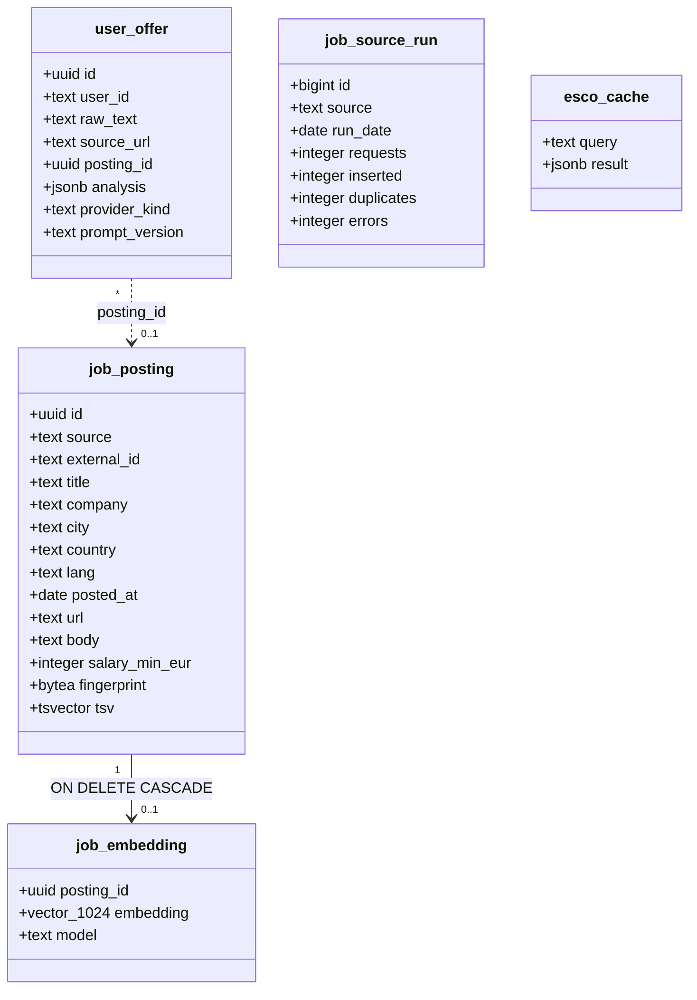
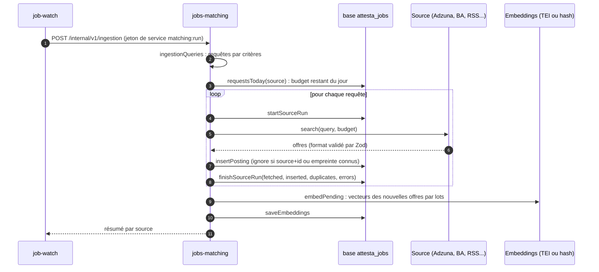
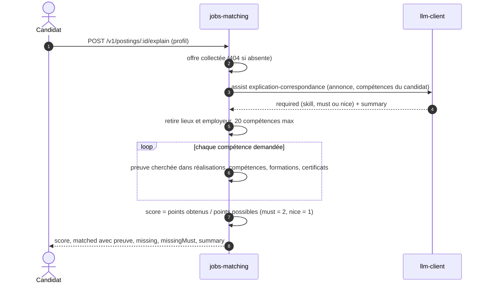

# Membre 4 — Ahmed Chaouch · Offres d'emploi et correspondance

> **Périmètre** : service `services/jobs-matching` — offres saisies par le candidat et analysées, catalogue
> d'offres collectées auprès de plusieurs sources, recherche, explication de correspondance.
> Le classement sémantique utilisé par la veille (vecteurs, fusion RRF, reclassement) est présenté par le
> membre 6, qui l'exploite.
> Toutes les affirmations renvoient à un fichier du dépôt (branche `chore/phase-2-socle`, 2026-10-26).

## 1. Partie CRUD

### Entité gérée : `user_offer` (offre visée par le candidat)

Table créée par `services/jobs-matching/migrations/1761000000000_jobs.sql`.

| Attribut | Type SQL | Contraintes |
|---|---|---|
| `id` | `uuid` | clé primaire |
| `user_id` | `text` | 1 à 80 caractères ; index `(user_id, created_at DESC)` |
| `raw_text` | `text` | texte collé de l'annonce, 50 à 20 000 caractères |
| `source_url` | `text` | facultatif (URL validée par `WebUrl`) |
| `posting_id` | `uuid` | facultatif : offre importée depuis le catalogue collecté |
| `analysis` | `jsonb` | analyse de l'offre (titre, entreprise, exigences, mots-clés) |
| `provider_kind` | `text` | `ia` ou `demo` (analyse sans IA) |
| `prompt_version` | `text` | signature du prompt (`analyse-offre@v1`) |
| `created_at` | `timestamptz` | `now()` |

Validation d'entrée : `JobOfferInput` (`packages/shared-schemas/src/offer.ts`) — `rawText` 50 à 20 000
caractères (« L'offre semble trop courte : collez le texte complet de l'annonce »), `sourceUrl` facultatif.



`job_posting` est unique par `(source, external_id)` et par `fingerprint` (doublons inter-sources) ; la colonne
`tsv` est générée selon la langue (`german`, `french`, sinon `simple`) et indexée en GIN.

### Opérations CRUD

Routes de `services/jobs-matching/src/routes.ts`, publiques sous `/api/jobs`.

| Opération | Méthode et route | Rôle requis | Validation |
|---|---|---|---|
| **Create** — offre collée | `POST /v1/offers` | `candidate`, `admin`, `guest` | `JobOfferInput` ; analyse IA ou sans IA ; 201 |
| **Create** — depuis le catalogue | `POST /v1/offers/from-posting/:id` | idem | `IdParam` ; 404 si l'offre collectée n'existe plus |
| **Read** — liste | `GET /v1/offers` | idem | — |
| **Read** — détail | `GET /v1/offers/:id` | idem, propriétaire | 404 sinon |
| **Update** | *aucune route* | — | une offre analysée est un instantané : on la supprime puis on la recrée |
| **Delete** | `DELETE /v1/offers/:id` | idem, propriétaire | 204 / 404 |
| Read — catalogue | `GET /v1/postings`, `GET /v1/postings/overview` | idem | filtres pays, ville, texte |
| Admin — synchroniser le catalogue | `POST /v1/admin/catalogue` | `admin` | — |

### Extrait de code commenté — création d'une offre avec repli sans IA

`services/jobs-matching/src/routes.ts` :

```ts
/**
 * Analyse par le modèle ; en cas de panne, de refus ou de budget atteint, analyse sans IA (mode dégradé,
 * signalé par `providerKind`) : l'offre reste utilisable.
 */
async function analysed(text: string) {
  if (llm) {
    try {
      return { analysis: await analyseOffer(llm, text), providerKind: llm.kind };
    } catch (error) {
      logger.warn({ event: "analyse_degradee", errorType: (error as Error)?.name }, "analyse d'offre");
    }
  }
  return { analysis: toOfferAnalysis(demoAnalysis(text)), providerKind: "demo" as const };
}

async function createOffer(res: Response, input: { rawText: string; sourceUrl?: string; postingId?: string }) {
  const { analysis, providerKind } = await analysed(input.rawText);
  // La signature du prompt est enregistrée avec l'offre : une analyse reste traçable.
  const row = await repo.createOffer(me(res), input, analysis, providerKind, prompts.signature("analyse-offre"));
  logger.info({ event: "offre_analysee", keywords: analysis.keywords.length, providerKind }, "offres");
  res.status(201).json(toDto(row));
}
```

### Côté front

| Écran | Fichier | Rôle |
|---|---|---|
| Offres (liste, ajout, suppression) et offres collectées (recherche) | `frontend/src/pages/Offers.tsx` (routes `/offres`, `/offres/collectees`) | « Offres », « Aucune offre pour cette recherche » |
| Étape « Offre visée » du parcours | `frontend/src/pages/Builder.tsx` | coller une annonce ou choisir une offre collectée |
| Outils | `frontend/src/lib/offer.ts` | présentation d'une offre |

## 2. Fonctionnalité avancée — collecte multi-sources et recherche lexicale

### Besoin et fonctionnement

Constituer un catalogue d'offres réelles (France, Allemagne, Tunisie selon les sources) sans dépasser les quotas
des fournisseurs et sans doublons (ADR 0007, 0031, 0034, 0035).

- **Sources** (`src/sources/`) : Adzuna, Arbeitnow, Bundesagentur für Arbeit (`ba.ts`), Jooble, flux RSS
  tunisiens, sites carrière d’employeurs via les API publiques Greenhouse, Lever et SmartRecruiters (`employers.ts`), outils de filtrage communs (`places.ts`) ; activables et plafonnées par
  variables (`*_ENABLED`, `*_DAILY_REQUESTS`).
- **Budgets journaliers** par source, partagés entre toutes les requêtes (`runQueries`, `ingestion.ts`) ;
  une source en erreur est journalisée **sans contenu ni URL** (une clé d'API peut y figurer).
- **Déduplication** : `(source, external_id)` unique et empreinte `fingerprint` unique ; un doublon est
  compté (`duplicates`), pas inséré.
- **Recherche lexicale** : `websearch_to_tsquery` en français, allemand et anglais, classement
  `ts_rank_cd` (`repository.ts`). L'ADR 0004 précise que ce n'est **pas BM25**.
- **Vectorisation** des nouvelles offres par lots (`embedPending`), exploitée par la veille (membre 6).
- Lancement : `POST /internal/v1/ingestion` (jeton de service portée `matching:run`, appelé par `job-watch`)
  et synchronisation périodique du catalogue (`CATALOGUE_SYNC_HOURS`).



### Extrait de code clé

`services/jobs-matching/src/ingestion.ts` (extrait de `runQueries`) :

```ts
for (const source of deps.sources) {
  const used = await deps.repo.requestsToday(source.id, date);
  const left = Math.max(0, (deps.dailyRequestLimits[source.id] ?? 0) - used);
  // `share` : part du quota restant que ces requêtes peuvent consommer (le catalogue en laisse aux veilles).
  budgets.set(source.id, new RequestBudget(Math.floor(left * share)));
}
for (const { source, query } of queries) {
  // …
  try {
    for await (const posting of source.search(query, { isKnown: (id) => deps.repo.isKnown(source.id, id), onSkip: () => run.errors++, budget })) {
      run.fetched++;
      if (await deps.repo.insertPosting(posting)) run.inserted++;
      else run.duplicates++; // même source ou même empreinte
    }
  } catch (error) {
    run.errors++;
    // Format inattendu (Zod) ou source en erreur : journalisé sans contenu ni URL (clé d'API possible).
    deps.logger.error({ event: "ingestion_erreur", source: source.id, errorType: (error as Error).name }, "source en erreur");
  }
}
```

### Difficultés rencontrées et solutions

| Difficulté | Solution dans le code |
|---|---|
| Quotas des API d'offres | budgets journaliers par source, part réservée aux veilles (`share`) |
| Même offre publiée sur plusieurs sites | empreinte `fingerprint` unique |
| Formats de sources qui changent | validation Zod de chaque réponse ; source en erreur isolée |
| Offres multilingues (FR, DE, EN) | `tsvector` généré par langue, requêtes dans les trois langues |
| Lieux et mentions de contrat pris pour des compétences | listes `NOT_SKILLS` et `placeNames` (`analysis.ts`) |
| Limite reconnue | `ts_rank_cd` n'est pas BM25 ; passage à une autre option seulement si l'écart est mesuré (ADR 0004) |

## 3. Assistant IA — analyse d'offre et explication de correspondance

### Fonctionnalités et cas d'usage

| Étape | Version | Cas d'usage | Code |
|---|---|---|---|
| `analyse-offre` | v1 | extraire titre, entreprise, exigences et mots-clés d'une annonce collée | `src/analysis.ts`, `analyseOffer` |
| `explication-correspondance` | v2 | expliquer pourquoi une offre collectée correspond (ou non) au profil | `src/explain.ts`, `explainMatch` |

### Modèle et API

> Fournisseur choisi par `AI_PROVIDER` (`createAiProvider`, `src/server.ts`) : Claude par défaut s’il est configuré, Groq, Gemini ou Ollama en option, avec repli automatique sur quota ou délai (ADR 0047, **statut proposé**, ajouté le 2026-10-26 ; détail dans la fiche du membre 1). En local, `demo` par défaut.

Claude via `@attesta/llm-client` ; `LLM_MODEL` par défaut `claude-opus-5-5` (`src/config.ts`) ; SDK
`@anthropic-ai/sdk` ^0.135.0 ; effort `low`, 8 000 jetons pour l'analyse.

### Fonctionnement — l'IA repère, le code décide

Pour l'explication, l'IA liste les compétences demandées par l'annonce (`must` ou `nice`) et rédige une
synthèse ; **le code** cherche une preuve de chaque compétence dans le profil et calcule le score pondéré
(une exigence compte double). L'IA ne peut donc pas « gonfler » une correspondance (commentaire de
`explain.ts`, ADR 0028, rôle 5).



Analyse avec cache (`services/jobs-matching/src/analysis.ts`) :

```ts
export async function analyseOffer(provider: LlmProvider, offerText: string, signal?: AbortSignal) {
  // Clé de cache : modèle + version du prompt + empreinte SHA-256 du texte (500 entrées max).
  const key = `${provider.model}:${prompts.signature("analyse-offre")}:${createHash("sha256").update(offerText).digest("hex")}`;
  const cached = cache.get(key);
  if (cached) return cached;
  for (let attempt = 0; attempt <= MAX_SCHEMA_RETRIES; attempt++) {
    try {
      const { data } = await provider.generate({
        step: "analyse-offre",
        system: prompts.system("analyse-offre"),
        messages: [{ role: "user", content: dataBlock("offre", { texte: offerText }) }], // donnée balisée
        schema: OfferAnalysisOutput, effort: "low", maxTokens: 8000, input: { offerText }, signal,
      });
      // … mise en cache puis retour
    } catch (error) {
      if (!(error instanceof LlmSchemaError)) throw error; // seule une sortie non conforme est relancée
    }
  }
}
```

### Erreurs, coûts, limites, sécurité

- Analyse : en cas d'échec, analyse **sans IA** (`demoAnalysis`) signalée par `providerKind = demo`.
- Explication : `AssistUnavailableError` → **503** explicite. Les scores d'une liste
  (`POST /v1/postings/scores`) sont calculés **par le code seul**, sans appel au modèle (ADR 0029).
- Coûts : budget mensuel 4 € (`LLM_MONTHLY_BUDGET_EUR`), 60 appels/min, cache des analyses identiques.
- Clés : variables d'environnement uniquement (`LLM_PROVIDER`, `LLM_MODEL`, `ADZUNA_APP_ID`,
  `ADZUNA_APP_KEY`, `JOOBLE_API_KEY`…) ; d'après `compose.yaml`, les clés des sources sont fournies par un
  `--env-file` jamais versionné. Aucune valeur ici.

## 4. Partie Docker

### Dockerfile du service `jobs-matching` (intégral, commenté)

```dockerfile
# syntax=docker/dockerfile:1.7
# Image du service jobs-matching. Contexte de construction : la racine du dépôt, réduite par
# Dockerfile.dockerignore au dossier du service et aux paquets partagés (docs/adr/0023).
#   docker build -f services/jobs-matching/Dockerfile -t attesta/jobs-matching .

# » Étape 1 « build » : image officielle Node 22 sur Debian 12 (bookworm), variante slim.
FROM node:22-bookworm-slim AS build
# » Répertoire qui reproduit l'arborescence du dépôt : les dépendances « file:../../packages/* » restent résolues.
WORKDIR /repo
# » Manifeste du paquet partagé @attesta/logger.
COPY packages/logger/package.json packages/logger/
# » @attesta/logger déjà compilé (dist/ versionné, ADR 0025) : rien à recompiler dans l'image.
COPY packages/logger/dist packages/logger/dist
# » Manifeste du paquet partagé @attesta/config.
COPY packages/config/package.json packages/config/
# » @attesta/config déjà compilé (dist/ versionné, ADR 0025) : rien à recompiler dans l'image.
COPY packages/config/dist packages/config/dist
# » Manifeste du paquet partagé @attesta/http-kit.
COPY packages/http-kit/package.json packages/http-kit/
# » @attesta/http-kit déjà compilé (dist/ versionné, ADR 0025) : rien à recompiler dans l'image.
COPY packages/http-kit/dist packages/http-kit/dist
# » Manifeste du paquet partagé @attesta/shared-schemas.
COPY packages/shared-schemas/package.json packages/shared-schemas/
# » @attesta/shared-schemas déjà compilé (dist/ versionné, ADR 0025) : rien à recompiler dans l'image.
COPY packages/shared-schemas/dist packages/shared-schemas/dist
# » Manifeste du paquet partagé @attesta/llm-client.
COPY packages/llm-client/package.json packages/llm-client/
# » @attesta/llm-client déjà compilé (dist/ versionné, ADR 0025) : rien à recompiler dans l'image.
COPY packages/llm-client/dist packages/llm-client/dist
# » Construction dans le seul dossier de l'unité services/jobs-matching (autonomie des services, ADR 0023).
WORKDIR /repo/services/jobs-matching
# » Manifestes et lockfile seuls d'abord : la couche « npm ci » reste en cache tant qu'ils ne changent pas.
COPY services/jobs-matching/package.json services/jobs-matching/package-lock.json services/jobs-matching/.npmrc ./
# Cache npm partagé entre les builds, reprises réseau : une relance réutilise les paquets déjà téléchargés.
# » Installation reproductible (lockfile), cache npm BuildKit partagé entre builds, reprises réseau.
RUN --mount=type=cache,target=/root/.npm npm ci --no-audit --no-fund --fetch-retries=5 --fetch-retry-maxtimeout=120000
# » Configuration de compilation (TypeScript, et Vite pour le frontend).
COPY services/jobs-matching/tsconfig.json services/jobs-matching/tsconfig.build.json ./
# » Code source copié en dernier : modifier le code n'invalide pas le cache des dépendances.
COPY services/jobs-matching/src src
# » Compilation TypeScript vers dist/, puis retrait des dépendances de développement.
RUN npm run build && npm prune --omit=dev

# » Étape 2 « runtime » : image neuve, sans sources TypeScript, sans compilateur ni dépendances de développement.
FROM node:22-bookworm-slim AS runtime
# » Mises à jour de sécurité Debian, puis suppression du cache apt et de npm/npx (inutiles à l'exécution, signalés par Trivy).
RUN apt-get update \
  && apt-get upgrade -y --no-install-recommends \
  && rm -rf /var/lib/apt/lists/* /usr/local/lib/node_modules/npm /usr/local/bin/npm /usr/local/bin/npx
# » Mode production et port d'écoute (pour letters-export : HOME et caches dans /tmp, chemin du Chromium système).
ENV NODE_ENV=production \
  PORT=4004
# » Dossier de l'application dans l'image finale.
WORKDIR /app
# » Seuls les artefacts utiles sont repris de l'étape build, propriété root : l'utilisateur d'exécution ne peut pas les modifier.
COPY --from=build --chown=root:root /repo/services/jobs-matching/package.json ./
# » Dépendances de production uniquement (après npm prune).
COPY --from=build --chown=root:root /repo/services/jobs-matching/node_modules node_modules
# » JavaScript compilé.
COPY --from=build --chown=root:root /repo/services/jobs-matching/dist dist
# » Migrations SQL du service, appliquées au démarrage (MIGRATE_ON_START, vrai par défaut).
COPY --chown=root:root services/jobs-matching/migrations migrations
# » Prompts versionnés (prompts/<étape>/vN.md), lus à l'exécution.
COPY --chown=root:root services/jobs-matching/prompts prompts
# » Référentiels JSON (villes, employeurs) lus à l'exécution.
COPY --chown=root:root services/jobs-matching/data data
# » Exécution sous l'utilisateur non-root « node » fourni par l'image officielle.
USER node
# » Port documenté du conteneur.
EXPOSE 4004
# » Sonde de santé : interroge /ready (ou /health) sans installer curl ; Docker marque le conteneur healthy ou unhealthy.
HEALTHCHECK --interval=10s --timeout=3s --start-period=20s --retries=5 \
  CMD ["node", "-e", "fetch('http://127.0.0.1:'+(process.env.PORT||4004)+'/ready').then(r=>process.exit(r.ok?0:1),()=>process.exit(1))"]
# » Démarrage direct de Node, sans npm : les signaux d'arrêt arrivent au processus (init: true dans compose).
CMD ["node", "dist/server.js"]
```

### Extrait de `compose.yaml` (variables : noms seulement)

```yaml
  jobs-matching:
    <<: *service
    build: { context: ., dockerfile: services/jobs-matching/Dockerfile }
    profiles: ["core", "full"]
    ports: ["${JOBS_MATCHING_PORT:-4004}:4004"]
    environment:
      <<: [*service-env, *ai-env]
      DATABASE_URL: …
      AUTH_JWKS_URL: …
      EMBEDDINGS_PROVIDER: …
      TEI_URL: …
      ADZUNA_APP_ID: …
      ADZUNA_APP_KEY: …
      JOOBLE_API_KEY: …
    depends_on:
      db-init: { condition: service_completed_successfully }
      auth: { condition: service_healthy }

# Ancre fusionnée par « <<: *service » (début de compose.yaml) :
x-service: &service
  init: true
  read_only: true
  tmpfs: ["/tmp"]
  cap_drop: [ALL]
  security_opt: ["no-new-privileges:true"]
  restart: unless-stopped
  environment: &service-env
    NODE_ENV: …
    LOG_LEVEL: …

# Ancre fusionnée par « *ai-env » (début de compose.yaml, ADR 0047) :
x-ai-env: &ai-env
  AI_PROVIDER: …
  LLM_PROVIDER: …
  CLAUDE_TRANSPORT: …
  AI_FALLBACK_PROVIDERS: …
  VERTEX_PROJECT_ID: …
  ANTHROPIC_API_KEY: …
  GROQ_API_KEY: …
  GROQ_MODEL: …
  GEMINI_API_KEY: …
  GEMINI_MODEL: …
  OLLAMA_BASE_URL: …
  OLLAMA_MODEL: …
```

Service optionnel associé (profil `tei`) :

```yaml
  tei:
    image: ghcr.io/huggingface/text-embeddings-inference:cpu-1.8
    profiles: ["tei"]
    command: ["--model-id", "BAAI/bge-m3", "--max-client-batch-size", "32"]
    volumes:
      - tei-models:/data
```

- **Port** : 4004 (`JOBS_MATCHING_PORT`). **Volumes** : aucun pour le service ; `tei-models` pour TEI.
- **Réseau** : réseau par défaut ; TEI est joint par `http://tei:80`.
- **depends_on** : `db-init` terminé, `auth` *healthy*.

### Commandes

```bash
docker build -f services/jobs-matching/Dockerfile -t attesta/jobs-matching .
docker compose --profile core up -d --build --wait jobs-matching
docker compose --profile tei up -d tei     # vecteurs BGE-M3 réels (2 Go au premier lancement)
```

### Justification

Modèle commun (voir fiche 1). Spécificités : `prompts/` et `data/` (villes, employeurs) copiés dans l'image ;
le modèle d'embeddings tourne dans un conteneur séparé (TEI, image CPU), ce qui garde l'image du service légère.

## 5. Stack et justifications

| Partie | Technologie | Version | Rôle | Justification | Alternative écartée et pourquoi |
|---|---|---|---|---|---|
| CRUD | Express | ^5.3.0 | API | socle commun | à confirmer |
| CRUD | PostgreSQL (`pg`) | ^8.23.1 | offres, catalogue | SQL explicite (ADR 0004) | — |
| Avancée | PostgreSQL plein texte (`tsvector`, `ts_rank_cd`) | image `pgvector/pgvector:0.8.0-pg16` | recherche lexicale | dans la même base, sans service en plus | BM25 (autre moteur) : seulement si l'écart est mesurable (ADR 0004) |
| Avancée | pgvector (`vector(1024)`, index HNSW) | 0.8.0 | vecteurs des offres | même base que les offres | à confirmer : base vectorielle dédiée non documentée |
| Avancée | API d'offres (Adzuna, Arbeitnow, BA, Jooble, RSS) | — | collecte | sources publiques ou sous clé (ADR 0031, 0035) | lecture de pages au-delà des flux : exclue (ADR 0035) |
| IA | @attesta/llm-client (SDK Anthropic) | ^0.135.0 | analyse, explication | sorties structurées | Mistral, Bedrock (ADR 0008) |
| Docker | node:22-bookworm-slim, TEI `cpu-1.8` | Node 22 / 1.8 | images | voir fiche 1 | — |
| Tests | Vitest, fast-check, supertest | ^5.0.5, ^4.10.2, ^7.3.1 | tests | outillage commun | — |

## 6. Tests

| Fichier | Tests | Ce qu'il couvre |
|---|---|---|
| `services/jobs-matching/tests/app.test.ts` | 15 | offres des candidats, référentiel et offres collectées, collecte et classement (jeton de service), RGPD (intégration PostgreSQL) |
| `services/jobs-matching/tests/units.test.ts` | 31 | texte des offres, géographie, fusion RRF, anonymisation |
| `services/jobs-matching/tests/places.test.ts` | 30 | reconnaissance des villes (boîte blanche), propriétés fast-check |
| `services/jobs-matching/tests/sources.test.ts` | 10 | Arbeitnow et flux RSS tunisiens (API simulées) |
| `config`, `db`, `openapi` | 2 + 3 + 2 | configuration, migrations, contrat OpenAPI |

```bash
cd services/jobs-matching && npx vitest run --coverage
```

Résultat obtenu le 2026-10-26 (Node 22.18.0, PostgreSQL local) : **93/93 tests réussis** (7 fichiers).
Couverture des lignes : **73,34 %**, **sous le seuil de 80 %** de `vitest.config.ts` (commande en échec, code 1,
malgré des tests verts).

**Seconde passe** (14 h 07–14 h 14, après l’ajout des fournisseurs de l’ADR 0047 dans le répertoire de travail) : 93/93 réussis, couverture 73,39 %.
