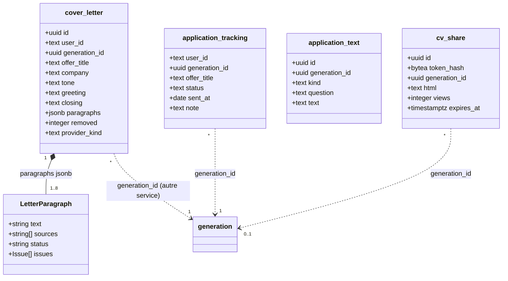
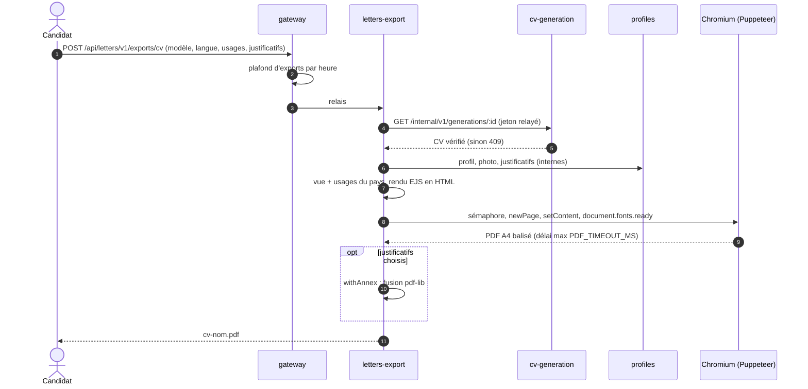
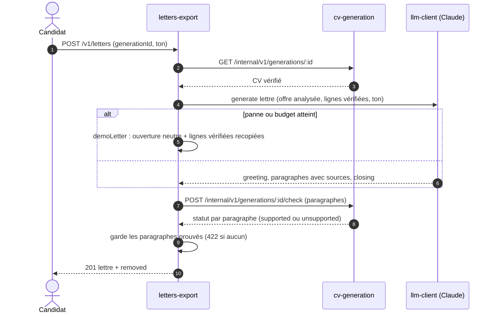

# Membre 5 — Neila Jribi · Lettres de motivation et exports

> **Périmètre** : service `services/letters-export` — lettres de motivation vérifiées, export du CV (PDF,
> Word, aperçu HTML), CV en ligne partagé, suivi des candidatures, rapports PDF de la veille.
> Toutes les affirmations renvoient à un fichier du dépôt (branche `chore/phase-2-socle`, 2026-10-26).

## 1. Partie CRUD

### Entité gérée : `cover_letter` (lettre de motivation)

Table créée par `services/letters-export/migrations/1761000000000_letters.sql`.

| Attribut | Type SQL | Contraintes |
|---|---|---|
| `id` | `uuid` | clé primaire |
| `user_id` | `text` | 1 à 80 caractères ; index `(user_id, created_at DESC)` |
| `generation_id` | `uuid` | CV vérifié dont la lettre est tirée (service `cv-generation`) |
| `offer_title`, `company` | `text` | intitulé de l'offre, entreprise (facultative) |
| `tone` | `text` | `sobre`, `chaleureux` ou `dynamique` |
| `greeting`, `closing` | `text` | formules d'appel et de politesse |
| `paragraphs` | `jsonb` | paragraphes avec `text`, `sources`, `status` (`supported`, `unsupported`, `edited`), `issues` |
| `removed` | `integer` | paragraphes écartés par le contrôle de fidélité |
| `provider_kind`, `prompt_version` | `text` | `ia` ou `demo`, signature du prompt |
| `created_at`, `updated_at` | `timestamptz` | — |

Validation (`packages/shared-schemas/src/api/letters.ts`) : `LetterCreate` = `{ generationId: uuid, tone }`
(ton `sobre` par défaut) ; `LetterUpdate` : formule d'appel 1 à 200 caractères, formule de politesse 1 à
400, 1 à 8 paragraphes de 1 à 1 500 caractères (« Un paragraphe ne peut pas être vide »).



`generation` appartient au service `cv-generation` : la relation est une référence par identifiant, sans
clé étrangère (une base par service, ADR 0013).

### Opérations CRUD

Routes de `services/letters-export/src/routes.ts`, publiques sous `/api/letters`.

| Opération | Méthode et route | Rôle requis | Validation |
|---|---|---|---|
| **Create** — rédiger une lettre | `POST /v1/letters` | `candidate`, `admin`, `guest` | `LetterCreate` ; CV vérifié exigé (409 sinon) ; 422 si aucun paragraphe ne passe le contrôle |
| **Read** — liste | `GET /v1/letters` | idem | — |
| **Read** — détail | `GET /v1/letters/:id` | idem, propriétaire | 404 sinon |
| **Update** — modifier | `PUT /v1/letters/:id` | idem | `LetterUpdate` ; paragraphes modifiés recontrôlés |
| **Delete** — supprimer | `DELETE /v1/letters/:id` | idem | 204 / 404 |
| Export — PDF de la lettre | `POST /v1/letters/:id/pdf` | idem | — |
| Suivi des candidatures | `GET /v1/applications/tracking`, `PUT /v1/applications/tracking/:id` | idem | statut parmi `a_envoyer`, `envoyee`, `relancee`, `entretien`, `refus`, `offre` |
| CV en ligne | `POST`, `GET /v1/shares`, `DELETE /v1/shares/:id` | compte réel (`accountOnly`) | lien valable 90 jours |

### Extrait de code commenté — modification d'une lettre

`services/letters-export/src/routes.ts` (`PUT /v1/letters/:id`) :

```ts
const body = parseInput(LetterUpdate, req.body);
const row = await own(res, id); // 404 si la lettre n'appartient pas à l'utilisateur
// Un paragraphe inchangé garde ses sources ; un paragraphe modifié ou nouveau est recontrôlé.
const paragraphs = body.paragraphs.map((p, i) => {
  const before = row.paragraphs[i];
  return before && before.text === p.text
    ? { text: p.text, sources: before.sources, edited: before.status === "edited" }
    : { text: p.text, sources: before?.sources ?? [], edited: true };
});
// Contrôle de fidélité délégué à cv-generation (POST /internal/v1/generations/:id/check).
const rechecked = await checked(res, row.generationId,
  paragraphs.map(({ text, sources }) => ({ text, sources })), paragraphs.map((p) => p.edited));
const saved = await store.update(me(res), id, { greeting: body.greeting, closing: body.closing, paragraphs: rechecked });
res.json(toDto(saved!));
```

### Côté front

| Écran | Fichier | Rôle |
|---|---|---|
| Lettres (liste, détail, édition, suppression) | `frontend/src/pages/Letters.tsx` (routes `/lettres`, `/lettres/:id`) | « Lettres de motivation », « Supprimer cette lettre ? » |
| Suivi des candidatures | `frontend/src/pages/Applications.tsx` | « Mes candidatures » |
| CV en ligne (lecture publique) | `frontend/src/pages/SharedCv.tsx` (route `/cv-en-ligne/:token`) | « CV partagé » |
| Export du CV | `frontend/src/pages/Generations.tsx`, `Builder.tsx` (« Ou exporter sans adaptation ») | PDF, Word, aperçu |

## 2. Fonctionnalité avancée — rendu PDF fidèle et partage du CV

### Besoin et fonctionnement

Exporter un CV ou une lettre **identique à l'aperçu**, lisible par les logiciels de tri (ATS), sans
qu'aucun contenu non vérifié ne sorte du système (ADR 0005, 0018, 0037, 0042).

- **Un seul gabarit** : EJS + CSS (`templates/cv.ejs`, modèles `ats`, `design`, `classique`, `moderne`,
  `compact`), qui sert à l'aperçu HTML et au PDF.
- **Rendu PDF** par Chromium headless via Puppeteer (`src/render/pdf.ts`) : navigateur partagé, une page par
  rendu, **sémaphore** qui borne les rendus simultanés (`PDF_MAX_CONCURRENCY`), délai maximal
  (`PDF_TIMEOUT_MS`), PDF A4 balisé (`tagged: true`).
- **Seul un CV vérifié sort** : `verified()` lit le CV par `GET /internal/v1/generations/:id` de
  `cv-generation` ; sinon 409 « seul un CV vérifié peut être exporté ».
- **Annexe des justificatifs** fusionnée au PDF à la demande (`pdf-lib`).
- **Word (.docx)** écrit sans dépendance : archive ZIP d'Office Open XML (`render/docx.ts`, ADR 0037).
- **Usages du pays** (`render/norms.ts`, ADR 0036) : photo, date de naissance, nationalité affichées ou
  masquées selon le pays visé.
- **CV en ligne** : jeton aléatoire de 24 octets, seul son SHA-256 est stocké ; page publique sans script
  (`Content-Security-Policy: default-src 'none'`), `X-Robots-Tag: noindex`, révocable, 90 jours.



### Extrait de code clé — rendu borné

`services/letters-export/src/render/pdf.ts` :

```ts
async render(html: string): Promise<Uint8Array> {
  const release = await this.slots.acquire();                 // pas plus de N pages Chromium à la fois
  const page = await (await this.getBrowser()).newPage();     // navigateur partagé, relancé s'il s'arrête
  let timer: NodeJS.Timeout | undefined;
  try {
    const work = (async () => {
      await page.setContent(html, { waitUntil: "load" });
      await page.evaluate(() => document.fonts.ready);         // polices chargées : rendu = aperçu
      return page.pdf({ format: "A4", printBackground: true, preferCSSPageSize: true, tagged: true });
    })();
    const timeout = new Promise<never>((_, reject) => {
      timer = setTimeout(() => reject(new PdfTimeoutError(this.options.timeoutMs)), this.options.timeoutMs);
    });
    return await Promise.race([work, timeout]);
  } finally {
    clearTimeout(timer);
    await page.close().catch(() => undefined);
    release();
  }
}
```

### Difficultés rencontrées et solutions

| Difficulté | Solution dans le code / les ADR |
|---|---|
| Aperçu et PDF différents | un seul gabarit EJS ; pdfkit / react-pdf écartés car ils imposent un second gabarit (ADR 0005) |
| Sandbox de Chromium bloquée par le profil seccomp par défaut de Docker | profil seccomp dédié `infra/seccomp/chromium.json` (compose), sandbox active (ADR 0009) |
| Chromium pèse ~300 Mo | rendu centralisé dans ce seul service (ADR 0018) |
| Saturation mémoire | sémaphore + délai par rendu |
| Système de fichiers en lecture seule | `HOME`, `XDG_*` dans `/tmp` (tmpfs) dans le Dockerfile |
| Lien public exposé | jeton haché, CSP stricte, `noindex`, `no-referrer`, expiration et révocation |
| Tests sur Ubuntu 24.04 | `kernel.apparmor_restrict_unprivileged_userns=0` en CI pour la sandbox |

## 3. Assistant IA — lettre de motivation vérifiée

### Fonctionnalités et cas d'usage

| Étape | Version | Cas d'usage | Code |
|---|---|---|---|
| `lettre` | v1 | rédiger une lettre à partir des seules lignes vérifiées du CV | `src/letters.ts`, `draftLetter` |
| `reponse-formulaire` | v2 | répondre à une question d'un formulaire de candidature | `src/applications.ts` |
| `message-recruteur` | v2 | message LinkedIn, relance, remerciement | `src/applications.ts` |
| `traduction-lettre` | v1 | traduire une lettre | `src/applications.ts` |

### Modèle et API

> Fournisseur choisi par `AI_PROVIDER` (`createAiProvider`, `src/server.ts`) : Claude par défaut s’il est configuré, Groq, Gemini ou Ollama en option, avec repli automatique sur quota ou délai (ADR 0047, **statut proposé**, ajouté le 2026-10-26 ; détail dans la fiche du membre 1). En local, `demo` par défaut.

Claude via `@attesta/llm-client` ; `LLM_MODEL` par défaut `claude-opus-5-5` (`src/config.ts`) ;
SDK `@anthropic-ai/sdk` ^0.135.0 ; lettre en effort `medium`, 4 000 jetons.

### Fonctionnement

Entrée : l'offre analysée, les **lignes vérifiées** du CV (`verifiedLines`) et le ton, chacun dans un bloc
balisé. Sortie : formules et paragraphes citant leurs sources, bornés par le code (6 paragraphes, 1 500
caractères). Chaque paragraphe est ensuite **contrôlé par `cv-generation`** ; seuls les paragraphes prouvés
sont gardés.



Extrait (`services/letters-export/src/routes.ts`, `POST /v1/letters`) :

```ts
try {
  draft = await draftLetter(llm, g, tone);
} catch (error) {
  // Panne ou budget atteint : lettre de démonstration à partir des lignes vérifiées (mode dégradé).
  logger.warn({ event: "lettre_degradee", errorType: (error as Error)?.name }, "lettre");
  draft = demoLetter({ offer, lines: verifiedLines(g), tone });
  providerKind = "demo";
}
const paragraphs = await checked(res, generationId, draft.paragraphs, draft.paragraphs.map(() => false));
const kept = paragraphs.filter((p) => p.status === "supported");
if (kept.length === 0) {
  throw new AppError("lettre_non_conforme", 422, "Aucun paragraphe de la lettre n'a passé le contrôle de fidélité. Réessayez.");
}
```

### Erreurs, coûts, limites, sécurité

- Lettre : sortie non conforme relancée 2 fois ; panne → lettre de démonstration signalée (`providerKind`) ;
  aucun fournisseur configuré → 503 « La rédaction de lettres n'est pas disponible ».
- Assistants de candidature et traduction : `AssistUnavailableError` → 503.
- Coûts : budget mensuel 5 € (`LLM_MONTHLY_BUDGET_EUR`), 30 appels/min (`server.ts`).
- Limite : le ton est libre, mais les faits ne peuvent venir que des lignes vérifiées.
- Clés : variables d'environnement uniquement (`LLM_PROVIDER`, `LLM_MODEL`, `VERTEX_PROJECT_ID`,
  `VERTEX_REGION`…), aucune valeur ici.

## 4. Partie Docker

### Dockerfile du service `letters-export` (intégral, commenté)

```dockerfile
# syntax=docker/dockerfile:1.7
# Image du service letters-export : seul service à embarquer Chromium (docs/adr/0018). Contexte : la racine
# du dépôt, réduite par Dockerfile.dockerignore. Exécution avec le profil seccomp infra/seccomp/chromium.json
# (sandbox de Chromium active, docs/adr/0009).
#   docker build -f services/letters-export/Dockerfile -t attesta/letters-export .

# » Étape 1 « build » : image officielle Node 22 sur Debian 12 (bookworm), variante slim.
FROM node:22-bookworm-slim AS build
# » Répertoire qui reproduit l'arborescence du dépôt : les dépendances « file:../../packages/* » restent résolues.
WORKDIR /repo
# » Puppeteer ne télécharge pas son propre Chromium : celui de Debian sera installé à l'étape runtime.
ENV PUPPETEER_SKIP_DOWNLOAD=true
# » Manifeste du paquet partagé @attesta/logger.
COPY packages/logger/package.json packages/logger/
# » @attesta/logger déjà compilé (dist/ versionné, ADR 0025) : rien à recompiler dans l'image.
COPY packages/logger/dist packages/logger/dist
# » Manifeste du paquet partagé @attesta/config.
COPY packages/config/package.json packages/config/
# » @attesta/config déjà compilé (dist/ versionné, ADR 0025) : rien à recompiler dans l'image.
COPY packages/config/dist packages/config/dist
# » Manifeste du paquet partagé @attesta/http-kit.
COPY packages/http-kit/package.json packages/http-kit/
# » @attesta/http-kit déjà compilé (dist/ versionné, ADR 0025) : rien à recompiler dans l'image.
COPY packages/http-kit/dist packages/http-kit/dist
# » Manifeste du paquet partagé @attesta/shared-schemas.
COPY packages/shared-schemas/package.json packages/shared-schemas/
# » @attesta/shared-schemas déjà compilé (dist/ versionné, ADR 0025) : rien à recompiler dans l'image.
COPY packages/shared-schemas/dist packages/shared-schemas/dist
# » Manifeste du paquet partagé @attesta/llm-client.
COPY packages/llm-client/package.json packages/llm-client/
# » @attesta/llm-client déjà compilé (dist/ versionné, ADR 0025) : rien à recompiler dans l'image.
COPY packages/llm-client/dist packages/llm-client/dist
# » Construction dans le seul dossier de l'unité services/letters-export (autonomie des services, ADR 0023).
WORKDIR /repo/services/letters-export
# » Manifestes et lockfile seuls d'abord : la couche « npm ci » reste en cache tant qu'ils ne changent pas.
COPY services/letters-export/package.json services/letters-export/package-lock.json services/letters-export/.npmrc ./
# Cache npm partagé entre les builds, reprises réseau : une relance réutilise les paquets déjà téléchargés.
# » Installation reproductible (lockfile), cache npm BuildKit partagé entre builds, reprises réseau.
RUN --mount=type=cache,target=/root/.npm npm ci --no-audit --no-fund --fetch-retries=5 --fetch-retry-maxtimeout=120000
# » Configuration de compilation (TypeScript, et Vite pour le frontend).
COPY services/letters-export/tsconfig.json services/letters-export/tsconfig.build.json ./
# » Code source copié en dernier : modifier le code n'invalide pas le cache des dépendances.
COPY services/letters-export/src src
# » Compilation TypeScript vers dist/, puis retrait des dépendances de développement.
RUN npm run build && npm prune --omit=dev

# » Étape 2 « runtime » : image neuve, sans sources TypeScript, sans compilateur ni dépendances de développement.
FROM node:22-bookworm-slim AS runtime
# Chromium et polices du système ; npm et npx retirés (inutiles à l'exécution, signalés par Trivy).
# Reprises apt : Chromium pèse une centaine de Mo, un réseau instable ne doit pas faire échouer le build.
# » Reprises apt, mises à jour de sécurité, Chromium et polices Liberation, puis nettoyage (cache apt, npm, npx).
RUN echo 'Acquire::Retries "8";' > /etc/apt/apt.conf.d/80-reprises \
  && apt-get update \
  && apt-get upgrade -y --no-install-recommends \
  && apt-get install -y --no-install-recommends chromium fonts-liberation ca-certificates \
  && rm -rf /var/lib/apt/lists/* /usr/local/lib/node_modules/npm /usr/local/bin/npm /usr/local/bin/npx
# Système de fichiers en lecture seule : Chromium écrit dans /tmp (tmpfs).
# » Mode production et port d'écoute (pour letters-export : HOME et caches dans /tmp, chemin du Chromium système).
ENV NODE_ENV=production \
  PORT=4006 \
  HOME=/tmp \
  XDG_CONFIG_HOME=/tmp/.config \
  XDG_CACHE_HOME=/tmp/.cache \
  PUPPETEER_SKIP_DOWNLOAD=true \
  PUPPETEER_EXECUTABLE_PATH=/usr/bin/chromium
# » Dossier de l'application dans l'image finale.
WORKDIR /app
# » Seuls les artefacts utiles sont repris de l'étape build, propriété root : l'utilisateur d'exécution ne peut pas les modifier.
COPY --from=build --chown=root:root /repo/services/letters-export/package.json ./
# » Dépendances de production uniquement (après npm prune).
COPY --from=build --chown=root:root /repo/services/letters-export/node_modules node_modules
# » JavaScript compilé.
COPY --from=build --chown=root:root /repo/services/letters-export/dist dist
# » Migrations SQL du service, appliquées au démarrage (MIGRATE_ON_START, vrai par défaut).
COPY --chown=root:root services/letters-export/migrations migrations
# » Prompts versionnés (prompts/<étape>/vN.md), lus à l'exécution.
COPY --chown=root:root services/letters-export/prompts prompts
# » Gabarits EJS et feuilles CSS du rendu des CV, lettres et rapports.
COPY --chown=root:root services/letters-export/templates templates
# » Exécution sous l'utilisateur non-root « node » fourni par l'image officielle.
USER node
# » Port documenté du conteneur.
EXPOSE 4006
# » Sonde de santé : interroge /ready (ou /health) sans installer curl ; Docker marque le conteneur healthy ou unhealthy.
HEALTHCHECK --interval=10s --timeout=3s --start-period=20s --retries=5 \
  CMD ["node", "-e", "fetch('http://127.0.0.1:'+(process.env.PORT||4006)+'/ready').then(r=>process.exit(r.ok?0:1),()=>process.exit(1))"]
# » Démarrage direct de Node, sans npm : les signaux d'arrêt arrivent au processus (init: true dans compose).
CMD ["node", "dist/server.js"]
```

### Extrait de `compose.yaml` (variables : noms seulement)

```yaml
  letters-export:
    <<: *service
    build: { context: ., dockerfile: services/letters-export/Dockerfile }
    profiles: ["core", "full"]
    ports: ["${LETTERS_EXPORT_PORT:-4006}:4006"]
    security_opt: ["no-new-privileges:true", "seccomp=./infra/seccomp/chromium.json"]
    environment:
      <<: [*service-env, *ai-env]
      DATABASE_URL: …
      APP_BASE_URL: …
      AUTH_JWKS_URL: …
      CV_GENERATION_URL: …
      PROFILES_URL: …
    depends_on:
      db-init: { condition: service_completed_successfully }
      auth: { condition: service_healthy }

# Ancre fusionnée par « <<: *service » (début de compose.yaml) :
x-service: &service
  init: true
  read_only: true
  tmpfs: ["/tmp"]
  cap_drop: [ALL]
  security_opt: ["no-new-privileges:true"]
  restart: unless-stopped
  environment: &service-env
    NODE_ENV: …
    LOG_LEVEL: …

# Ancre fusionnée par « *ai-env » (début de compose.yaml, ADR 0047) :
x-ai-env: &ai-env
  AI_PROVIDER: …
  LLM_PROVIDER: …
  CLAUDE_TRANSPORT: …
  AI_FALLBACK_PROVIDERS: …
  VERTEX_PROJECT_ID: …
  ANTHROPIC_API_KEY: …
  GROQ_API_KEY: …
  GROQ_MODEL: …
  GEMINI_API_KEY: …
  GEMINI_MODEL: …
  OLLAMA_BASE_URL: …
  OLLAMA_MODEL: …
```

- **Port** : 4006 (`LETTERS_EXPORT_PORT`). **Volumes** : aucun (Chromium écrit dans `/tmp`, tmpfs).
- **Réseau** : réseau par défaut ; appelle `cv-generation` et `profiles` par leur nom DNS.
- **Sécurité** : seul service avec le profil seccomp `infra/seccomp/chromium.json` (surcharge de
  `security_opt`).
- **depends_on** : `db-init` terminé, `auth` *healthy*.

### Commandes

```bash
docker build -f services/letters-export/Dockerfile -t attesta/letters-export .
docker compose --profile core up -d --build --wait letters-export
```

### Justification

Image la plus lourde de la plateforme : Chromium et polices Liberation sont installés depuis Debian
(`apt-get install chromium fonts-liberation`), d'où le choix d'une base **Debian** plutôt qu'Alpine pour
disposer du paquet `chromium` (raison déduite du Dockerfile, à confirmer par l'équipe). `PUPPETEER_SKIP_DOWNLOAD`
évite un second Chromium ; reprises apt (`Acquire::Retries "8"`) contre un réseau instable ; templates et
prompts copiés pour l'exécution ; utilisateur `node`.

## 5. Stack et justifications

| Partie | Technologie | Version | Rôle | Justification | Alternative écartée et pourquoi |
|---|---|---|---|---|---|
| CRUD | Express | ^5.3.0 | API | socle commun | à confirmer |
| CRUD | PostgreSQL `jsonb` (`pg`) | ^8.23.1 | lettres, suivi, partages | paragraphes avec sources en JSON | — |
| Avancée | Puppeteer + Chromium Debian | ^25.14.0 | rendu PDF | rendu identique à l'aperçu | pdfkit, react-pdf : second gabarit, « cassent l'égalité aperçu = PDF » (ADR 0005) |
| Avancée | EJS | ^3.1.10 | gabarits HTML | un gabarit pour aperçu, PDF et partage | — |
| Avancée | pdf-lib | ^1.17.1 | fusion de l'annexe des justificatifs | PDF existants fusionnés | — |
| Avancée | `node:zlib` (docx fait main) | Node 22 | export Word | sans dépendance (ADR 0037) | — |
| Avancée | @fontsource/source-sans-3 | ^5.3.1 | police embarquée | rendu identique hors ligne | — |
| IA | @attesta/llm-client (SDK Anthropic) | ^0.135.0 | lettre, assistants | sorties structurées | Mistral, Bedrock (ADR 0008) |
| Docker | node:22-bookworm-slim + `chromium` | Node 22 | image | voir § 4 | — |
| Tests | Vitest, pdfjs-dist, fast-check, supertest | ^5.0.5, ^6.4.299, ^4.10.2, ^7.3.1 | tests (PDF relus) | outillage commun | — |

## 6. Tests

| Fichier | Tests | Ce qu'il couvre |
|---|---|---|
| `services/letters-export/tests/app.test.ts` | 11 | lettres, export du CV, rapports, RGPD, administration (intégration PostgreSQL) |
| `services/letters-export/tests/norms.test.ts` | 13 | table de décision des usages par pays, propriétés fast-check |
| `services/letters-export/tests/render-pdf-ats.test.ts` | 5 | compatibilité ATS du PDF |
| `services/letters-export/tests/render-render.test.ts` | 8 | dates, vue depuis le profil, `renderCvHtml` |
| `services/letters-export/tests/render-report.test.ts` | 4 | rapports de veille |
| `services/letters-export/tests/upstreams.test.ts` | 2 | services amont, rendu d'une lettre avec Chromium réel |
| `config`, `db`, `openapi` | 2 + 3 + 2 | configuration, migrations, contrat OpenAPI |

```bash
cd services/letters-export && npx vitest run --coverage
```

Résultat obtenu le 2026-10-26 (Node 22.18.0, PostgreSQL local) : **50/50 tests réussis** (9 fichiers).
Couverture des lignes : **53,86 %**, **sous le seuil de 80 %** de `vitest.config.ts` (commande en échec, code 1,
malgré des tests verts).

**Seconde passe** (14 h 07–14 h 14, après l’ajout des fournisseurs de l’ADR 0047 dans le répertoire de travail) : 50/50 réussis, couverture 54 %.
