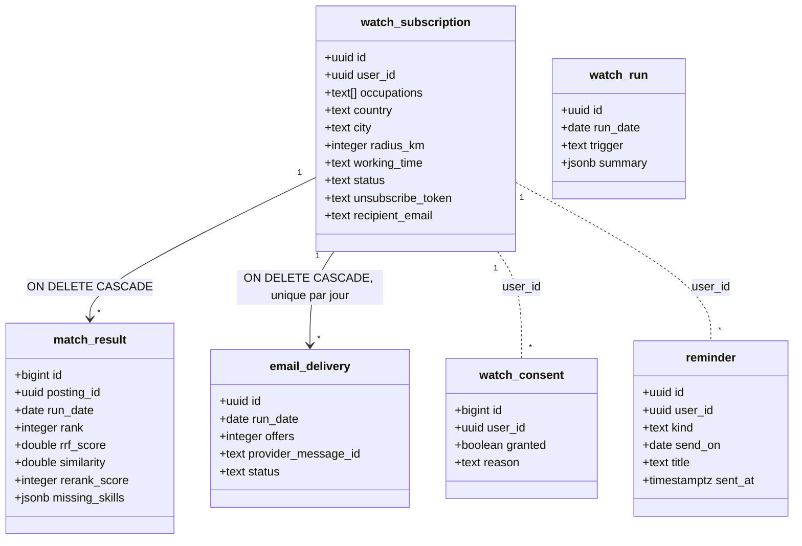
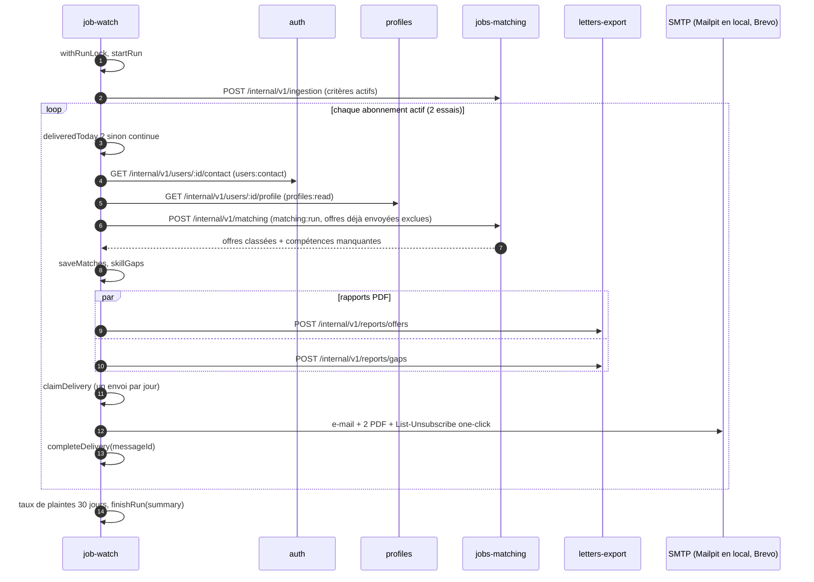
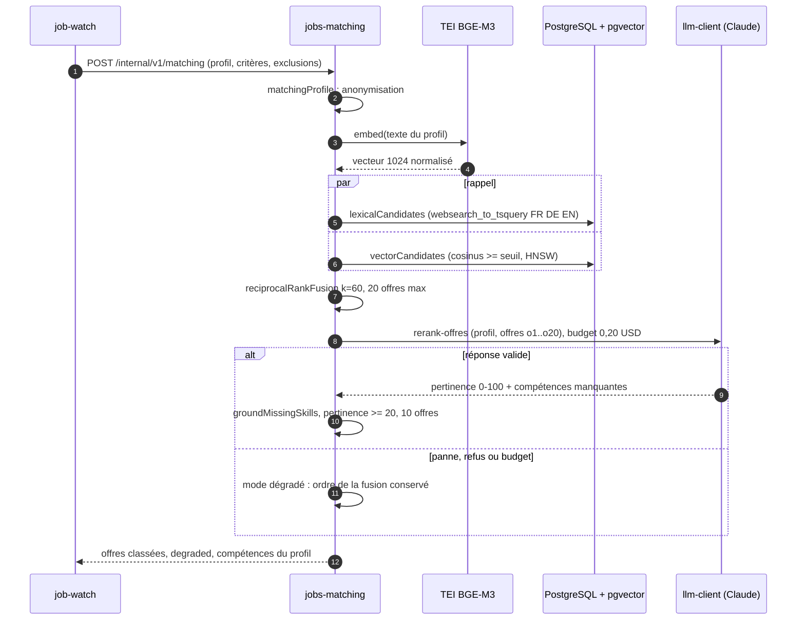

# Membre 6 — Ghassen Bougache · Veille emploi

> **Périmètre** : service `services/job-watch` — abonnement à la veille, exécution quotidienne (collecte,
> classement, rapports PDF, e-mail), rappels, retours du fournisseur d'e-mail.
> **Assistant IA** : le service n'appelle aucun modèle lui-même ; il déclenche le classement sémantique de
> `jobs-matching` (vecteurs BGE-M3, fusion RRF, reclassement par Claude), présenté ici (§ 3).
> Toutes les affirmations renvoient à un fichier du dépôt (branche `chore/phase-2-socle`, 2026-10-26).

## 1. Partie CRUD

### Entité gérée : `watch_subscription` (abonnement à la veille)

Table créée par `services/job-watch/migrations/1761000000000_watch.sql`, modifiée par
`1761600000000_watch-recipient.sql` et `1762000000000_pays.sql`. Second CRUD : `reminder` (rappels).

| Attribut | Type SQL | Contraintes |
|---|---|---|
| `id` | `uuid` | clé primaire |
| `user_id` | `uuid` | **unique** : une veille par compte |
| `occupations` | `text[]` | 1 à 5 métiers |
| `country` | `text` | `DE`, `FR`, `CA` ou `TN` (migration `1762000000000_pays.sql`, ADR 0033) |
| `city`, `lat`, `lon` | `text`, `double precision` | ville résolue par `jobs-matching` |
| `radius_km` | `integer` | 5 à 200 |
| `working_time` | `text` | `indifferent`, `plein`, `partiel` |
| `status` | `text` | `en_attente`, `active`, `desabonnee`, `suspendue` |
| `confirm_token_hash`, `confirm_expires_at`, `confirmed_at` | `bytea`, `timestamptz` | confirmation par lien (anciens abonnements) |
| `unsubscribe_token` | `text` | unique, lien de désabonnement |
| `recipient_email` | `text` | ≤ 254 caractères (adresse propre à la veille) |
| `created_at`, `updated_at` | `timestamptz` | — |

Validation (`packages/shared-schemas/src/api/watch.ts`) : `SubscriptionInput` (1 à 5 métiers de 2 à 80
caractères, ville obligatoire, rayon choisi dans `WATCH_RADII`), `ReminderInput` (type, date ISO, titre 1 à
200 caractères, lien interne `^/…` uniquement).



### Opérations CRUD

Routes de `services/job-watch/src/routes.ts`, publiques sous `/api/watch`.

| Opération | Méthode et route | Rôle requis | Validation |
|---|---|---|---|
| **Create / Update** — enregistrer la veille | `PUT /v1/subscriptions/me` | `candidate`, `admin` (`requireAccount()`) | `SubscriptionInput` ; ville résolue (400 sinon) ; profil exigé (409) ; adresse e-mail exigée si le compte n'en a pas |
| **Read** — ma veille | `GET /v1/subscriptions/me` | idem | 404 si aucune |
| **Read** — offres retenues | `GET /v1/subscriptions/me/matches` | idem | — |
| **Delete** — arrêter la veille | `DELETE /v1/subscriptions/me` | idem | 204 |
| Désabonnement en un clic | `POST /v1/subscriptions/unsubscribe/:token` | public (jeton du lien, RFC 8058) | jeton validé par regex |
| **Create** — rappel | `POST /v1/reminders` | `candidate`, `admin` | `ReminderInput` ; date entre la veille et un an ; 20 rappels en attente max |
| **Read / Delete** — rappels | `GET /v1/reminders`, `DELETE /v1/reminders/:id` | idem | — |
| Admin — exécutions | `GET`, `POST /v1/admin/runs` | `admin` | 409 si une exécution est en cours |

### Extrait de code commenté — enregistrement de la veille

`services/job-watch/src/routes.ts` (`PUT /v1/subscriptions/me`, extrait) :

```ts
const input = parseInput(SubscriptionInput, req.body);
// Trois appels en parallèle à d'autres services (jamais à leur base) :
const [city, profile, contact] = await Promise.all([
  upstreams.resolveCity(principalOf(res).token, input.country, input.city), // jobs-matching
  upstreams.profile(userId),                                                // profiles (jeton de service)
  upstreams.contact(userId),                                                // auth (jeton de service)
]);
if (!city) throw new AppError("entree_invalide", 400, "Certaines informations sont invalides.", [/* … */]);
if (!profile) throw new AppError("profil_absent", 409, "Enregistrez d'abord votre profil : la veille compare les offres à celui-ci.");
// Un compte par identifiant n'a pas d'adresse (ADR 0030) : celle de la veille est obligatoire.
const accountEmail = contact.email?.toLowerCase() ?? null;
const recipient = input.email && input.email !== accountEmail ? input.email : null;
const { row } = await store.saveSubscription(userId, { /* critères + coordonnées */ }, recipient, ipHash(req));
// Veille active tout de suite, sans lien de confirmation (ADR 0030, point 5).
res.json({ subscription: toDto(row), confirmationSent: false });
```

### Côté front

| Écran | Fichier | Rôle |
|---|---|---|
| Veille emploi (formulaire, offres retenues, arrêt) | `frontend/src/pages/Watch.tsx` (route `/veille`) | « Veille emploi » |
| Liens d'e-mail | composant `WatchLink` déclaré dans `frontend/src/App.tsx` (routes `/veille/confirmer/:token`, `/veille/desabonner/:token`) | confirmation, désabonnement |
| Administration | `frontend/src/pages/Admin.tsx` | exécutions de la veille, lancement manuel |
| Rappels | appels `watch.reminders` dans `frontend/src/api/endpoints.ts` | programmation de rappels |

## 2. Fonctionnalité avancée — exécution quotidienne de la veille

### Besoin et fonctionnement

Chaque matin, envoyer à chaque abonné **un seul e-mail** avec les offres nouvelles les plus pertinentes et deux
rapports PDF, sans doublon même en cas de relance (ADR 0007, 0010). `runDaily` (`src/daily.ts`) :

1. **Verrou** d'exécution (`withRunLock`) et trace `watch_run` (`planifiee` ou `manuelle`).
2. **Collecte** du jour pour tous les critères actifs (`POST /internal/v1/ingestion` de `jobs-matching`) ; en
   cas d'échec, le classement porte sur les offres déjà stockées.
3. **Par abonné** (`processSubscription`, 2 essais) : contact et statut du compte (`auth`), profil (`profiles`),
   classement en excluant les offres déjà envoyées (`jobs-matching`), sauvegarde des résultats, rapport 1
   (offres) et rapport 2 (écarts de compétences, `gaps.ts`) rendus en PDF par `letters-export`, puis envoi.
4. **Idempotence** : `claimDelivery` réserve l'envoi du jour (`UNIQUE (subscription_id, run_date)`) ; si le
   message n'est certainement pas parti, la réservation est levée pour la relance.
5. **Surveillance** : taux de plaintes sur 30 jours ; au-delà de 0,1 %, journal en niveau ERROR.
6. Planification interne à l'heure `DAILY_RUN_HOUR` (7 h par défaut) si `DAILY_RUN_ENABLED` ; en local,
   lancement manuel depuis l'administration (`POST /v1/admin/runs`, 202).

Formule du rapport 2 (`gaps.ts`, présentée comme **hypothèse à valider**) :
`priorité = 0,5 × fréquence + 0,3 × écart de salaire normalisé − 0,2 × effort`.



### Extrait de code clé — envoi au plus une fois

`services/job-watch/src/daily.ts` :

```ts
const delivery = await store.claimDelivery(s.id, date, result.postings.length);
if (!delivery) return { status: "deja-envoye" }; // une autre exécution a déjà réservé l'envoi du jour
let messageId: string;
try {
  ({ messageId } = await deps.mailer.send(dailyReportMessage({
    to, deliveryId: delivery, date: frDate(date), offers: /* titre, entreprise, URL */ [],
    unsubscribeUrl: new URL(`/veille/desabonner/${s.unsubscribeToken}`, deps.appBaseUrl).href,
    oneClickUrl: new URL(`/api/watch/v1/subscriptions/unsubscribe/${s.unsubscribeToken}`, deps.appBaseUrl).href,
    attachments: [/* offres-<date>.pdf, points-a-ameliorer-<date>.pdf */],
  })));
} catch (error) {
  // Message certainement pas parti : réservation levée, la relance réessaiera. Sinon, au plus un envoi.
  if (error instanceof MailError && error.notSent) await store.releaseDelivery(delivery);
  throw error;
}
await store.completeDelivery(delivery, messageId);
```

### Difficultés rencontrées et solutions

| Difficulté | Solution dans le code |
|---|---|
| Relance après une panne au milieu de l'exécution | réservation `claimDelivery` + unicité par jour : au plus un e-mail |
| Échec d'un abonné | 2 essais par abonné, les autres continuent ; échecs comptés dans `summary` |
| Plaintes et rebonds | webhook Brevo authentifié par jeton (comparaison d'empreintes à temps constant) ; plainte → veille arrêtée, rebond → suspendue (ADR 0010) |
| Désabonnement imposé par les messageries | lien `List-Unsubscribe` en un clic (RFC 8058), route publique dédiée |
| Accès aux données d'autres services | jetons de service à portée minimale (`SERVICE_GRANTS` de `auth`), aucune base partagée |
| Comptes sans e-mail (ADR 0030) | adresse propre à la veille (`recipient_email`), exigée à l'abonnement |
| Formule de priorité non validée | affichée comme hypothèse dans le rapport ; « associé à », jamais « causé par » le salaire |

## 3. Assistant IA — classement sémantique des offres de la veille

> Code exécuté par `jobs-matching` (`src/matching.ts`, `src/embeddings.ts`, `src/rerank.ts`,
> `src/ranking.ts`), à la demande de `job-watch` via `POST /internal/v1/matching`.

### Fonctionnalité et cas d'usage

Trouver, parmi les offres collectées, celles qui correspondent **au sens** du profil (et pas seulement à ses
mots), puis les reclasser et citer les compétences manquantes.

### Modèles et API (versions lues dans le code)

| Étage | Modèle / outil | Source |
|---|---|---|
| Vecteurs | **BAAI/bge-m3** (1 024 dimensions) servi par Hugging Face **Text Embeddings Inference**, image `ghcr.io/huggingface/text-embeddings-inference:cpu-1.8`, auto-hébergé | `embeddings.ts`, `compose.yaml` (service `tei`) |
| Vecteurs (dev/tests) | `hash-v1` : hachage de mots, **aucune sémantique**, interdit en production par la configuration | `embeddings.ts`, `config.ts` |
| Recherche | pgvector 0.8.0, index HNSW cosinus, `hnsw.iterative_scan = relaxed_order` | migration, `repository.ts` |
| Fusion | Reciprocal Rank Fusion, `k = 60` (Cormack et al., 2009) | `ranking.ts` |
| Reclassement | modèle de `@attesta/llm-client`, étape `rerank-offres` v1 : Claude `claude-opus-5-5` par défaut (SDK ^0.135.0), ou Groq, Gemini, Ollama selon `AI_PROVIDER`, avec repli (ADR 0047, proposé) | `rerank.ts`, `analysis.ts`, `packages/llm-client/src/ai-config.ts` |

### Fonctionnement

1. **Anonymisation** du profil (`matchingProfile`, `anonymize.ts`) : nom, ville, région… retirés du texte.
2. **Rappel lexical** (`tsvector`, titres ESCO + compétences) et **rappel vectoriel** (similarité cosinus ≥
   seuil propre au modèle, 0,45 pour BGE-M3, valeur « provisoire, à calibrer »), en parallèle.
3. **Fusion RRF** des deux listes : seuls les rangs comptent, pas des scores d'échelles différentes ; 20 offres
   au plus passent au reclassement.
4. **Reclassement** par Claude : identifiants courts (`o1`, `o2`…, aucun identifiant interne envoyé), extraits
   de 1 500 caractères, pertinence 0-100 ; budget de 0,20 $ par classement.
5. **Ancrage** : une compétence manquante citée par le modèle n'est gardée que si elle figure dans l'offre et
   nulle part dans le profil (`groundMissingSkills`) ; on garde les offres de pertinence ≥ 20, 10 au plus.



Extrait (`services/jobs-matching/src/matching.ts`) :

```ts
const [vector] = await deps.embeddings.embed([profile.text]);
const [lexical, semantic] = await Promise.all([
  deps.repo.lexicalCandidates(criteria, date, excludePostingIds, { fr: …, de: …, en: … }),
  deps.repo.vectorCandidates(criteria, date, excludePostingIds, vector!, deps.embeddings.minSimilarity),
]);
// Fusion par rangs réciproques, puis 20 offres au plus pour le reclassement par le modèle.
const fused = reciprocalRankFusion([lexical, semantic.map((c) => c.id)]).slice(0, RERANK_MAX_POSTINGS);
```

### Erreurs, coûts, limites, sécurité

- TEI injoignable ou réponse inattendue (nombre ou dimension des vecteurs) : `EmbeddingError`.
- Reclassement en panne, refusé ou hors budget : **mode dégradé**, la veille continue avec l'ordre de la
  fusion ; le rapport l'indique (`degraded`).
- Coûts : 0,20 $ max par classement (`RERANK_MAX_COST_USD`), dans le budget mensuel de `jobs-matching` (4 €).
- Limites : seuil de similarité provisoire (décision Q17) ; vecteurs `hash` sans sémantique en local par défaut
  (`EMBEDDINGS_PROVIDER=hash` dans `compose.yaml`).
- Confidentialité : TEI auto-hébergé, « les textes ne quittent pas l'infrastructure » ; profil anonymisé avant
  tout envoi. Sur Cloud Run, jeton d'identité Google demandé au serveur de métadonnées, « aucune clé à gérer ».
- Variables (noms seulement) : `EMBEDDINGS_PROVIDER`, `TEI_URL`, `LLM_PROVIDER`, `LLM_MODEL` ; côté veille :
  `SERVICE_SECRET`, `BREVO_WEBHOOK_TOKEN`, `SMTP_URL`, `IP_HASH_SECRET`. Aucune valeur ici.

## 4. Partie Docker

### Dockerfile du service `job-watch` (intégral, commenté)

```dockerfile
# syntax=docker/dockerfile:1.7
# Image du service job-watch. Contexte de construction : la racine du dépôt, réduite par
# Dockerfile.dockerignore au dossier du service et aux paquets partagés (docs/adr/0023).
#   docker build -f services/job-watch/Dockerfile -t attesta/job-watch .

# » Étape 1 « build » : image officielle Node 22 sur Debian 12 (bookworm), variante slim.
FROM node:22-bookworm-slim AS build
# » Répertoire qui reproduit l'arborescence du dépôt : les dépendances « file:../../packages/* » restent résolues.
WORKDIR /repo
# » Manifeste du paquet partagé @attesta/logger.
COPY packages/logger/package.json packages/logger/
# » @attesta/logger déjà compilé (dist/ versionné, ADR 0025) : rien à recompiler dans l'image.
COPY packages/logger/dist packages/logger/dist
# » Manifeste du paquet partagé @attesta/config.
COPY packages/config/package.json packages/config/
# » @attesta/config déjà compilé (dist/ versionné, ADR 0025) : rien à recompiler dans l'image.
COPY packages/config/dist packages/config/dist
# » Manifeste du paquet partagé @attesta/http-kit.
COPY packages/http-kit/package.json packages/http-kit/
# » @attesta/http-kit déjà compilé (dist/ versionné, ADR 0025) : rien à recompiler dans l'image.
COPY packages/http-kit/dist packages/http-kit/dist
# » Manifeste du paquet partagé @attesta/shared-schemas.
COPY packages/shared-schemas/package.json packages/shared-schemas/
# » @attesta/shared-schemas déjà compilé (dist/ versionné, ADR 0025) : rien à recompiler dans l'image.
COPY packages/shared-schemas/dist packages/shared-schemas/dist
# » Construction dans le seul dossier de l'unité services/job-watch (autonomie des services, ADR 0023).
WORKDIR /repo/services/job-watch
# » Manifestes et lockfile seuls d'abord : la couche « npm ci » reste en cache tant qu'ils ne changent pas.
COPY services/job-watch/package.json services/job-watch/package-lock.json services/job-watch/.npmrc ./
# Cache npm partagé entre les builds, reprises réseau : une relance réutilise les paquets déjà téléchargés.
# » Installation reproductible (lockfile), cache npm BuildKit partagé entre builds, reprises réseau.
RUN --mount=type=cache,target=/root/.npm npm ci --no-audit --no-fund --fetch-retries=5 --fetch-retry-maxtimeout=120000
# » Configuration de compilation (TypeScript, et Vite pour le frontend).
COPY services/job-watch/tsconfig.json services/job-watch/tsconfig.build.json ./
# » Code source copié en dernier : modifier le code n'invalide pas le cache des dépendances.
COPY services/job-watch/src src
# » Compilation TypeScript vers dist/, puis retrait des dépendances de développement.
RUN npm run build && npm prune --omit=dev

# » Étape 2 « runtime » : image neuve, sans sources TypeScript, sans compilateur ni dépendances de développement.
FROM node:22-bookworm-slim AS runtime
# » Mises à jour de sécurité Debian, puis suppression du cache apt et de npm/npx (inutiles à l'exécution, signalés par Trivy).
RUN apt-get update \
  && apt-get upgrade -y --no-install-recommends \
  && rm -rf /var/lib/apt/lists/* /usr/local/lib/node_modules/npm /usr/local/bin/npm /usr/local/bin/npx
# » Mode production et port d'écoute (pour letters-export : HOME et caches dans /tmp, chemin du Chromium système).
ENV NODE_ENV=production \
  PORT=4005
# » Dossier de l'application dans l'image finale.
WORKDIR /app
# » Seuls les artefacts utiles sont repris de l'étape build, propriété root : l'utilisateur d'exécution ne peut pas les modifier.
COPY --from=build --chown=root:root /repo/services/job-watch/package.json ./
# » Dépendances de production uniquement (après npm prune).
COPY --from=build --chown=root:root /repo/services/job-watch/node_modules node_modules
# » JavaScript compilé.
COPY --from=build --chown=root:root /repo/services/job-watch/dist dist
# » Migrations SQL du service, appliquées au démarrage (MIGRATE_ON_START, vrai par défaut).
COPY --chown=root:root services/job-watch/migrations migrations
# » Exécution sous l'utilisateur non-root « node » fourni par l'image officielle.
USER node
# » Port documenté du conteneur.
EXPOSE 4005
# » Sonde de santé : interroge /ready (ou /health) sans installer curl ; Docker marque le conteneur healthy ou unhealthy.
HEALTHCHECK --interval=10s --timeout=3s --start-period=20s --retries=5 \
  CMD ["node", "-e", "fetch('http://127.0.0.1:'+(process.env.PORT||4005)+'/ready').then(r=>process.exit(r.ok?0:1),()=>process.exit(1))"]
# » Démarrage direct de Node, sans npm : les signaux d'arrêt arrivent au processus (init: true dans compose).
CMD ["node", "dist/server.js"]
```

### Extrait de `compose.yaml` (variables : noms seulement)

```yaml
  job-watch:
    <<: *service
    build: { context: ., dockerfile: services/job-watch/Dockerfile }
    profiles: ["full"]
    ports: ["${JOB_WATCH_PORT:-4005}:4005"]
    environment:
      <<: *service-env
      DATABASE_URL: …
      AUTH_JWKS_URL: …
      AUTH_URL: …
      PROFILES_URL: …
      JOBS_MATCHING_URL: …
      LETTERS_EXPORT_URL: …
      SERVICE_SECRET: …
      APP_BASE_URL: …
      SMTP_URL: …
      MAIL_FROM: …
      IP_HASH_SECRET: …
      DAILY_RUN_ENABLED: …
    depends_on:
      db-init: { condition: service_completed_successfully }
      auth: { condition: service_healthy }
      mailpit: { condition: service_started }

# Ancre fusionnée par « <<: *service » (début de compose.yaml) :
x-service: &service
  init: true
  read_only: true
  tmpfs: ["/tmp"]
  cap_drop: [ALL]
  security_opt: ["no-new-privileges:true"]
  restart: unless-stopped
  environment: &service-env
    NODE_ENV: …
    LOG_LEVEL: …
```

- **Port** : 4005 (`JOB_WATCH_PORT`). **Volumes** : aucun. **Réseau** : réseau par défaut.
- **Profil** : `full` uniquement (pas dans `core`) : la veille n'est pas sur le parcours principal.
- **depends_on** : `db-init` terminé, `auth` *healthy*, `mailpit` démarré (e-mails capturés en local).
- Le secret de service est partagé avec `auth` par une ancre YAML (`*secret-job-watch`), jamais recopié.

### Commandes

```bash
docker build -f services/job-watch/Dockerfile -t attesta/job-watch .
docker compose --profile full up -d --build --wait job-watch
# puis lancement manuel depuis l'écran Administration ; e-mails visibles sur http://localhost:8025
```

### Justification

Image la plus légère des services : pas de `llm-client`, pas de `prompts/`, pas de Chromium (les PDF sont rendus
par `letters-export`, ADR 0018). Même socle que les autres (`node:22-bookworm-slim`, multi-stage, non-root,
`HEALTHCHECK`).

## 5. Stack et justifications

| Partie | Technologie | Version | Rôle | Justification | Alternative écartée et pourquoi |
|---|---|---|---|---|---|
| CRUD | Express | ^5.3.0 | API | socle commun | à confirmer |
| CRUD | PostgreSQL (`pg`) | ^8.23.1 | abonnements, résultats, envois | contraintes d'unicité = idempotence | — |
| Avancée | nodemailer (SMTP) | ^8.0.2 | envoi des e-mails | le code ne dépend que de SMTP : changer de fournisseur ne touche que la configuration (ADR 0010) | Amazon SES : Brevo retenu (société française, données dans l'UE, ADR 0010, Q18) |
| Avancée | Mailpit | v1.27 | boîte de réception locale | aucun e-mail ne sort du poste | — |
| Avancée | planificateur interne (`startScheduler`) | — | exécution quotidienne | une image, aucun service en plus | pg-boss prévu par l'ADR 0007, reporté (ADR 0004 amendé) |
| IA | TEI + BGE-M3 | `cpu-1.8` | vecteurs | auto-hébergé, UE (décision Q15) | à confirmer : API d'embeddings externe non documentée |
| IA | pgvector | 0.8.0 | recherche vectorielle | dans la base du service | — |
| IA | @attesta/llm-client (SDK Anthropic) | ^0.135.0 | reclassement | sorties structurées | Mistral, Bedrock (ADR 0008) |
| Docker | node:22-bookworm-slim | Node 22 | image | voir fiche 1 | — |
| Tests | Vitest, fast-check, supertest | ^5.0.5, ^4.10.2, ^7.3.1 | tests | outillage commun | — |

## 6. Tests

| Fichier | Tests | Ce qu'il couvre |
|---|---|---|
| `services/job-watch/tests/app.test.ts` | 18 | abonnement, exécution quotidienne, retours du fournisseur, RGPD, administration (intégration PostgreSQL) |
| `services/job-watch/tests/reminders.test.ts` | 14 | adresse d'envoi, envoi des rappels (API simulée), planification, écarts de compétences (fast-check) |
| `services/job-watch/tests/units.test.ts` | 9 | planification, rapport 2, e-mails, erreurs SMTP assainies |
| `services/job-watch/tests/upstreams.test.ts` | 1 | services appelés par la veille |
| `config`, `db`, `openapi` | 3 + 3 + 2 | configuration et secret de service, migrations, contrat OpenAPI |
| `services/jobs-matching/tests/units.test.ts` | (31, fiche 4) | fusion RRF, anonymisation (partie IA ci-dessus) |

```bash
cd services/job-watch && npx vitest run --coverage
```

Résultat obtenu le 2026-10-26 (Node 22.18.0, PostgreSQL local) : **50/50 tests réussis** (7 fichiers).
Couverture des lignes : **87,26 %** (seuil de 80 % atteint).

**Seconde passe** (14 h 07–14 h 14, après l’ajout des fournisseurs de l’ADR 0047 dans le répertoire de travail) : résultats identiques.
